<div align="center">

<svg width="920" height="248" viewBox="0 0 920 248" xmlns="http://www.w3.org/2000/svg" role="img" aria-label="Sacred Timeline Substrate architecture banner">
  <defs>
    <linearGradient id="omni-banner-sky" x1="0%" y1="0%" x2="100%" y2="100%">
      <stop offset="0%" stop-color="#1a0518"/>
      <stop offset="38%" stop-color="#3b0a3a"/>
      <stop offset="68%" stop-color="#7a1048"/>
      <stop offset="100%" stop-color="#e11d74"/>
    </linearGradient>
    <linearGradient id="omni-banner-text" x1="0%" y1="0%" x2="100%" y2="0%">
      <stop offset="0%" stop-color="#ff6b9d"/>
      <stop offset="45%" stop-color="#e879f9"/>
      <stop offset="100%" stop-color="#c084fc"/>
    </linearGradient>
    <radialGradient id="omni-banner-star" cx="50%" cy="40%" r="70%">
      <stop offset="0%" stop-color="#fda4af" stop-opacity="0.35"/>
      <stop offset="100%" stop-color="#0d1117" stop-opacity="0"/>
    </radialGradient>
  </defs>
  <rect width="920" height="248" fill="#0d1117" rx="16"/>
  <rect x="2" y="2" width="916" height="244" fill="url(#omni-banner-sky)" rx="14" opacity="0.92"/>
  <ellipse cx="720" cy="40" rx="220" ry="90" fill="url(#omni-banner-star)"/>
  <circle cx="118" cy="42" r="1.6" fill="#fbcfe8"/>
  <circle cx="214" cy="28" r="1.1" fill="#f9a8d4"/>
  <circle cx="388" cy="36" r="1.4" fill="#e879f9"/>
  <circle cx="612" cy="22" r="1.2" fill="#c084fc"/>
  <circle cx="804" cy="54" r="1.5" fill="#fb7185"/>
  <circle cx="860" cy="88" r="1.0" fill="#f472b6"/>
  <text x="460" y="78" text-anchor="middle" font-family="'Courier New', ui-monospace, monospace" font-size="42" font-weight="700" fill="url(#omni-banner-text)" letter-spacing="7">SACRED TIMELINE</text>
  <text x="460" y="118" text-anchor="middle" font-family="'Courier New', ui-monospace, monospace" font-size="22" fill="#fecdd3" letter-spacing="10">SUBSTRATE</text>
  <line x1="210" y1="142" x2="710" y2="142" stroke="#f472b6" stroke-width="2" opacity="0.55"/>
  <text x="460" y="168" text-anchor="middle" font-family="'Courier New', ui-monospace, monospace" font-size="13" fill="#e9d5ff" letter-spacing="3">ARCHITECTURE / SPEC  ·  CODEBASE WHITEPAPER  ·  v1.2</text>
  <text x="460" y="196" text-anchor="middle" font-family="'Courier New', ui-monospace, monospace" font-size="12" fill="#f9a8d4">one clock  ·  one sacred history  ·  tensors by handle  ·  C[agent, capability, context, tick]</text>
  <text x="460" y="224" text-anchor="middle" font-family="'Courier New', ui-monospace, monospace" font-size="10" fill="#9f1239" letter-spacing="4">SOMNUS  ·  DAERON BLACKFYRE  ·  THE COLONY</text>
</svg>

</div>

<p align="center">
  
  
  
</p>
<p align="center">
  
  
  
  
</p>

---

<div align="center">

<svg width="720" height="52" viewBox="0 0 720 52" xmlns="http://www.w3.org/2000/svg">
  <rect id="omni-signoff-bg" width="720" height="52" fill="#1a0518" rx="8"/>
  <text x="360" y="33" text-anchor="middle" font-family="'Courier New', monospace" font-size="14" fill="#f9a8d4" letter-spacing="3">SIGN-OFF  ·  SUBSYSTEM FRONTIER  ·  NOT THE WIDER HOST</text>
</svg>

</div>

This file is the **architecture spec** and the **codebase whitepaper**. It is synonymous with a `SPEC.md`. `AGENTS.md` remains the router. `PLAN.md` remains design history. `TASK.md` remains dispatch. Source on `origin/main` wins this document when they disagree. This v1.1 pass thickens v1.0 with line-cited source, a component catalog, the one-way dependency arrow, leftover host imports, and numbers copied from **committed** `test/*/runs/*/result.json` files. It does not invent a parallel spec.

**I will sign this, and I will not over-sign it.**

Sacred Timeline Substrate, as an **in-process multi-agent runtime**, has reached the packet-local frontier of *its own* architecture. Clock owns when. Engine owns order. Registry owns payload identity. Session owns sacred branch 0. Who-acts is a RecursiveTensor contraction on `C[agent, capability, context, tick]`. Synthesis is a measured relation, not a slogan. That heartbeat executes.

This is **not** a claim that Somnus-the-host is done. This is **not** a claim that Heart C (shell TCP) is ACP. This is **not** an operator-gate PASS. `run_test-2.py` is absent: **NOT VERIFIABLE**. The wider system — model loaders, memory cores, VM transports, other Somnus trees — is out of this sign-off.

The old v0.3 architecture freeze (`6331336`, P5 still DRAFT, P6 TARGET, route as costume) is **outdated**. This v1.2 second pass is written against `origin/main` **`fdd81ff`** (RTA tensor heartbeat merge, PR #6), after P5 Exit (`050cc7a`), P6 (`441f544` / `60b302d`), and hub P7 (`13a8b56`). Freeze SHA for every line cite below is that tree unless a run artifact names another timestamp.

| Label | Meaning |
| --- | --- |
| CONFIRMED | In source on `fdd81ff` and/or a named packet-local run committed under `test/*/runs/` |
| TARGET | Specified; not the live path |
| INFERRED | Read from code; no dedicated run cited here |
| HISTORY | A committed run that failed, then was repaired. Not current truth |
| NOT VERIFIABLE | Prerequisite missing. Never PASS |

| This file | Does |
| --- | --- |
| `ARCHITECTURE.md` | Living whitepaper / SPEC. Topology, contracts, evidence, hazards |
| `AGENTS.md` | Session bootstrap and execution router. Not runtime |
| `PLAN.md` | Target topology, measured decisions D1–D6, packet sequence |
| `TASK.md` | Active packet and dispatch board |
| `NOTEPAD.md` | Append-only factual handoff ledger |
| `SOTA_RUN.md` | Latest packet-local harness lock. Not the operator gate |

---

## TABLE OF CONTENTS

1. [Executive Summary](#1-executive-summary)
2. [System Flow](#2-system-flow)
3. [Core Technical Innovations](#3-core-technical-innovations)
4. [Component Catalog](#4-component-catalog)
5. [Data Structures and Schemas](#5-data-structures-and-schemas)
6. [Integration Challenges](#6-integration-challenges)
7. [Operational Hazards](#7-operational-hazards)
8. [Security and Threat Considerations](#8-security-and-threat-considerations)
9. [Validation](#9-validation)
10. [Roadmap](#10-roadmap)
11. [Glossary](#11-glossary)
12. [GitHub render contract](#12-github-render-contract)
13. [Trust zones and authority map](#13-trust-zones-and-authority-map)
14. [Class contracts](#14-class-contracts)
15. [Lease and branch state](#15-lease-and-branch-state)
16. [Who-acts algebra](#16-who-acts-algebra)
17. [Source contracts](#17-source-contracts)
18. [Packet-local evidence](#18-packet-local-evidence)
19. [Implementation, lift-out, leftover hosts](#19-implementation-and-lift-out)
20. [Hard bans and open questions](#20-hard-bans-and-open-questions)
21. [Schema and error registry](#21-schema-and-error-registry)
22. [Change log](#22-change-log)
23. [Field geometry — second pass](#23-field-geometry--second-pass)

---

## 1. EXECUTIVE SUMMARY

### 1.1 Architectural intent

Sacred Timeline Substrate is one organism with three hearts in one repository.

<div align="center">

<svg width="920" height="220" viewBox="0 0 920 220" xmlns="http://www.w3.org/2000/svg" role="img" aria-label="Three hearts of Sacred Timeline Substrate">
  <defs>
    <linearGradient id="omni-heart-b" x1="0%" y1="0%" x2="100%" y2="100%">
      <stop offset="0%" stop-color="#3b0a3a"/>
      <stop offset="100%" stop-color="#7a1048"/>
    </linearGradient>
    <linearGradient id="omni-heart-a" x1="0%" y1="0%" x2="100%" y2="100%">
      <stop offset="0%" stop-color="#4a044e"/>
      <stop offset="100%" stop-color="#c084fc"/>
    </linearGradient>
    <linearGradient id="omni-heart-c" x1="0%" y1="0%" x2="100%" y2="100%">
      <stop offset="0%" stop-color="#3f0d12"/>
      <stop offset="100%" stop-color="#f59e0b"/>
    </linearGradient>
  </defs>
  <rect width="920" height="220" fill="#0d1117" rx="14"/>
  <rect x="24" y="28" width="280" height="164" rx="12" fill="url(#omni-heart-b)" stroke="#f472b6" stroke-width="1.5"/>
  <text x="164" y="58" text-anchor="middle" font-family="'Courier New', monospace" font-size="13" fill="#fda4af" letter-spacing="3">HEART B</text>
  <text x="164" y="86" text-anchor="middle" font-family="'Courier New', monospace" font-size="12" fill="#fecdd3">temporality + processing</text>
  <text x="164" y="112" text-anchor="middle" font-family="'Courier New', monospace" font-size="11" fill="#e9d5ff">clock / engine / registry</text>
  <text x="164" y="134" text-anchor="middle" font-family="'Courier New', monospace" font-size="11" fill="#e9d5ff">session / RTA / field</text>
  <text x="164" y="164" text-anchor="middle" font-family="'Courier New', monospace" font-size="11" fill="#86efac">CONFIRMED executing</text>
  <rect x="320" y="28" width="280" height="164" rx="12" fill="url(#omni-heart-a)" stroke="#e879f9" stroke-width="1.5"/>
  <text x="460" y="58" text-anchor="middle" font-family="'Courier New', monospace" font-size="13" fill="#f5d0fe" letter-spacing="3">HEART A</text>
  <text x="460" y="86" text-anchor="middle" font-family="'Courier New', monospace" font-size="12" fill="#fae8ff">hub + ACP</text>
  <text x="460" y="112" text-anchor="middle" font-family="'Courier New', monospace" font-size="11" fill="#e9d5ff">MessageBus principals</text>
  <text x="460" y="134" text-anchor="middle" font-family="'Courier New', monospace" font-size="11" fill="#e9d5ff">BranchHandle turns</text>
  <text x="460" y="164" text-anchor="middle" font-family="'Courier New', monospace" font-size="11" fill="#86efac">CONFIRMED executing</text>
  <rect x="616" y="28" width="280" height="164" rx="12" fill="url(#omni-heart-c)" stroke="#f59e0b" stroke-width="1.5"/>
  <text x="756" y="58" text-anchor="middle" font-family="'Courier New', monospace" font-size="13" fill="#fde68a" letter-spacing="3">HEART C</text>
  <text x="756" y="86" text-anchor="middle" font-family="'Courier New', monospace" font-size="12" fill="#fef3c7">advanced_ai_shell.py</text>
  <text x="756" y="112" text-anchor="middle" font-family="'Courier New', monospace" font-size="11" fill="#fed7aa">127.0.0.1 TCP</text>
  <text x="756" y="134" text-anchor="middle" font-family="'Courier New', monospace" font-size="11" fill="#fed7aa">type: task_delegation</text>
  <text x="756" y="164" text-anchor="middle" font-family="'Courier New', monospace" font-size="11" fill="#fcd34d">ISLAND · TARGET join</text>
  <line x1="304" y1="110" x2="320" y2="110" stroke="#f9a8d4" stroke-width="2"/>
  <line x1="600" y1="110" x2="616" y2="110" stroke="#78350f" stroke-width="2" stroke-dasharray="6 4"/>
</svg>

</div>

| Heart | Surface | Status |
| --- | --- | --- |
| **B** Temporal + processing | `temporality/`, `processing/` | CONFIRMED executing. Lift-out: `import temporality, processing` |
| **A** Agent plane | `agent_collaboration_core.py`, `agent_communication_protocol.py` | CONFIRMED executing. Turns bind to `BranchHandle`. Route is RTA |
| **C** Shell island | `advanced_ai_shell.py` (5175 lines / 217097 bytes) | CONFIRMED separate. Localhost socket is **not** ACP. TARGET join |

**Scale of the signed subsystem** (source bytes on this tree, not the shell):

| Path | Lines | Bytes | Role |
| --- | ---: | ---: | --- |
| `temporality/internal_clock.py` | 1950 | 88571 | Time source |
| `temporality/timeline_engine.py` | 2515 | 115976 | Order source |
| `temporality/registry.py` | 636 | 25405 | Payload identity |
| `temporality/session.py` | 708 | 29177 | Sacred policy + harness |
| `processing/recursive_tensor.py` | 2918 | 117351 | RTA algebra |
| `processing/capability_field.py` | 1117 | 44019 | Who-acts field |
| `processing/reconciliation.py` | 710 | 24983 | Measured relation |
| `processing/capability_index.py` | 68 | 1857 | Historical import alias |
| `agent_collaboration_core.py` | 2224 | 93673 | Hub, bus, bind |
| `agent_communication_protocol.py` | 1230 | 46322 | Envelope, orchestrator, synthesis |
| `test/_harness.py` | 637 | 19949 | Packet-local artifact emitter |

**DEFINED OUT-OF-SCOPE**

- Spectral / Gram eigenmode team selection. PLAN D6 measured ceremony. CONFIRMED unused as a router. `RecursiveTensor.compute_eigenstates` still exists in `processing/recursive_tensor.py` (opens at line 846). Do not call it from who-acts.
- Breath, harmonic field, or `SACRED_RATIO` redesign. `_advance_harmonic_field` still runs every engine tick (`temporality/timeline_engine.py` `process_tick` around line 1132). Do not edit.
- Removing `copy.deepcopy` in `TimelineEngine.process_tick`. Make the copied thing cheap (handles).
- Treating this whitepaper as runtime.
- Operator-gate PASS while `run_test-2.py` is absent.
- Claiming Docker/VM shell on a guest that cannot run it.
- Folding Heart C TCP into `MessageBus` without an operator packet.

**DEFINED IN-SCOPE**

- One clock, one sacred history, payloads by handle.
- Speculative agent turns as transactions: fork, work, accept or reject.
- `CapabilityField.route` as the only who-acts door: window, project context, convolve last-axis ticks, contract requirements.
- `classify_contributions` as synthesis: REDUNDANT / COMPLEMENTARY / CONFLICTING / UNRESOLVED.
- Lift-out of `temporality` and `processing` without importing the hub.

### 1.2 Governing logic

<div style="background:#1a0518;border:1px solid #9f1239;border-radius:10px;padding:18px 22px;color:#fecdd3;font-family:'Courier New',monospace;font-size:13px;line-height:1.7;margin:18px 0;">

when &nbsp;&nbsp;:= TemporalCoherence.now() → TimePoint &nbsp;&nbsp;<span style="color:#f472b6;">stamp, never order</span><br/>
order &nbsp;:= TimelineEngine.master_tick &nbsp;&nbsp;<span style="color:#e879f9;">integer replay identity</span><br/>
payload := PayloadRegistry leases[handle] &nbsp;&nbsp;<span style="color:#c084fc;">identity ≠ branch claim</span><br/>
write &nbsp;:= TemporalSession.accept(handle) → branch 0<br/>
drop &nbsp;&nbsp;:= TemporalSession.reject(handle) &nbsp;&nbsp;<span style="color:#fb7185;">local dispose, not global rewind</span><br/>
route &nbsp;:= window → project_context → convolve_ticks(time_axis=last) → contract_requirements<br/>
bind &nbsp;&nbsp;:= open_speculative → work → record_outcome → accept → promote_handles <b>once</b><br/>
relate := classify_contributions(...) → RelationKind &nbsp;&nbsp;<span style="color:#f9a8d4;">not a consensus slogan</span>

</div>

**Philosophy.** Time and order are different authorities so rollback cannot be contaminated by wall-clock adjustment. Objects never enter events. Branch 0 is the only canonical history. Capability numbers are not routing until they are contracted on named axes indexed by engine tick. Consensus is a measurement or it is theater.

### 1.3 What a packet-local PASS is allowed to say

Latest committed processing lock (`SOTA_RUN.md` / `test/processing/runs/20260919T000400Z/result.json`): status=PASS 5/5; code leader=`coder` score=1.000 compat=0.995; research leader=`coder_2` score=1.000; latest=`late` conv=`early` score=0.800 `conv_axis=3`; reject cell=1.500 handle_gone; `process_tick deepcopy=2`. That is this runner, these fixtures, this tree. It is not `run_test-2.py`.

---

## 2. SYSTEM FLOW

A live hub turn is one transaction through both hearts. This diagram is first-class. It is not hidden.

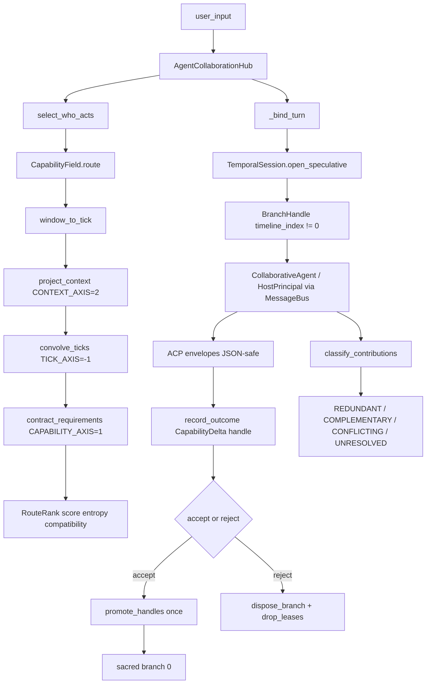

### 2.1 Phase 1 — bind

`AgentCollaborationHub._bind_turn` refuses an unbound session, refuses a missing handle, and **aborts** if `timeline_index == 0`. Sacred is not a scratch pad.

Source: `agent_collaboration_core.py` `_bind_turn` opens at **line 1690** on `fdd81ff`. `TemporalTurnBinder.open_turn` at **line 1071** is a thin wrap of `TemporalSession.open_speculative`. `TemporalSession.open_speculative` itself opens at **line 339** in `temporality/session.py` and forks with `engine.branch_timeline(source_idx=SACRED_BRANCH_INDEX)` where `SACRED_BRANCH_INDEX = 0` (**line 79**).

### 2.2 Phase 2 — work on a world

Work may be solo or orchestration. Both share `_bind_turn`. Orchestration dispatches through `MessageBus` to registered `CollaborativeAgent` beings. `_simulate_agent_execution` is gone (grep zero on both agent modules; asserted by `test/agent_plane/runs/20260918T235715Z` check `simulate_deleted`). Unregistered UUIDs cannot receive: `MessageBus.send_message` at **line 1221** raises `BusDeliveryError` when `recipient_id not in self.principals`.

Complexity still gates solo versus orchestration: `process_user_input` at **line 1571** calls `_analyze_task_complexity` (**line 1593**) and, if score `> 0.7` or `require_orchestration`, `_process_with_acp_orchestration` (**line 1633**). That path is live ACP, not a simulation chamber.

### 2.3 Phase 3 — tick, lease, commit

`session.process_tick` advances engine order. `master_tick == 0` after open is refused (seed slot) at `_bind_turn` **lines 1726–1729**. Capability deltas are leased as handles via `CapabilityField.record_outcome` (**line 789** in `processing/capability_field.py`). `accept` promotes leases (`temporality/session.py` **line 408** calls `registry.promote_branch`). `promote_handles` writes cells **once** (`_bind_turn` **lines 1753–1755**). Rejected worlds do not teach.

### 2.4 What this is not

Heart C `advanced_ai_shell.py` still speaks a localhost `task_delegation` frame (`_send_task_delegation` at **line 1285**, bind `127.0.0.1` at **line 700**). That is a third heart. Folding it is TARGET.

### 2.5 Accept versus reject as two exits of one world

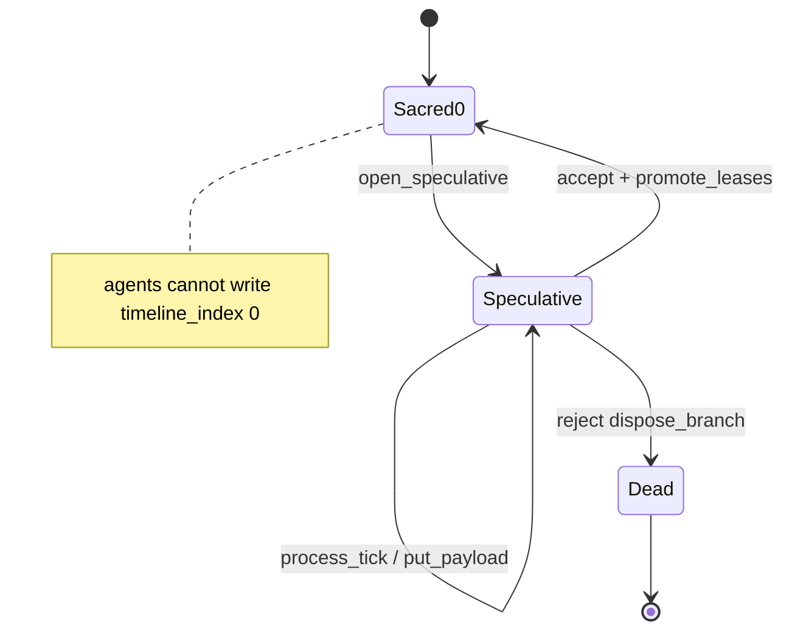

`reject` is `TimelineEngine.dispose_branch` plus `registry.reclaim_branch` (`temporality/session.py` **lines 416–448**). It is **not** `engine.restore_state` of the whole baseline. `restore_lone_baseline` (**line 450**) remains the single-world identity experiment; `test_sacred` check `lone_baseline_restores_export_state_digest` PASS with digest prefix `e2af1cb361c72cb8`. Sibling reject left beta active and advanced `master_tick 3->4` (not rewound): `test/temporality/runs/20260918T195357Z-test_sacred`.

---

## 3. CORE TECHNICAL INNOVATIONS

### 3.1 Handles, not objects, on the tick path

P2 measured roughly a **133×** gap between deepcopy of a tensor object and deepcopy of its handle (`PLAN.md` D2: 0.4500 ms vs 0.0034 ms on a sparse tensor with 163 nonzeros). The architecture changed around that measurement. `_json_safe(RecursiveTensor)` is a lossy `$type/$repr` — not a round-trip. The live object stays in `PayloadRegistry`.

Committed confirmation, not a re-measurement of the 133× table: `test/temporality/runs/20260918T195704Z-test_registry` check `deepcopy_handle_inputs_under_0_05ms` recorded **median_deepcopy_ms=0.00150** (limit 0.05) at nnz≈390. Check `semantic_fingerprint_handle_metadata` recorded `tensor_json_safe=lossy_type_repr` and `handle_json_safe=str`.

`_json_safe` lives at `temporality/timeline_engine.py` **line 282**. Unknown objects fall through at **line 320**:

<div class="ch" style="background:#161b22;padding:8px 16px;border:1px solid #4a044e;border-bottom:none;border-radius:6px 6px 0 0;font-family:monospace;font-size:12px;color:#f9a8d4;margin-top:14px;"><span>temporality/timeline_engine.py:282</span><span style="float:right;color:#e879f9;letter-spacing:2px;">PYTHON</span></div>

```python
def _json_safe(value: object, *, depth: int = 0) -> JsonValue:
    if depth > 64:
        raise SerializationError("snapshot nesting exceeds 64 levels")
    if value is None or isinstance(value, (bool, int, str)):
        return value
    # ... mappings, arrays, TemporalEvent ...
    return {"$type": type(value).__qualname__, "$repr": repr(value)}
```

### 3.2 Sacred transactions

Fork state, speculate, produce artifacts, reconcile, commit or abort. `reject` is `TimelineEngine.dispose_branch` plus lease reclaim. It is **not** `engine.restore_state` of the whole baseline (that would rewind siblings). `restore_lone_baseline` remains the single-world identity experiment.

`create_counterfactual` is registered in `_speculative` (`temporality/session.py` **lines 552–592**) so `process_tick(..., branch=child)` succeeds. `test_sacred` check `counterfactual_registered_and_tickable` PASS: child idx=2 ticked then rejected; parent survived until reject.

### 3.3 Clock is not order

`TemporalCoherence` stamps *when*. `TimelineEngine.master_tick` is *which came first*. Snapshots export `clock` and restore it via `TemporalCoherence.restore_payload` / `BiologicalClock.from_dict(..., apply_live_update=False)`. Hub `logical_tick` is an alias of `master_tick` (`agent_collaboration_core.py` **lines 1426–1428**).

`test_session` (`test/temporality/runs/20260918T195357Z-test_session`):

- `monotonic_timepoints_per_tick` — 5 stamps, sequence `1789761237043813654` → `1789761237044898983`, monotonic nondecreasing
- `deterministic_replay_ordering` — identical `master_tick=4`, event ids `probe-0000` … `probe-0003`, sequences `[1, 2, 3, 4]`
- `local_time_not_wall_clock` — `local_time 0.0->0.5 (+0.5)`; TimePoint is stamp only
- `snapshot_clock_engine_agree_on_N` — snapshot at tick 4 restores; clock `creation_time` and `last_update_time` match payload; engine `master_tick` agrees

`TemporalCoherence.now` is at `temporality/internal_clock.py` **line 1496** and returns `scientific_timekeeper.get_current_timepoint()`. `TimePoint.now` at **line 285** records `monotonic_time=time.monotonic_ns() / 1_000_000_000.0`. The engine never ranks sibling worlds by that stamp.

### 3.4 RecursiveTensor as the live processor

Not a costume score. `CapabilityField.route` on `fdd81ff` (`processing/capability_field.py` **lines 934–990**):

1. `window_to_tick(horizon)` — project last axis onto `I[:tick+1]` (**line 722**)
2. `project_context` — `RecursiveTensor.project` on `CONTEXT_AXIS` (2) (**line 750**)
3. `convolve_ticks` — `apply_temporal_convolution(..., time_axis=rank-1)` (**line 760**) with `DEFAULT_DECAY_KERNEL = (0.05, 0.10, 0.20, 0.28, 0.37)` (**line 215**)
4. `contract_requirements` — `RecursiveTensor.contract` on `CAPABILITY_AXIS` (1) (**line 774**)
5. `RouteRank.score` / `.entropy` (`compute_entropy`) / `.compatibility` (`compute_dict_compatibility`)

`RecursiveTensor.apply_temporal_convolution` default is last axis (`processing/recursive_tensor.py` **lines 2391–2409**). Passing `time_axis=0` on a rank-4 capability tensor mixes the agent axis. P7 exists because that default used to be 0.

Spectral / Gram eigenmodes stay rejected. PLAN D6: redundancy only fell when the diversity penalty swapped in an agent with 0.212 task fit to buy 0.115 of decorrelation. Revisit only past roughly thirty agents.

### 3.5 Measured synthesis

High compatibility (≥ 0.7, `REDUNDANT_THRESHOLD` in `processing/reconciliation.py` **line 50**) → REDUNDANT. Low overlap that is different-and-true → COMPLEMENTARY. Opposite polarity on a shared key → CONFLICTING (`_opposing_keys` **line 678**: `left_value * right_value < 0.0`). `escalate` is true only if any pair is CONFLICTING. Hub `HOST::` strings without a vector are UNRESOLVED. Canned “High confidence consensus” is grep-banned from production ACP/hub.

Committed numbers:

| Check | Artifact | Numbers |
| --- | --- | --- |
| identical vectors | `test/processing/runs/20260918T225104Z` | REDUNDANT compatibility=**1.0000** threshold=0.7 |
| disjoint true support | same | COMPLEMENTARY compatibility=**0.0000** overlap=0 contradiction=0 |
| opposite polarity | same | CONFLICTING compatibility=**0.7500** contradiction=0.5000 opposing=`use_postgres` |
| live bus REDUNDANT | `test/agent_plane/runs/20260918T235721Z` | compatibility=**1.0** escalate=false proposals=2 completions=2 |
| live bus COMPLEMENTARY | same | compatibility=**0.0** escalate=false |
| live bus CONFLICTING | same | compatibility=**0.75** escalate=true |
| hub orchestration HOST:: | same | relation=**UNRESOLVED** applied=14 timeline_index=4 |
| P7 live ACP turn | `test/agent_plane/runs/20260919T000322Z` | COMPLEMENTARY leader=`coder_2` score=**0.4440** engine_tick=3 |

PLAN D5 measured 0.796 near-duplicate vs 0.125 complementary on an earlier embedding. Live `classify_contributions` on disjoint sparse support is ~0 and is **not** conflict. That correction is durable (`MEMORY.md` / reconciliation module header). Do not revive “low compatibility means disagreement.”

### 3.6 Axis identity is state, not a ranking class

`RecursiveTensor` stores numbers. `CapabilityTensorIndex` stores what those numbers mean (`processing/capability_field.py` **lines 351–549**). Schemas: `capability_tensor_index.v1`, `capability_field.v1`, `capability_delta.v1`. Retired agent indices are never silently reused (`retire_agent` **line 418**; returning policy `refuse` / `new_slot` / `reuse`).

`hub.capability_index` **is** `field.index` (`agent_collaboration_core.py` **lines 1431–1434**). There is no second hub ranking class. `processing/capability_index.py` is a 68-line re-export so the historical import path is real, not a missing-module failure.

PLAN D4 measured systems/webdev inversion on a contraction:

| Model | Result |
| --- | --- |
| Flat scalar (pre-P5) | coder 1.200, coder_2 1.125 (6% apart) |
| `C[agent, cap, context, time]` contracted | systems: coder 1.500, coder_2 0.328 / webdev: coder_2 1.462, coder 0.660 |

Live packet-local confirmation (same direction, not bit-identical to PLAN’s table, because seed tables and kernels moved):

| Runner | systems | webdev |
| --- | --- | --- |
| `test_capability_field` 9/9 | top=coder:**1.500** | top=coder_2:**1.462** |
| `test_routing` 8/8 | coder=**1.300** coder_2=0.193 | coder_2=**1.240** coder=0.353 |
| `test_live_acp` 14/14 | coder=**1.039** coder_2=0.116 | coder=0.122 coder_2=**0.979** |

Those three tables are three fixtures. Do not collapse them into one number. All three invert systems vs webdev. That is the load-bearing claim.

---

## 4. COMPONENT CATALOG

This catalog is the module map. It is not a router. Dispatch still starts at `AGENTS.md` + `TASK.md`.

<div align="center">

<svg width="920" height="280" viewBox="0 0 920 280" xmlns="http://www.w3.org/2000/svg" role="img" aria-label="Axis identity of the capability field">
  <defs>
    <linearGradient id="omni-axes-fill" x1="0%" y1="100%" x2="0%" y2="0%">
      <stop offset="0%" stop-color="#1a0518"/>
      <stop offset="100%" stop-color="#7a1048"/>
    </linearGradient>
  </defs>
  <rect width="920" height="280" fill="#0d1117" rx="14"/>
  <text x="460" y="32" text-anchor="middle" font-family="'Courier New', monospace" font-size="14" fill="#f9a8d4" letter-spacing="4">C[agent, capability, context, tick]</text>
  <rect x="80" y="70" width="90" height="160" rx="8" fill="url(#omni-axes-fill)" stroke="#fb7185"/>
  <text x="125" y="150" text-anchor="middle" font-family="'Courier New', monospace" font-size="11" fill="#fecdd3">agent</text>
  <text x="125" y="170" text-anchor="middle" font-family="'Courier New', monospace" font-size="10" fill="#fda4af">axis 0</text>
  <rect x="210" y="90" width="160" height="140" rx="8" fill="#3b0a3a" stroke="#e879f9"/>
  <text x="290" y="155" text-anchor="middle" font-family="'Courier New', monospace" font-size="11" fill="#f5d0fe">capability</text>
  <text x="290" y="175" text-anchor="middle" font-family="'Courier New', monospace" font-size="10" fill="#e9d5ff">axis 1</text>
  <rect x="410" y="110" width="200" height="120" rx="8" fill="#4a044e" stroke="#c084fc"/>
  <text x="510" y="165" text-anchor="middle" font-family="'Courier New', monospace" font-size="11" fill="#e9d5ff">context</text>
  <text x="510" y="185" text-anchor="middle" font-family="'Courier New', monospace" font-size="10" fill="#d8b4fe">axis 2</text>
  <rect x="650" y="60" width="220" height="170" rx="8" fill="#7a1048" stroke="#f472b6"/>
  <text x="760" y="135" text-anchor="middle" font-family="'Courier New', monospace" font-size="11" fill="#fecdd3">tick LAST</text>
  <text x="760" y="155" text-anchor="middle" font-family="'Courier New', monospace" font-size="10" fill="#f9a8d4">axis -1 / rank-1</text>
  <text x="760" y="175" text-anchor="middle" font-family="'Courier New', monospace" font-size="10" fill="#fda4af">engine master_tick</text>
  <text x="460" y="258" text-anchor="middle" font-family="'Courier New', monospace" font-size="11" fill="#9f1239">numbers live in RecursiveTensor · names live in CapabilityTensorIndex</text>
</svg>

</div>

### 4.1 `temporality/internal_clock.py` — TemporalCoherence

**Role.** Time source: monotonic-insulated timebase, subjective time, temporal memory, biological clock.

**Public.** `TemporalCoherence.now()` → `TimePoint`; `update()`; `restore_payload`; `export` internals used by session snapshot.

**Does not own.** Causal order. The engine never reads wall time to rank events.

**Dependencies.** stdlib only (`time`, `datetime`, `hashlib`, `hmac`, `json`, `threading`). No `processing`, no agent modules.

**Evidence.** `test/temporality/test_session.py` 5/5. Clock restore internals: `test_heartbeat` check `clock_restore_inspects_internals` recorded `core_temp=36.799998 attn=0.820 phase=EVENING` (fixture values, not a health claim).

**Notes.** `TimePoint` carries wall, monotonic, atomic, and ordering coordinates (`internal_clock.py` **line 259**). Monotonic coordinates are process-local; restore rebases them.

### 4.2 `temporality/timeline_engine.py` — TimelineEngine

**Role.** Order source: integer ticks, branches, causal graph, merge, paradox, snapshot.

**Public.** `process_tick`, `schedule_event`, `branch_timeline`, `merge_timelines_detailed`, `create_counterfactual`, `dispose_branch`, `export_state` / `restore_state`, `payload_handles_from_event`.

**Does not own.** Wall time, payload bytes, sacred policy (session wraps that).

**Hard bans encoded here.** Two `copy.deepcopy` sites in `process_tick` at **lines 1108 and 1111**. `_advance_harmonic_field` still runs every tick. `_json_safe` lossy fallback.

**Evidence.** `test_sacred` 7/7; `test_merge` 4/4 (`test/temporality/runs/20260918T231800Z`): conflict key=`(1, 'agent_result')` resolution=0.5; `deepcopy=2`; sibling still active after reject; `master_tick=1`.

**Merge still keys on** `(quantized_time, event_type)`. Content classification is P6’s job via handles, not a replacement of that key. CONFIRMED both: merge keeps handle strings; classify lives beside it.

### 4.3 `temporality/registry.py` — PayloadRegistry

**Role.** Payload handle table. Identity is separate from branch ownership.

**Public.** `put` / `get` / `get_entry`; `PayloadLease`; `promote_leases` / `promote_branch` (alias at **line 355**); `drop_leases` / `reclaim_branch`; `export_payloads` / `import_payloads`; `json_blob.v1`.

**Lease statuses.** `LEASE_SPECULATIVE`, `LEASE_SACRED`, `LEASE_SHARED` (**lines 50–52**). Sibling worlds may share an immutable handle. Reject drops one branch’s claims and reclaims the payload only when no lease remains.

**Does not own.** Tensor mathematics, ordering.

**Substrate-internal import.** `_default_materialize` lazily imports `processing.capability_field.CapabilityDelta` and `processing.recursive_tensor.RecursiveTensor` (**lines 626 and 634**) so snapshot blobs round-trip. That is temporality → processing, never processing → agents.

**Evidence.** `test_registry` 9/9: put/get identity; reclaim 2 remaining 1; shared lease survives sibling reclaim; promote retags `status=sacred sacred_id=timeline-0`; json blob isolated from caller mutation.

### 4.4 `temporality/session.py` — TemporalSession

**Role.** Harness entry. Binds clock, engine, registry. Enforces sacred branch policy. Wraps `classify_contributions` / `attach_classification`.

**Public.** `open_speculative`, `accept`, `reject`, `restore_lone_baseline`, `process_tick`, `put_payload` / `get_payload`, `create_counterfactual`, `export_snapshot` / restore, `classify_contributions`, `attach_classification`.

**Invariant.** `BranchHandle` is frozen and does **not** carry an engine reference (`BranchHandle` **lines 88–95**). Agents receive handles. Global hard ban 3.

**Operator purity.** `OPERATOR_PURITY_POLICY` (**lines 74–77**): `rcf_operator` must be pure w.r.t. session shared state. Mutate shared state only through session APIs. PLAN open question 4 is still unanswered as a host decision; the string is recorded.

**Does not own.** Any single module’s internals.

**Dependencies.** `temporality.internal_clock`, `temporality.registry`, `temporality.timeline_engine`, and `processing.reconciliation` (wrappers only).

### 4.5 `processing/recursive_tensor.py` — RecursiveTensor

**Role.** Sparse and dense representation, contraction, projection, eigenstates, compatibility, entropy, last-axis convolution, `from_dict`.

**Live path for this substrate.** `from_dict` (**line 195**), `contract` (**line 430**), `project` (**line 603**), `compute_entropy` (**line 1248**), `compute_dict_compatibility` (**line 1433**), `apply_temporal_convolution` (**line 2391**), `serialize` / `deserialize`.

**Present and unused as a router.** `compute_eigenstates` (**line 846**), `fractal_iteration` (**line 1042**), `persistent_homology` (**line 2127**), matplotlib visualization helpers. PLAN D6 rejected spectral team selection. CONFIRMED the symbols still exist. TARGET: do not wire them to `select_who_acts`.

**Does not own.** Temporal semantics, agent behavior.

**Dependencies.** numpy, scipy.sparse, scipy.sparse.linalg.eigsh, numpy.fft, matplotlib.pyplot (import-time; visualizations degrade if missing). `requirements.txt` lists those names unpinned.

**P1 gate.** `dimensions` is always a shape tuple. Integer `dimensions` is refused by `from_dict` (**lines 231–234**). `test_dimensions` 17/17 PASS including repr across distributions.

### 4.6 `processing/capability_field.py` — CapabilityField

**Role.** `C[agent, capability, context, tick]` plus axis identity. The only who-acts door.

**Public.** `CapabilityField.route`, `window_to_tick`, `project_context`, `convolve_ticks`, `contract_requirements`, `record_outcome`, `promote_handles`, `slice_to_tick`, `seed_specialization`, `infer_task_capabilities`, `infer_work_context`, `record_colony_workers`.

**Axis constants.** `AGENT_AXIS=0`, `CAPABILITY_AXIS=1`, `CONTEXT_AXIS=2`, `TICK_AXIS=-1` (**lines 81–84**).

**Copied as data, not imported from the hub.** `HUB_CAPABILITIES` and `HUB_WORK_CONTEXTS` (**lines 88–115**) so processing never imports `agent_collaboration_core`. Dependency arrow.

**Colony rows.** `COLONY_WORKER_ROLES` (**lines 162–213**): omniscient, fletcher, finalizer, docs, nest. `test_routing` check `colony_roles_and_unified_inferrer`: `research_leader=omniscient technical_leader=fletcher docs_leader=docs`.

**Does not own.** Time, ACP envelopes.

### 4.7 `processing/capability_index.py`

**Role.** Re-export alias. Hub historically imported `processing.capability_index`. Owning module is `capability_field`. Do not fork a second index here.

### 4.8 `processing/reconciliation.py`

**Role.** Measured contribution relations. Schema `contribution_classification.v1`.

**Public.** `classify_contributions`, `Contribution`, `ClassificationReport`, `PairClassification`, `RelationKind`.

**Contract.** Tensors never enter the returned report; handles are recorded as strings (**module docstring and `classify_contributions` at line 215**). Classification is not a CapabilityField write.

**Evidence.** `test_reconciliation` 6/6; `test_p6_reconciliation` 9/9; report JSON 440 bytes in the substrate run.

### 4.9 `agent_collaboration_core.py` — hub and bus

**Role.** Agent hub, message bus, collaborative agent, routing and selection, temporal bind.

**Public (load-bearing).** `select_who_acts` (**line 249**), `rank_field` (**line 276**, UUID adapter — does not score), `seed_agent_capabilities` (**line 212**), `MessageBus` (**line 1121**), `AgentCollaborationHub` (**line 1377**), `TemporalTurnBinder` (**line 1060**), `InProcessHostModel` (**line 900**, fixture host — emits `HOST::<name>::LIVE`, never Finding 1/2/3).

**Host protocols, not host imports.** `HostModel`, `HostModelLoader`, `HostMemory` (**lines 97–114**). This repo does not ship Somnus host implementations. Callers inject objects. Tests use in-process fixtures that generate text.

**Does not own.** Time, order, payload lifecycle (session/registry do).

**Evidence.** `test_live_acp` 14/14; `test_p5_exit` 8/8; `test_tensor_turn` 4/4; `test_live_path` 16/16.

### 4.10 `agent_communication_protocol.py` — ACP

**Role.** Envelope, delegation protocol, synthesis protocol, orchestrator.

**Public.** `AgentCommunicationMessage`, `copy_envelope` / `copy_message`, `TaskDelegationProtocol`, `ResponseSynthesisProtocol`, `CommunicationOrchestrator.orchestrate_multi_agent_task`, `synthesize_from_contributions` (**line 872**), `_classify_synthesis_inputs` (**line 842**).

**Does not import temporality.** ACP imports `processing.reconciliation` only (**lines 36–40**). Session/branch are duck-typed into synthesis. Hub owns the bind.

**Does not own.** Agent selection, temporal state.

**Grammar.** `TASK_DELEGATION_TYPE = "task_delegation"` with subtypes `proposal` / `acceptance` / `rejection` / `completion` / `progress_update` (**lines 69–74**). Heart C’s JSON `type: task_delegation` is a different frame.

### 4.11 `advanced_ai_shell.py` — Heart C

**Role.** Localhost TCP collaboration socket plus optional Somnus host integrations.

**Not ACP.** `_send_task_delegation` builds `{"type": "task_delegation", ...}` and length-prefixes it on a `socket`. Bind is `127.0.0.1` (**line 700**).

**Leftover host imports.** See [§19](#19-implementation-and-lift-out). TARGET join is a transport under ACP semantics, not a second bus.

### 4.12 Tests and harness

| Path | Owns |
| --- | --- |
| `test/_harness.py` | `run_checks` → `test/<domain>/runs/<ts>/{result.json,result.md,result.log}` + `SOTA_RUN.md` |
| `test/run_support.py` | Older sibling emitter used by some `test_*.py` files (`runs/<stamp>-<test>/`) |
| `test/control/` | doctor + harness smoke. Packet-local, not the operator gate |
| `test/temporality/` | P2–P4, heartbeat, merge |
| `test/processing/` | P1 dimensions, field, routing, reconciliation, tensor heartbeat |
| `test/agent_plane/` | live ACP, P5 exit, P6, P7 tensor turn |
| `test/agent/` | live path 16/16 |
| `test/shell/` | Heart C extras. ACP-unrelated |

No pytest. Direct `python3 test/<domain>/test_<name>.py`. Missing prerequisite → NOT RUN / NOT VERIFIABLE, never a fictional PASS.

---

## 5. DATA STRUCTURES AND SCHEMAS

Axes of the field. Tick is last. Convolution on axis 0 mixed the agent identity (P7).

| Axis | Index | Name | Role |
| --- | --- | --- | --- |
| agent | 0 | `AGENT_AXIS` | Live vs retired slots in `CapabilityTensorIndex` |
| capability | 1 | `CAPABILITY_AXIS` | Contracted against `requirement_tensor` |
| context | 2 | `CONTEXT_AXIS` | Finite ontology; `project_context` reduces extent to 1 |
| tick | last / `-1` | `TICK_AXIS` | Engine `master_tick` numbering. Window `[:tick+1]` |

### 5.1 Ontology (copied as data, not imported from the hub)

`HUB_CAPABILITIES`: `text_analysis`, `code_generation`, `research_synthesis`, `creative_writing`, `logical_reasoning`, `data_processing`, `technical_documentation`, `problem_solving`.

`HUB_WORK_CONTEXTS`: `technical`, `research`, `creative`, `analytical`, `solo`, `collaborate`, `delegate`, `systems`, `webdev`, `general`.

PLAN D4 measured inversion uses the `systems` / `webdev` pair. Residual work lands in `general`.

### 5.2 Named schemas on disk

| Schema string | Owner | JSON-safe |
| --- | --- | --- |
| `capability_tensor_index.v1` | `CapabilityTensorIndex` | yes |
| `capability_field.v1` | field snapshot (index + tensor serialize) | tensor blob, not an event |
| `capability_delta.v1` | `CapabilityDelta` leased on a branch | yes |
| `contribution_classification.v1` | `ClassificationReport` | yes |
| `json_blob.v1` | registry mapping copy-on-put | yes |

A `RecursiveTensor` is **not** a schema in an event. It is a live object behind a handle.

### 5.3 Entity relationship — identity vs claim

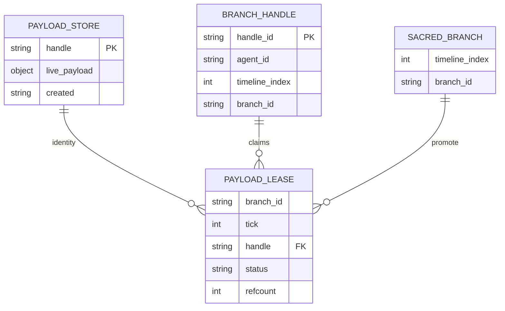

Legend: identity lives in the store. A lease is a claim. Reject drops claims. Accept retags claims onto sacred/shared. The object dies only at refcount zero.

### 5.4 `RouteRank` and `CapabilityDelta`

| Record | Fields (source) |
| --- | --- |
| `RouteRank` | `agent_id`, `score` (contracted latest after optional convolution), `context_id`, `tick` (horizon), `index` (axis slot), `entropy`, `compatibility` |
| `CapabilityDelta` | `agent_id`, `capability_id`, `context_id`, `tick`, `delta`, `absolute` |
| `ClassificationReport` | `schema`, `relation`, `pairs`, `contributor_ids`, `payload_handles`, `kept_ids`, `escalate`, `basis`, `redundant_threshold` |
| `PairClassification` | `left_id`, `right_id`, `relation`, `compatibility`, `contradiction`, `overlap`, `shared_basis_size`, `opposing_keys`, `kept_id`, `escalate` |
| `BranchHandle` | `handle_id`, `agent_id`, `timeline_index`, `branch_id` |

### 5.5 Route door (source, abbreviated)

<div style="background:#161b22;padding:8px 16px;border:1px solid #4a044e;border-bottom:none;border-radius:6px 6px 0 0;font-family:monospace;font-size:12px;color:#f9a8d4;margin-top:14px;"><span>processing/capability_field.py</span><span style="float:right;color:#e879f9;letter-spacing:2px;">PYTHON</span></div>

```python
def route(self, context, candidates, *, requirements=None, tick=None,
          decay_kernel=DEFAULT_DECAY_KERNEL) -> list[RouteRank]:
    self.index.require_context(context)
    horizon = self.index.committed_tick if tick is None else int(tick)
    working = self.window_to_tick(horizon)
    working = self.project_context(context, working)
    if decay_kernel is not None and int(working.dimensions[-1]) > 1:
        working = self.convolve_ticks(decay_kernel, working)
    contracted = self.contract_requirements(requirements, working)
    latest = self._latest_agent_scores(contracted)
    # RouteRank: score, entropy, compatibility — no Gram matrix
    ranked.sort(key=lambda item: (-item.score, item.agent_id))
    return ranked
```

<div style="background:#161b22;padding:8px 16px;border:1px solid #4a044e;border-bottom:none;border-radius:6px 6px 0 0;font-family:monospace;font-size:12px;color:#f9a8d4;margin-top:14px;"><span>agent_collaboration_core.py</span><span style="float:right;color:#e879f9;letter-spacing:2px;">PYTHON</span></div>

```python
def select_who_acts(field, context, candidates, *, requirements, tick):
    if not requirements:
        raise CapabilityIndexError("select_who_acts requires a non-empty requirement vector")
    return field.route(
        str(context), ids, requirements=req, tick=int(tick),
        decay_kernel=DEFAULT_DECAY_KERNEL,
    )
```

`decay_kernel=None` on who-acts is forbidden: that would read the latest cell like a scalar costume.

---

## 6. INTEGRATION CHALLENGES

**Issue A — Two generations, one heartbeat.** P0–P4 built Heart B beside Heart A. Collapse closed the simulation chamber and bound turns. Residual: host imports (`core.memory_core`, model loader) still threaten lift-out purity. `temporality` and `processing` must import without the root agent modules.

**Issue B — Heart C.** Shell TCP `type: task_delegation` is not `MessageBus`. Do not pretend it is ACP. TARGET is a transport adapter under ACP semantics without forking the bus.

**Issue C — Dual index, killed.** A hub `CapabilityTensorIndex` wrapper existed and was removed (`20260918T201041Z` FAIL, then deletion). Processing index is axis identity. `hub.capability_index` returns `field.index`. Do not resurrect the wrapper. Do not merge leftover adapter SHAs (`7e89d97`, `59f96b5`, `a411404`).

**Issue D — Global reject.** Early session `reject` restored the whole engine. That rewinds siblings. CONFIRMED replaced by `dispose_branch` + `reclaim_branch`. `restore_lone_baseline` remains the single-world identity experiment.

**Issue E — Operator gate.** Named `run_test-2.py`. Absent. Packet-local triples are not that gate. PLAN open question 1 is unanswered.

**Issue F — Accept flush vs capability write.** `accept()` may flush merge events onto sacred and advance `master_tick` one extra tick without writing capability cells. Convolution still runs over that zero tail. P7 proved close specialists still flip; far systems/webdev priors (1.50 vs 0.30) do not invert from a single collapse. Ranking must not invent a private clock.

**Issue G — Carry-forward zeros.** Unwritten later ticks are zeros, not skill. Accepted outcomes invert next `route()` when unselected identities carry last-known cells onto that tick (`_last_known_capability`). Zeros-as-empty is CONFIRMED policy.

---

## 7. OPERATIONAL HAZARDS

**Sacred digest vs harmonic_phase.** Speculative ticks still run `_advance_harmonic_field`. After sibling ticks, assert sacred **event ids**, not the full digest, unless you intend to measure breath (you must not edit breath). Global hard ban 5.

**Double-write learning.** `promote_handles` plus a second blob apply (`_apply_capability_blobs`) was over-learning. CONFIRMED: promote once. Do not restore the second apply.

**Lossy tensor JSON.** `_json_safe` unknown objects become `{"$type": ..., "$repr": ...}`. Putting `RecursiveTensor` in `TemporalEvent.metadata` historically raised `TypeError` via `dimensions ** rank` (tuple vs int) on the digest path. Even if the crash is repaired, the snapshot describes a tensor rather than carrying it. Handles only.

**Broadcast mutation.** One shared message object across inboxes races status. Delivery receipts must be per recipient. CONFIRMED repaired on the live bus (`broadcast_delivery_isolation`).

**Inbox leaks.** `asyncio.create_task` without ownership survived `remove_agent`. CONFIRMED: owned tasks, cancel on shutdown (`remove_agent_cancels_inbox_task`).

**Unregistered delivery.** Send to an unknown UUID must raise `BusDeliveryError`, not broadcast (`unknown_recipient_does_not_broadcast`).

**String synthesis.** `HOST::` live strings classify `UNRESOLVED` because they are not contribution vectors. Do not treat UNRESOLVED as consensus.

**Stdlib `test` shadow.** Package `test/` needs `__init__.py` so `test.run_support` beats stdlib `test`. Historical FAIL: `ModuleNotFoundError: test.run_support`.

---

## 8. SECURITY AND THREAT CONSIDERATIONS

This is an **in-process research runtime**, not a cleared network service. There is no authentication boundary between hearts A and B. Heart C is a localhost socket island. Compliance overlays (NIST, FIPS, MIL-STD) are **[REQUIRES INPUT]**. They are not claimed.

<div align="center">

<svg width="920" height="280" viewBox="0 0 920 280" xmlns="http://www.w3.org/2000/svg" role="img" aria-label="Trust zones of three hearts">
  <defs>
    <linearGradient id="omni-trust-sky" x1="0%" y1="0%" x2="100%" y2="0%">
      <stop offset="0%" stop-color="#1a0518"/>
      <stop offset="50%" stop-color="#7a1048"/>
      <stop offset="100%" stop-color="#e11d74"/>
    </linearGradient>
    <linearGradient id="omni-trust-fill" x1="0%" y1="0%" x2="0%" y2="100%">
      <stop offset="0%" stop-color="#3b0a3a"/>
      <stop offset="100%" stop-color="#1a0518"/>
    </linearGradient>
  </defs>
  <rect width="920" height="280" fill="#0d1117" rx="14"/>
  <rect x="2" y="2" width="916" height="276" fill="none" stroke="#7a1048" rx="12"/>
  <text x="460" y="28" text-anchor="middle" font-family="'Courier New', monospace" font-size="13" fill="#e879f9" letter-spacing="3">TRUST ZONES  ·  ONE PROCESS  ·  NO CRYPTOGRAPHIC AGENT IDENTITY</text>
  <rect x="28" y="48" width="270" height="190" fill="url(#omni-trust-fill)" stroke="#c084fc" rx="10"/>
  <text x="163" y="76" text-anchor="middle" font-family="'Courier New', monospace" font-size="14" fill="#c084fc">ZONE B  temporal/RTA</text>
  <text x="163" y="104" text-anchor="middle" font-family="'Courier New', monospace" font-size="11" fill="#f9a8d4">clock · engine · registry</text>
  <text x="163" y="124" text-anchor="middle" font-family="'Courier New', monospace" font-size="11" fill="#f9a8d4">session sacred policy</text>
  <text x="163" y="154" text-anchor="middle" font-family="'Courier New', monospace" font-size="11" fill="#fecdd3">isolation = deepcopy x2</text>
  <text x="163" y="174" text-anchor="middle" font-family="'Courier New', monospace" font-size="11" fill="#fecdd3">payloads = handles</text>
  <text x="163" y="210" text-anchor="middle" font-family="'Courier New', monospace" font-size="10" fill="#f472b6">lift-out CONFIRMED</text>
  <rect x="325" y="48" width="270" height="190" fill="url(#omni-trust-fill)" stroke="#e879f9" rx="10"/>
  <text x="460" y="76" text-anchor="middle" font-family="'Courier New', monospace" font-size="14" fill="#e879f9">ZONE A  agent plane</text>
  <text x="460" y="104" text-anchor="middle" font-family="'Courier New', monospace" font-size="11" fill="#f9a8d4">hub · bus · ACP</text>
  <text x="460" y="124" text-anchor="middle" font-family="'Courier New', monospace" font-size="11" fill="#f9a8d4">who-acts = Field.route</text>
  <text x="460" y="154" text-anchor="middle" font-family="'Courier New', monospace" font-size="11" fill="#fecdd3">model text untrusted</text>
  <text x="460" y="174" text-anchor="middle" font-family="'Courier New', monospace" font-size="11" fill="#fecdd3">no agent crypto id</text>
  <text x="460" y="210" text-anchor="middle" font-family="'Courier New', monospace" font-size="10" fill="#f472b6">host imports residual</text>
  <rect x="622" y="48" width="270" height="190" fill="#1a0518" stroke="#9f1239" rx="10" stroke-dasharray="6 4"/>
  <text x="757" y="76" text-anchor="middle" font-family="'Courier New', monospace" font-size="14" fill="#fb7185">ZONE C  shell island</text>
  <text x="757" y="104" text-anchor="middle" font-family="'Courier New', monospace" font-size="11" fill="#f9a8d4">localhost socket</text>
  <text x="757" y="124" text-anchor="middle" font-family="'Courier New', monospace" font-size="11" fill="#f9a8d4">task_delegation frame</text>
  <text x="757" y="154" text-anchor="middle" font-family="'Courier New', monospace" font-size="11" fill="#fecdd3">NOT MessageBus</text>
  <text x="757" y="174" text-anchor="middle" font-family="'Courier New', monospace" font-size="11" fill="#fecdd3">NOT ACP transport yet</text>
  <text x="757" y="210" text-anchor="middle" font-family="'Courier New', monospace" font-size="10" fill="#fb7185">TARGET join</text>
  <text x="460" y="262" text-anchor="middle" font-family="'Courier New', monospace" font-size="11" fill="#9f1239">constructor of TemporalSession + hub = writer of speculative history</text>
</svg>

</div>

### 8.1 Trust model (CONFIRMED)

Whoever can construct a `TemporalSession` and an `AgentCollaborationHub` in-process can:

- Open speculative worlds off sacred 0
- Lease capability deltas
- Accept into canonical history or reject locally
- Send ACP envelopes to any registered principal

There is **no** cryptographic agent identity. UUIDs are table keys. Registration on `MessageBus` is the only admission control. Unregistered UUIDs fail closed (`BusDeliveryError`).

### 8.2 Attack surface sketch

| Surface | Class | What source actually does | Residual |
| --- | --- | --- | --- |
| Process address space | Trust | One process. No sandbox between hearts A and B. | Host compromise is runtime compromise. |
| `MessageBus` | Spoofing | Delivery requires a registered principal. Unknown UUID does not broadcast. | A registered principal can send any JSON-safe envelope. |
| ACP `content` | Injection | Application data. Synthesis prints measured relation, not a slogan. | If a host ever feeds model text to tools, treat it as untrusted. Not implemented as a tool firewall here. |
| `TemporalEvent.metadata` | Integrity | `_json_safe` + handle-only policy. Tensors in events break snapshot/merge/tick. | A caller that violates the ban still crashes or snapshots a `$type/$repr`. |
| `process_tick` inputs | Isolation | Two `copy.deepcopy` calls. | Removing them is a hard ban. Cheap handles keep the cost down (PLAN D2: 133×). |
| Registry leases | Integrity | Sibling reclaim does not steal a shared identity. Reject reclaims only zero-lease payloads. | A bug that `restore_state`s the whole engine would rewind siblings (closed). |
| Sacred branch 0 | Authorization | `_bind_turn` aborts if `timeline_index == 0`. Direct sacred writes outside the accept write-gate raise `TemporalSessionError`. `dispose_branch(0)` raises. | Harmonic field still retouches sacred `harmonic_phase` on sibling ticks (out of scope). |
| Capability learning | Integrity | Rejected `CapabilityDelta` does not mutate committed cells. Promote once after accept. | Double-apply would over-learn (closed). `decay_kernel=None` would costume-score (forbidden on who-acts). |
| Heart C socket | Network | Localhost `task_delegation` frame. | Not ACP. Binding it without a transport adapter forks the bus. TARGET. |
| Snapshots | Confidentiality | `export_state` is JSON-safe. Payloads serialize at snapshot boundaries. | Do not put credentials in events, tensors, or this file. |
| Tests / artifacts | Hygiene | `result.json` / `result.md` / `result.log` under `test/*/runs/`. | Packet-local PASS is not operator-gate PASS. |

### 8.3 STRIDE mapping (in-process, not a network product)

| STRIDE | Applies? | Mitigation in source | Gap |
| --- | --- | --- | --- |
| Spoofing | Yes, identity is a UUID | Bus registration; unknown recipient fails | No signatures, no mTLS, no agent attestation |
| Tampering | Yes, tensors and events | Handles; JSON-safe metadata; deepcopy isolation; sacred write-gate | In-process caller can still mutate live objects if they hold a Python reference |
| Repudiation | Partial | Engine event ids, merge event ids, first-person `result.md` | Not an audit log for humans-in-the-loop. No hash chain beyond snapshot digest. |
| Information disclosure | Yes if secrets enter payloads | Policy: no secrets in events/tensors | Not enforced by a scanner in this repository |
| Denial of service | Local | Tick lock; finite sacred flush (64); registry refcount | Unbounded speculative worlds / tensor growth not rate-limited here |
| Elevation | Yes, sacred 0 is canonical | Session policy refuses agent writes to 0 | Constructor-level access is already root |

### 8.4 Isolation guarantee (load-bearing)

```python
# temporality/timeline_engine.py process_tick
stabilized = rcf_operator(copy.deepcopy(dict(inputs)))
# ...
stabilized = copy.deepcopy(dict(stabilized))
```

PLAN D2 measured deepcopy of a sparse tensor (163 nonzeros) at 0.4500 ms vs handle string 0.0034 ms (**133×**). The deepcopy stays. Make the copied thing cheap.

`test_registry` `deepcopy_handle_inputs_under_0_05ms`: median 0.00155 ms (limit 0.05) nnz≈392.

### 8.5 Secrets and compliance

- No credentials belong in events, tensors, snapshots, or this file.
- NIST / FIPS / MIL-STD overlays are **[REQUIRES INPUT]**. Not claimed.
- Cleared-personnel and air-gap assumptions are **[REQUIRES INPUT]**. This runtime does not encode them.
- Operator gate `run_test-2.py` is absent: **NOT VERIFIABLE**. Do not stamp a security PASS from packet-local Python.

---

## 9. VALIDATION

Packet-local evidence on the line that became `fdd81ff` (and its ancestors). **Not** the operator gate. Tests are direct `python3 test/<domain>/test_<name>.py` writing `result.json`, first-person `result.md`, `result.log`. No pytest. No mocks of the substrate.

> **Gate posture.** Candidate harness `run_test-2.py` is absent. PLAN open question 1 unanswered. Every PASS below is packet-local. A missing prerequisite is NOT VERIFIABLE, never PASS.

### 9.1 Runner matrix (freeze line)

| Runner | Result | Artifact | What it proved |
| --- | --- | --- | --- |
| `test/processing/test_tensor_heartbeat.py` | PASS 5/5 | `test/processing/runs/20260919T000400Z` | Requirement invert; last-axis conv ≠ latest cell; reject no leak; deepcopy=2; no hub ranking class |
| `test/processing/test_routing.py` | PASS 8/8 | `20260919T000320Z-test_routing` | systems/webdev invert; decay tracks collapse; slice restores; colony rows real |
| `test/processing/test_capability_field.py` | PASS 9/9 | `20260919T000321Z-test_capability_field` | from_dict cells; accept promote then apply; reject cell unchanged |
| `test/agent_plane/test_tensor_turn.py` | PASS 4/4 | `20260918T235743Z` | Live who-acts contracts; score 0.4440 ≠ latest; COMPLEMENTARY; Heart C not imported |
| `test/agent_plane/test_p5_exit.py` | PASS 8/8 | `20260918T235720Z` | First-ready dead; accept inverts; reject does not; colony compile on handle |
| `test/agent_plane/test_p6_reconciliation.py` | PASS 9/9 | `20260918T231843Z` | Live bus three relations + HOST:: UNRESOLVED; grep-ban holds |
| `test/agent_plane/test_live_acp.py` | PASS 14/14 | `20260918T235715Z` / `201426Z` 14/14 | Real ACP traffic; leases_promoted; no simulate |
| `test/agent/test_live_path.py` | PASS 16/16 | `20260918T235731Z-test_live_path` | Solo bind; no second index; broadcast isolation; inbox cancel |
| `test/temporality/test_session.py` | PASS 5/5 | `20260918T195357Z-test_session` | Monotonic TimePoints; replay event ids; clock restore; local_time +0.5 |
| `test/temporality/test_sacred.py` | PASS 7/7 | `20260918T225218Z-test_sacred` | Sibling reject local; sacred writes blocked; counterfactual tickable |
| `test/temporality/test_registry.py` | PASS 9/9 | `20260918T195442Z-test_registry` | Shared lease; promote sacred; json_blob.v1; handle deepcopy |
| `test/temporality/test_merge.py` | PASS 4/4 | `20260918T231800Z` | Conflict key; overlay handles; classification not a field write |
| `test/processing/test_reconciliation.py` | PASS 6/6 | `20260918T225104Z` | REDUNDANT 1.0; COMPLEMENTARY 0.0; CONFLICTING escalate |
| `run_test-2.py` | **NOT VERIFIABLE** | absent | Operator gate |

### 9.2 Measured numbers (do not round into slogans)

| Claim | Number | Source check |
| --- | --- | --- |
| PLAN D2 deepcopy gap | 0.4500 ms object / 0.0034 ms handle = 133× | PLAN.md D2 |
| Registry deepcopy | median 0.00155 ms (limit 0.05) | `test_registry` |
| process_tick deepcopy sites | 2 | tensor_heartbeat, merge |
| D4 flat scalar gap | coder 1.200 vs coder_2 1.125 (6%) | PLAN.md D4 |
| D4 tensor systems | coder 1.500 / coder_2 0.328 | PLAN.md D4 |
| D4 tensor webdev | coder_2 1.462 / coder 0.660 | PLAN.md D4 |
| Live systems/webdev (routing 8/8) | systems coder=1.300 coder_2=0.193; webdev coder_2=1.240 coder=0.353 | `20260919T000320Z` |
| Field systems/webdev | systems coder:1.500 / webdev coder_2:1.462 | `20260919T000321Z` |
| Requirement invert | code_generation coder=1.000; research_synthesis coder_2=1.000 | tensor_heartbeat |
| Convolution ≠ latest | latest=late conv=early score=0.800 `conv_axis=3` | tensor_heartbeat |
| Slice restore | before coder=1.300; degraded tick3 leader=0.050; slice[:1] coder=1.300 | routing |
| Reject no leak | cell=1.500 handle_gone=True sacred_events=0 | tensor_heartbeat |
| P7 live ACP convolution | leader=coder_2 score=0.4440 write_tick=1 engine_tick=3 applied=2 | tensor_turn |
| P7 field accept | accept_leader=coder_2 score=0.7800 write_tick=1 engine_tick=2 | tensor_turn |
| P6 REDUNDANT | compatibility=1.0 escalate=false field=0.910 | `20260918T231843Z` |
| P6 COMPLEMENTARY | compatibility=0.0 escalate=false | same |
| P6 CONFLICTING | escalate=true compatibility=0.75 | same |
| P6 HOST:: hub | UNRESOLVED escalate=false applied=14 timeline_index=4 | same |
| REDUNDANT_THRESHOLD | 0.7 | `processing/reconciliation.py` |
| DEFAULT_DECAY_KERNEL | `(0.05, 0.10, 0.20, 0.28, 0.37)` | `capability_field.py` |
| Session local_time | 0.0 → 0.5 per tick | test_session |
| Sacred sibling reject | master_tick 3→4 not rewound; beta still active | test_sacred |

### 9.3 Invariant matrix

| Invariant | Proof | Status |
| --- | --- | --- |
| Clock stamps when; engine orders | test_session monotonic + local_time not wall | CONFIRMED packet-local |
| Handles on tick path | test_registry fingerprint; `_json_safe` lossy for tensors | CONFIRMED |
| Sacred 0 not a scratch pad | `_bind_turn` abort; test_sacred sacred_writes_blocked | CONFIRMED |
| Reject is local | dispose+reclaim; sibling active; no restore_state | CONFIRMED |
| Who-acts is Field.route | select_who_acts names DEFAULT_DECAY_KERNEL; p5_exit | CONFIRMED |
| Convolution last axis | conv_axis=3; time_axis=0 ≠ last | CONFIRMED |
| Promote once | `_bind_turn` applied count; p5/p7 | CONFIRMED |
| Synthesis measured | classify_contributions; grep-ban | CONFIRMED |
| No simulate | grep zero `_simulate_agent_execution` | CONFIRMED |
| No hub ranking class | AST: no ClassDef CapabilityTensorIndex on hub | CONFIRMED |
| Operator gate | `run_test-2.py` | **NOT VERIFIABLE** |

Baseline checks, valid regardless of gate confirmation:

```bash
python3 -m compileall -q temporality processing *.py
python3 -c "import temporality, processing"
```

---

## 10. ROADMAP

### Immediate (operator-defined)

- Name or create the operator gate. Until then every PASS in this file is packet-local.
- Host-boundary extraction so Heart A does not import `core.memory_core` / model loader lineages.
- Heart C as a **transport** under ACP semantics — not a second bus.
- PLAN open questions 2–4: breath switchability; registry persistence across process restart; `rcf_operator` purity vs separately guarded tensor.

### Explicit non-goals

- Do not resurrect first-ready selection or `available_agents[0]`.
- Do not resurrect a hub `CapabilityTensorIndex` ranking class.
- Do not set `decay_kernel=None` on `select_who_acts`.
- Do not merge leftover adapter SHAs (`7e89d97`, `59f96b5`, `a411404`) that wrap ranking.
- Do not adopt spectral / Gram eigenmode team selection (PLAN D6).
- Do not edit breath, harmonic, or `SACRED_RATIO` without explicit operator direction.
- Do not remove `copy.deepcopy` in `process_tick`.
- Do not claim operator-gate PASS.

---

## 11. GLOSSARY

| Term | Meaning |
| --- | --- |
| Sacred | Branch 0. Agents merge in. They do not mutate it. |
| Speculative world | Open `BranchHandle` with `timeline_index != 0`. |
| Handle | Registry id. The only legal tensor reference in an event. |
| Lease | A branch's claim on an immutable payload identity. Status speculative/sacred/shared. |
| Capability field | `C[agent, capability, context, tick]` plus axis identity. |
| RouteRank | Score after window/project/convolve/contract. Not a latest-cell costume. |
| Promote once | After `accept`, `CapabilityField.promote_handles` exactly once. |
| Complementarity | Different and simultaneously true. Not conflict. |
| UNRESOLVED | No vector/claims to measure (e.g. `HOST::` strings). Not a fake consensus. |
| Colony | Workers that inhabited this repo: nest, omniscient, Fletcher, finalizer, docs. Seeded as capability identities. |
| Packet-local | A direct-python triple passed. Not the operator gate. |
| NOT VERIFIABLE | Prerequisite missing. Never converted into PASS. |
| Heart C | `advanced_ai_shell.py` localhost socket. Island. TARGET join. |
| Costume score | Reading the latest tensor cell as if it were a scalar specialization. Forbidden as who-acts. |

---

## 12. GITHUB RENDER CONTRACT

This whitepaper is written so **github.com** can render it.

| Device | Allowed here | Forbidden here |
| --- | --- | --- |
| SVG banners / diagrams | Inline SVG, unique `id`s prefixed `omni-`, gradients | Scripts, external font files that GitHub will drop, `feGaussianBlur` on titles |
| Mermaid | `flowchart`, `sequenceDiagram`, `stateDiagram-v2`, `classDiagram`, `erDiagram` | HTML inside mermaid nodes |
| Code | Fenced blocks with language tags + a small HTML file header using **inline** styles | A global `<style>` block (GitHub strips it) |
| Color | Shields.io, SVG fills, inline styles (`#1a0518 #7a1048 #e11d74 #e879f9 #f472b6 #c084fc`) | Document-global CSS classes that require a stylesheet |
| Emphasis | Tables, blockquotes, first-class diagrams | Emojis, `<details>` hiding architecture, empty badges |

Terminal frames from the Somnus design system appear **sometimes**, with inline styles, because a running system should look like one. They are not the only container. Prose, mermaid, SVG, and evidence tables carry equal weight.

Glow filters (`feGaussianBlur`) are omitted from banners so GitHub sanitization cannot blank the title. Color is in the gradient.

---

### 12.1 Sequence — one accepted turn

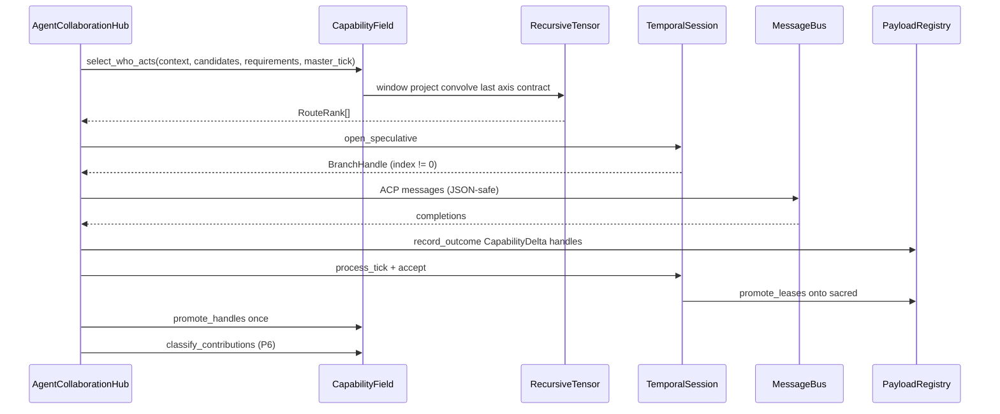

### 12.2 Sequence — reject does not rewind siblings

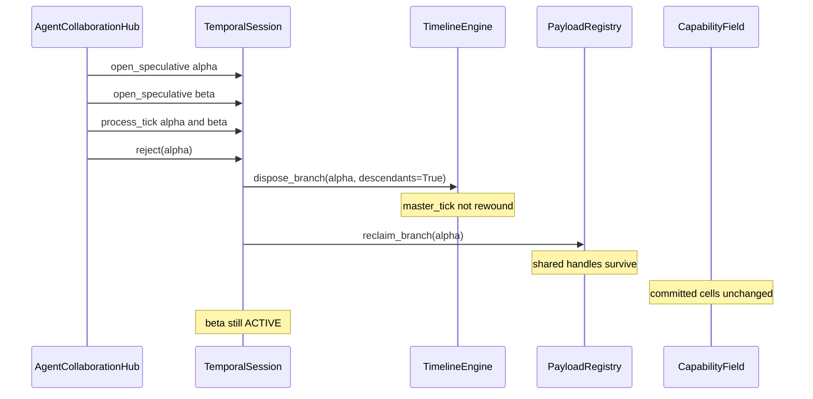

### 12.3 Sequence — measured synthesis

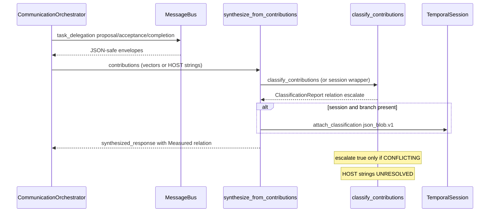

### 12.4 State — engine branch status

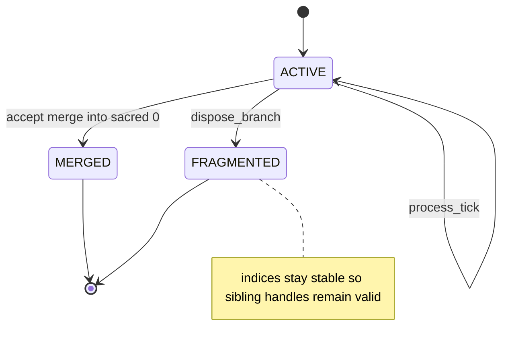

### 12.5 State — relation kinds

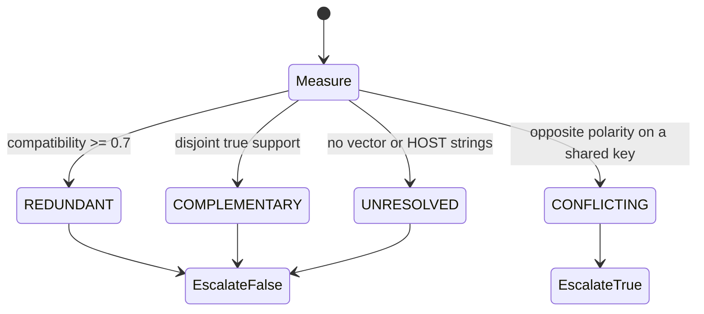

---

## 13. TRUST ZONES AND AUTHORITY MAP

Local authority from `AGENTS.md`. A generated artifact cannot silently overrule the source it reflects.

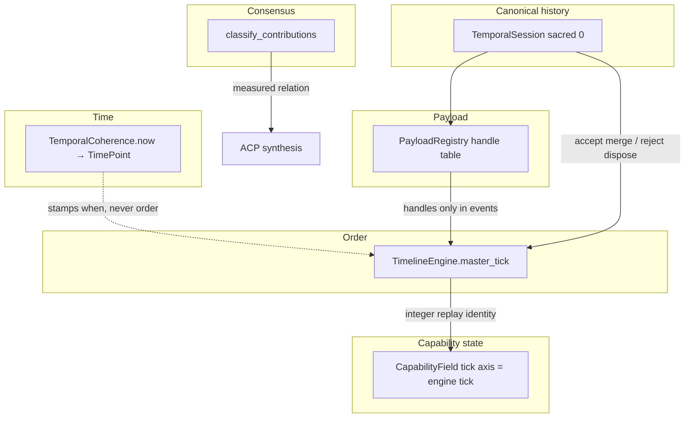

| Boundary | Design intent | Local owner | Conflict rule |
| --- | --- | --- | --- |
| Time | Clock is authoritative for when; monotonic, insulated from wall-clock adjustment | `temporality/internal_clock.py` | The clock wins. The engine never reads wall time. |
| Order | Engine is authoritative for which came first | `temporality/timeline_engine.py` | The engine wins. The clock never reorders events. |
| Payload | Objects move by handle | `temporality/registry.py` | The registry wins. No object enters an event. |
| Canonical history | Branch 0 is sacred | `temporality/session.py` | Session policy wins over any direct engine call. |
| Capability state | Tensor time axis indexed by engine tick | `processing/recursive_tensor.py` + field | Engine tick numbering wins; the tensor follows it. |
| Consensus | Measured from contribution content | `processing/reconciliation.py` consumed by ACP | Measurement wins. No fixed narrative claim ships. |

---

## 14. CLASS CONTRACTS

Types as they exist on `fdd81ff`. This is not a proposed UML redesign.

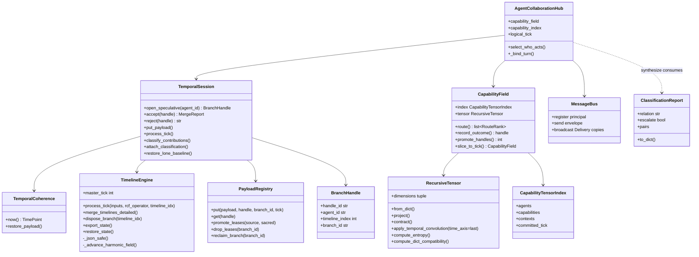

`hub.capability_index` is a property returning `field.index`. There is no second ranking type.

`logical_tick` aliases `engine.master_tick`. Ranking tick is also `master_tick`. After accept flush, convolution may see a zero tail.

---

## 15. LEASE AND BRANCH STATE

<div align="center">

<svg width="900" height="220" viewBox="0 0 900 220" xmlns="http://www.w3.org/2000/svg" role="img" aria-label="Payload lease lifecycle">
  <defs>
    <linearGradient id="omni-lease-bar" x1="0%" y1="0%" x2="100%" y2="0%">
      <stop offset="0%" stop-color="#7a1048"/>
      <stop offset="100%" stop-color="#e879f9"/>
    </linearGradient>
  </defs>
  <rect width="900" height="220" fill="#0d1117" rx="12"/>
  <text x="450" y="28" text-anchor="middle" font-family="'Courier New', monospace" font-size="13" fill="#e879f9" letter-spacing="2">PAYLOAD IDENTITY  vs  BRANCH CLAIM</text>
  <rect x="30" y="50" width="160" height="70" fill="#1a0518" stroke="#c084fc" rx="8"/>
  <text x="110" y="80" text-anchor="middle" font-family="'Courier New', monospace" font-size="12" fill="#c084fc">put_payload</text>
  <text x="110" y="100" text-anchor="middle" font-family="'Courier New', monospace" font-size="10" fill="#f9a8d4">SPECULATIVE lease</text>
  <rect x="250" y="50" width="160" height="70" fill="#1a0518" stroke="#e879f9" rx="8"/>
  <text x="330" y="80" text-anchor="middle" font-family="'Courier New', monospace" font-size="12" fill="#e879f9">accept</text>
  <text x="330" y="100" text-anchor="middle" font-family="'Courier New', monospace" font-size="10" fill="#f9a8d4">promote_leases</text>
  <rect x="470" y="50" width="160" height="70" fill="#1a0518" stroke="#f472b6" rx="8"/>
  <text x="550" y="80" text-anchor="middle" font-family="'Courier New', monospace" font-size="12" fill="#f472b6">SACRED/SHARED</text>
  <text x="550" y="100" text-anchor="middle" font-family="'Courier New', monospace" font-size="10" fill="#f9a8d4">canonical claim</text>
  <rect x="690" y="50" width="180" height="70" fill="#1a0518" stroke="#9f1239" rx="8"/>
  <text x="780" y="80" text-anchor="middle" font-family="'Courier New', monospace" font-size="12" fill="#fb7185">reject</text>
  <text x="780" y="100" text-anchor="middle" font-family="'Courier New', monospace" font-size="10" fill="#f9a8d4">drop_leases / reclaim</text>
  <line x1="190" y1="85" x2="250" y2="85" stroke="url(#omni-lease-bar)" stroke-width="2"/>
  <line x1="410" y1="85" x2="470" y2="85" stroke="url(#omni-lease-bar)" stroke-width="2"/>
  <text x="450" y="160" text-anchor="middle" font-family="'Courier New', monospace" font-size="12" fill="#fecdd3">refcount &gt; 0 keeps the object  ·  sibling reclaim does not steal identity</text>
  <text x="450" y="186" text-anchor="middle" font-family="'Courier New', monospace" font-size="12" fill="#f472b6">then Field.promote_handles ONCE  ·  numbers enter C via from_dict</text>
  <text x="450" y="208" text-anchor="middle" font-family="'Courier New', monospace" font-size="11" fill="#9f1239">classification attach is json_blob.v1  ·  not a CapabilityField write</text>
</svg>

</div>

Accept path from source (`temporality/session.py`):

1. `_require_open(handle)`
2. `merge_timelines_detailed(speculative → 0, strategy=overlay)`
3. Sacred write-gate: flush pending merge (up to 64 identity ticks)
4. Speculative status `MERGED`, `active=False`
5. `registry.promote_branch(handle.branch_id, sacred_branch_id)`
6. Hub then `capability_field.promote_handles(session, payload_handles)` **once**

Reject path from source:

1. Collect open descendants
2. `engine.dispose_branch(..., descendants=True)` — indices stable, `master_tick` not rewound, sacred 0 cannot be disposed
3. `registry.reclaim_branch` per unique `branch_id`
4. Pop speculative records
5. Return sacred digest (event-id comparison is the honest post-sibling assertion)

---

## 16. WHO-ACTS ALGEBRA

<div align="center">

<svg width="920" height="200" viewBox="0 0 920 200" xmlns="http://www.w3.org/2000/svg" role="img" aria-label="CapabilityField.route pipeline">
  <defs>
    <linearGradient id="omni-rta-g" x1="0%" y1="0%" x2="100%" y2="0%">
      <stop offset="0%" stop-color="#7a1048"/>
      <stop offset="50%" stop-color="#e11d74"/>
      <stop offset="100%" stop-color="#c084fc"/>
    </linearGradient>
  </defs>
  <rect width="920" height="200" fill="#0d1117" rx="12"/>
  <text x="460" y="28" text-anchor="middle" font-family="'Courier New', monospace" font-size="13" fill="#e879f9" letter-spacing="2">C[agent, capability, context, tick]  ·  TICK IS LAST</text>
  <rect x="18" y="50" width="165" height="88" fill="#1a0518" stroke="#c084fc" rx="8"/>
  <text x="100" y="88" text-anchor="middle" font-family="'Courier New', monospace" font-size="12" fill="#c084fc">window_to_tick</text>
  <text x="100" y="110" text-anchor="middle" font-family="'Courier New', monospace" font-size="10" fill="#f9a8d4">project I[:tick+1]</text>
  <rect x="198" y="50" width="165" height="88" fill="#1a0518" stroke="#e879f9" rx="8"/>
  <text x="280" y="88" text-anchor="middle" font-family="'Courier New', monospace" font-size="12" fill="#e879f9">project_context</text>
  <text x="280" y="110" text-anchor="middle" font-family="'Courier New', monospace" font-size="10" fill="#f9a8d4">CONTEXT_AXIS=2</text>
  <rect x="378" y="50" width="175" height="88" fill="#1a0518" stroke="#f472b6" rx="8"/>
  <text x="465" y="82" text-anchor="middle" font-family="'Courier New', monospace" font-size="12" fill="#f472b6">convolve_ticks</text>
  <text x="465" y="104" text-anchor="middle" font-family="'Courier New', monospace" font-size="10" fill="#f9a8d4">time_axis = rank-1</text>
  <text x="465" y="122" text-anchor="middle" font-family="'Courier New', monospace" font-size="9" fill="#fecdd3">0.05 0.10 0.20 0.28 0.37</text>
  <rect x="568" y="50" width="165" height="88" fill="#1a0518" stroke="#e11d74" rx="8"/>
  <text x="650" y="88" text-anchor="middle" font-family="'Courier New', monospace" font-size="12" fill="#fb7185">contract_req</text>
  <text x="650" y="110" text-anchor="middle" font-family="'Courier New', monospace" font-size="10" fill="#f9a8d4">CAPABILITY_AXIS=1</text>
  <rect x="748" y="50" width="154" height="88" fill="#1a0518" stroke="#c084fc" rx="8"/>
  <text x="825" y="88" text-anchor="middle" font-family="'Courier New', monospace" font-size="12" fill="#c084fc">RouteRank</text>
  <text x="825" y="110" text-anchor="middle" font-family="'Courier New', monospace" font-size="10" fill="#f9a8d4">score entropy compat</text>
  <line x1="18" y1="170" x2="902" y2="170" stroke="url(#omni-rta-g)" stroke-width="3"/>
  <text x="460" y="192" text-anchor="middle" font-family="'Courier New', monospace" font-size="11" fill="#f9a8d4">spectral / Gram unused  ·  decay_kernel=None forbidden on select_who_acts</text>
</svg>

</div>

Decision flow for ranking:

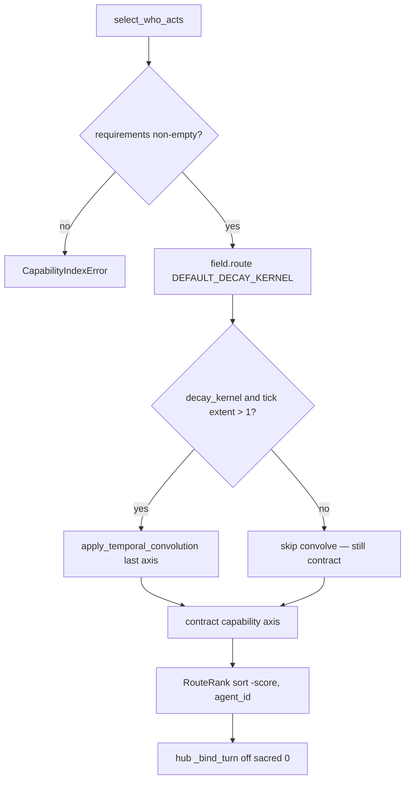

PLAN D6 rejected spectral selection: Gram eigenmodes at five-to-ten agents and eight capabilities were ceremony. Redundancy only fell when the diversity penalty swapped in an agent with 0.212 task fit to buy 0.115 of decorrelation. Revisit only past roughly thirty agents. `fractal_iteration` and `persistent_homology` are out of scope.

---

## 17. SOURCE CONTRACTS

Snippets below are abbreviated from `fdd81ff` source. If they disagree with the file on disk, the file wins.

### 17.0 Line index (freeze `fdd81ff`)

| Path | File | Line |
| --- | --- | --- |
| `select_who_acts` | `agent_collaboration_core.py` | 249 |
| `_bind_turn` | same | 1690 |
| Sacred 0 refuse | same | 1706–1708 |
| Seed slot refuse | same | 1726–1729 |
| `promote_handles` once | same | 1753–1755 |
| `open_speculative` | `temporality/session.py` | 339 |
| `accept` / `promote_branch` | same | 374 / 408 |
| `reject` | same | 416 |
| `process_tick` deepcopy | `temporality/timeline_engine.py` | 1108, 1111 |
| `_json_safe` | same | 282; fallthrough 320 |
| `dispose_branch` sacred ban | same | 1436–1439 |
| `route` | `processing/capability_field.py` | 934 |
| `record_outcome` | same | 789 |
| `DEFAULT_DECAY_KERNEL` | same | 215 |
| `apply_temporal_convolution` | `processing/recursive_tensor.py` | 2391 |
| `classify_contributions` | `processing/reconciliation.py` | 215 |
| `synthesize_from_contributions` | `agent_communication_protocol.py` | 872 |
| Heart C bind / frame | `advanced_ai_shell.py` | 700 / 1285 |

### 17.1 Sacred refuse and seed-slot refuse

<div style="background:#161b22;padding:8px 16px;border:1px solid #4a044e;border-bottom:none;border-radius:6px 6px 0 0;font-family:monospace;font-size:12px;color:#f9a8d4;margin-top:14px;"><span>agent_collaboration_core.py _bind_turn</span><span style="float:right;color:#e879f9;letter-spacing:2px;">PYTHON</span></div>

```python
session = self.temporal_binder.session
if session is None:
    raise AgentPlaneError("TemporalSession unbound; refusing an unbound agent turn")
handle = self.temporal_binder.open_turn(owner_id)
if int(handle.timeline_index) == 0:
    self.temporal_binder.abort_turn(handle)
    raise AgentPlaneError("refusing agent turn on sacred branch 0")
session.process_tick({"phase": "agent_turn_open", "owner_id": str(owner_id)},
                     lambda inputs: dict(inputs), branch=handle)
tick = int(session.master_tick)
if tick == 0:
    raise AgentPlaneError("engine master_tick stayed 0; refusing to overwrite the seed slot")
session.accept(handle)
applied = self.capability_field.promote_handles(session, payload_handles)
```

### 17.2 JSON-safe fallthrough (lossy)

<div style="background:#161b22;padding:8px 16px;border:1px solid #4a044e;border-bottom:none;border-radius:6px 6px 0 0;font-family:monospace;font-size:12px;color:#f9a8d4;margin-top:14px;"><span>temporality/timeline_engine.py</span><span style="float:right;color:#e879f9;letter-spacing:2px;">PYTHON</span></div>

```python
def _json_safe(value: object, *, depth: int = 0) -> JsonValue:
    if depth > 64:
        raise SerializationError("snapshot nesting exceeds 64 levels")
    # ... bool/int/str/float/numpy/Enum/Path/TemporalEvent/Mapping/set/list ...
    return {"$type": type(value).__qualname__, "$repr": repr(value)}
```

### 17.3 Convolution default is last axis

<div style="background:#161b22;padding:8px 16px;border:1px solid #4a044e;border-bottom:none;border-radius:6px 6px 0 0;font-family:monospace;font-size:12px;color:#f9a8d4;margin-top:14px;"><span>processing/recursive_tensor.py</span><span style="float:right;color:#e879f9;letter-spacing:2px;">PYTHON</span></div>

```python
def apply_temporal_convolution(self, kernel, time_axis=None):
    """Default time_axis is the last axis. Capability layout is
    C[agent, capability, context, tick]; tick is last. Pass 0 explicitly
    only for a time-first tensor."""
    if time_axis is None:
        axis = self.rank - 1
```

P7 surprise (first-person `result.md`): the previous default `time_axis=0` mixed the **agent** axis. Packet-local proof: `conv_axis=3`.

### 17.4 Classify contract

<div style="background:#161b22;padding:8px 16px;border:1px solid #4a044e;border-bottom:none;border-radius:6px 6px 0 0;font-family:monospace;font-size:12px;color:#f9a8d4;margin-top:14px;"><span>processing/reconciliation.py</span><span style="float:right;color:#e879f9;letter-spacing:2px;">PYTHON</span></div>

```python
REDUNDANT_THRESHOLD = 0.7

class RelationKind(str, Enum):
    REDUNDANT = "REDUNDANT"
    COMPLEMENTARY = "COMPLEMENTARY"
    CONFLICTING = "CONFLICTING"
    UNRESOLVED = "UNRESOLVED"

def classify_contributions(contributions, *, resolve=None, basis=None,
                           redundant_threshold=REDUNDANT_THRESHOLD) -> ClassificationReport:
    """High compute_dict_compatibility (>= 0.7) is REDUNDANT.
    Disjoint or weakly overlapping true support is COMPLEMENTARY.
    CONFLICTING requires opposite polarity on a shared key.
    Tensors never enter the returned report; handles are strings."""
```

ACP consume (`synthesize_from_contributions`):

```python
escalate = report.relation == RelationKind.CONFLICTING.value
parts.append(f"Measured relation: {report.relation}")
parts.append(f"escalate={str(escalate).lower()}")
```

No canned “High confidence consensus”. Grep-banned on production ACP/hub.

### 17.5 Dispose sacred is illegal

```python
# temporality/timeline_engine.py dispose_branch
if timeline_idx == 0:
    raise TemporalConstraintError("cannot dispose sacred branch 0", "sacred")
branch.status = BranchStatus.FRAGMENTED
branch.active = False
# master_tick is not rewound — those ticks already happened in engine order
```

---

## 18. PACKET-LOCAL EVIDENCE

First-person logs are the harness contract. Counts in `result.md` must match `result.json`. These excerpts are not the operator gate.

<div style="background:#1a0518;border:1px solid #7a1048;border-radius:10px;margin:22px 0;overflow:hidden;font-family:'Courier New',monospace;">
  <div style="background:#3b0a3a;padding:10px 16px;border-bottom:1px solid #7a1048;color:#f9a8d4;font-size:12px;">
    <span style="display:inline-block;width:10px;height:10px;border-radius:50%;background:#e11d74;margin-right:6px;"></span>
    <span style="display:inline-block;width:10px;height:10px;border-radius:50%;background:#e879f9;margin-right:6px;"></span>
    <span style="display:inline-block;width:10px;height:10px;border-radius:50%;background:#c084fc;margin-right:8px;"></span>
    test/processing/runs/20260919T000400Z · tensor_heartbeat
    <span style="float:right;color:#c084fc;letter-spacing:1px;font-size:10px;">PACKET-LOCAL 5/5</span>
  </div>
  <pre style="margin:0;padding:16px 18px;color:#fecdd3;font-size:12.5px;line-height:1.55;overflow-x:auto;white-space:pre;">I ran CapabilityField.route, slice_to_tick, and record_outcome against
RecursiveTensor.project, contract, apply_temporal_convolution,
compute_dict_compatibility, and compute_entropy. Tick is the last axis.

[PASS] route_ranking_changes_with_requirement_vector
       code leader=coder score=1.000 compat=0.995
       research leader=coder_2 score=1.000
[PASS] slice_and_convolution_use_last_axis
       latest=late conv=early score=0.800
       slice[:5] leader=early extent=5 conv_axis=3
[PASS] reject_does_not_leak_into_sacred_field
       leader=coder score=1.500 cell=1.500 handle_gone=True sacred_events=0
[PASS] fletcher_calls_field_without_second_index
       no hub CapabilityTensorIndex class
[PASS] deepcopy_and_from_dict_still_load_bearing
       process_tick deepcopy=2; from_dict dims=(2, 2, 2, 3)

Surprise: apply_temporal_convolution defaulted to time_axis=0,
which mixed the agent axis. Default is now the last axis.
Operator gate remains NOT YET CONFIRMED.</pre>
</div>

<div style="background:#1a0518;border:1px solid #7a1048;border-radius:10px;margin:22px 0;overflow:hidden;font-family:'Courier New',monospace;">
  <div style="background:#3b0a3a;padding:10px 16px;border-bottom:1px solid #7a1048;color:#f9a8d4;font-size:12px;">
    <span style="display:inline-block;width:10px;height:10px;border-radius:50%;background:#e11d74;margin-right:6px;"></span>
    <span style="display:inline-block;width:10px;height:10px;border-radius:50%;background:#e879f9;margin-right:6px;"></span>
    <span style="display:inline-block;width:10px;height:10px;border-radius:50%;background:#c084fc;margin-right:8px;"></span>
    test/agent_plane/runs/20260918T235743Z · tensor_turn
    <span style="float:right;color:#c084fc;letter-spacing:1px;font-size:10px;">PACKET-LOCAL 4/4</span>
  </div>
  <pre style="margin:0;padding:16px 18px;color:#fecdd3;font-size:12.5px;line-height:1.55;overflow-x:auto;white-space:pre;">I ran live who-acts through CapabilityField.route with the real
requirement vector, engine master_tick, and DEFAULT_DECAY_KERNEL.

[PASS] live_ranking_is_contraction — select_who_acts → field.route
[PASS] field_accept_contraction_flips
       accept_leader=coder_2 score=0.7800 write_tick=1 engine_tick=2 applied=2
       kernel=[0.05, 0.1, 0.2, 0.28, 0.37]
[PASS] live_acp_turn_flips_from_contraction
       relation=COMPLEMENTARY leader=coder_2 score=0.4440
       write_tick=1 engine_tick=3 applied=2 proposals=2 completions=2
[PASS] hub_live_turn_flips_from_contraction
       applied=7 deltas=7 engine_tick=2 kind=solo

Surprise: accept() still advances master_tick one extra sacred flush
tick past the capability write. Convolution over that zero tail still
flipped close specialists. Heart C shell was not imported.</pre>
</div>

<div style="background:#1a0518;border:1px solid #7a1048;border-radius:10px;margin:22px 0;overflow:hidden;font-family:'Courier New',monospace;">
  <div style="background:#3b0a3a;padding:10px 16px;border-bottom:1px solid #7a1048;color:#f9a8d4;font-size:12px;">
    <span style="display:inline-block;width:10px;height:10px;border-radius:50%;background:#e11d74;margin-right:6px;"></span>
    <span style="display:inline-block;width:10px;height:10px;border-radius:50%;background:#e879f9;margin-right:6px;"></span>
    <span style="display:inline-block;width:10px;height:10px;border-radius:50%;background:#c084fc;margin-right:8px;"></span>
    test/agent_plane/runs/20260918T231843Z · p6_reconciliation
    <span style="float:right;color:#c084fc;letter-spacing:1px;font-size:10px;">PACKET-LOCAL 9/9</span>
  </div>
  <pre style="margin:0;padding:16px 18px;color:#fecdd3;font-size:12.5px;line-height:1.55;overflow-x:auto;white-space:pre;">I found REDUNDANT, COMPLEMENTARY, and CONFLICTING in real synthesis
from real bus turns. escalate is true only for CONFLICTING.

[PASS] no_canned_consensus_or_jaccard
[PASS] live_bus_redundant      relation=REDUNDANT escalate=False compatibility=1.0
[PASS] live_bus_complementary  relation=COMPLEMENTARY escalate=False compatibility=0.0
[PASS] live_bus_conflicting_escalates relation=CONFLICTING escalate=True compatibility=0.75
[PASS] live_hub_orchestration_measured_relation
       relation=UNRESOLVED (HOST:: strings) applied=14 timeline_index=4

Classification handle is json_blob.v1. CapabilityField unchanged
by classify/attach. Operator gate remains NOT YET CONFIRMED.</pre>
</div>

### 18.1 Additional packet-local facts (tables, not terminals)

**test_sacred 7/7** `20260918T225218Z`

| Check | Detail |
| --- | --- |
| lone_baseline_restores_export_state_digest | digest=acfce5e652f06830… |
| reject_reclaims_registry_to_baseline | registry 1 → 0 |
| sibling_reject_is_branch_local | reject(alpha) left beta active; master_tick 3→4; sacred digest unchanged |
| sacred_writes_blocked_outside_accept | direct sacred schedule/tick raise TemporalSessionError |
| counterfactual_registered_and_tickable | child idx=2; parent survived until reject |

**test_session 5/5** `20260918T195357Z`

| Check | Detail |
| --- | --- |
| no_background_thread | none after construct or speculative tick |
| monotonic_timepoints_per_tick | 5 stamps nondecreasing |
| deterministic_replay_ordering | master_tick=4 event_ids probe-0000…0003 |
| snapshot_clock_engine_agree_on_N | clock internals match payload |
| local_time_not_wall_clock | 0.0→0.5 (+0.5); TimePoint is stamp only |

**test_routing 8/8** `20260919T000320Z`

| Check | Detail |
| --- | --- |
| systems_webdev_context_inversion | systems coder=1.300 coder_2=0.193; webdev coder_2=1.240 coder=0.353 |
| decay_convolution_tracks_degraded_outcome | tick=5 coder=1.275 coder_2=0.820 |
| rollback_by_slice_restores_ranking | slice[:1] restored coder=1.300 |
| rejected_capability_delta_does_not_leak | leaked=False; accept applied=2 leader=coder_2 score=1.500 |
| colony_roles_and_unified_inferrer | omniscient/fletcher/finalizer/docs/nest; research_leader=omniscient |

**test_live_path 16/16** `20260918T235731Z`

| Check | Detail |
| --- | --- |
| simulate_path_deleted | no `_simulate_agent_execution` |
| unknown_recipient_does_not_broadcast | BusDeliveryError |
| broadcast_delivery_isolation | per-recipient Delivery |
| remove_agent_cancels_inbox_task | runtime_before=1 runtime_after=0 |
| solo_turn_binds_temporal_session | kind=solo timeline=4 |
| hub_has_no_second_tensor_index | class_hits=[] |

**test_p5_exit 8/8** `20260918T235720Z`

| Check | Detail |
| --- | --- |
| selection_is_field_route | DEFAULT_DECAY_KERNEL; no first-ready; no available[0] |
| field_accept_inverts_reject_does_not | reject_leader=coder accept_leader=coder_2 |
| hub_reject_does_not_change_route | unchanged=True score=1.4963 |
| colony_compile_via_field_and_handle | worker=fletcher timeline_index=4 applied=5 compile_ok=True |

**test_merge 4/4** `20260918T231800Z`

| Check | Detail |
| --- | --- |
| conflict_key_is_quantized_time_and_type | key=(1, 'agent_result') resolution=0.5 |
| reconcile_keeps_payload_handle_strings | handles=['payload-spec-bbbbbbbb', 'payload-sacred-aaaaaaaa'] |
| reject_does_not_leak_classification | relation=CONFLICTING field=1.000 handle_gone=True |
| deepcopy_stays_and_reject_is_local | deepcopy=2 sibling_active_after_reject=True |

---

## 19. IMPLEMENTATION AND LIFT-OUT

### 19.1 Prerequisites

| Item | Status |
| --- | --- |
| Python 3 + numpy | Required for `temporality` / `processing` |
| `.venv` on this host | Used for packet-local runs cited above |
| pytest | **Not used.** Direct module runners. |
| Docker / guest VM | Not claimed. Do not invent a pass. |
| `run_test-2.py` | Absent. NOT VERIFIABLE. |

Lift-out contract: `python3 -c "import temporality, processing"` must succeed without importing `agent_collaboration_core`. The dependency arrow forbids processing → agent modules. `HUB_CAPABILITIES` are copied as data for that reason.

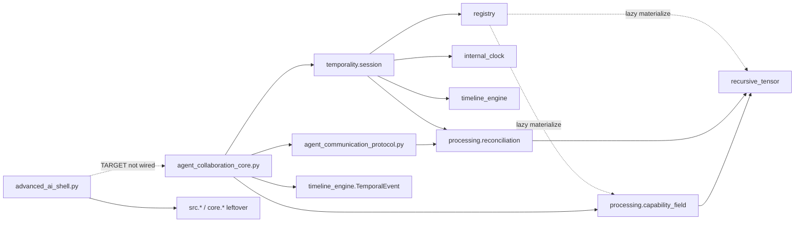

Solid arrows are CONFIRMED imports on `fdd81ff`. Dashed registry arrows are lazy `_default_materialize` (`temporality/registry.py` **626** / **634**). Heart C is TARGET.

**CONFIRMED one-way (agents → substrate).** Grep on `processing/` for `from temporality` / `from agent_`: zero. Grep on `temporality/` for `from agent_`: zero.

| Importer | Import | Lines |
| --- | --- | --- |
| `agent_collaboration_core.py` | `agent_communication_protocol` | 35–55 |
| `agent_collaboration_core.py` | `processing.capability_field` | 56–64 |
| `agent_collaboration_core.py` | `temporality.session` (`BranchHandle`, `TemporalSession`) | 65 |
| `agent_collaboration_core.py` | `temporality.timeline_engine.TemporalEvent` | 66 |
| `agent_communication_protocol.py` | `processing.reconciliation` | 36–40 |
| `temporality/session.py` | `processing.reconciliation` (wrappers) | 45 |
| `temporality/registry.py` | `CapabilityDelta` / `RecursiveTensor` (lazy) | 626, 634 |

**Agent plane leftover host imports = none.** Grep counts on both agent modules for `recursive_tensor_template`, `core.memory_core`, `vm_memory`, `src.memory_core`, `from core`, `from cas`, `from schemas`, `from src.`: all zero. Host *protocols* remain (`HostModelLoader` at **line 104**) so a future injector has a shape. `InProcessHostModel.generate` returns `HOST::{name}::LIVE` (**line 910**). That is a test double, not `src.memory_core`. Doctor check `live_path_import_hazard` was skip: already retargeted.

**Heart C leftover host imports (CONFIRMED island).** `advanced_ai_shell.py` still reaches out of this repository:

| Line | Statement | Gate |
| ---: | --- | --- |
| 89–105 | `from core import artifact_system`; `core.artifact_system.ArtifactManager`; `core.git_integration_module`; `projects.project_core.ProjectStatus` | only if `AI_SHELL_LOAD_EXTERNAL_INTEGRATIONS` in `{1,true,yes,on}`; `except Exception` → standalone |
| 113 | `from src.memory_core import MemoryManager, MemoryConfiguration, MemoryType, MemoryImportance` | `try` / `ImportError`; `MEMORY_AVAILABLE` |
| 120 | `from src.system_cache import SomnusCache, CacheNamespace, CachePriority` | `CACHE_AVAILABLE` |
| 127 | `from src.modifying_prompts import AutonomousPromptSystem` | leftover host |
| 134–135 | `src.artifacts.file_upload_system`; `src.artifacts.accelerated_file_processing` | leftover host |
| 5053 | `from src.memory_integration import SessionMemoryContext` | nested import |
| 700 | `collaboration_socket.bind(("127.0.0.1", collaboration_port))` | localhost listener |
| 1285–1296 | `_send_task_delegation` JSON `type: task_delegation` | not ACP |

Those `src.*` / `core.*` modules are **not** in this repo’s lift-out surface. Absence is expected on a guest densify. Heart C remains an island whether or not they import. `.cursor/discover_imports.py` still lists `recursive_tensor_template`, `vm_memory_system`, `core`, `cas`, `schemas` as hazard names to scan — that scanner is not runtime.

### 19.2 Turn procedure (operational)

1. Bind hub to a `TemporalSession` (refuse if unbound).
2. `select_who_acts(field, context, candidates, requirements=..., tick=master_tick)`.
3. `_bind_turn`: `open_speculative` → work on `BranchHandle` → `process_tick` → lease `CapabilityDelta` handles → `put_payload` summary → `accept` → `promote_handles` once.
4. On failure before accept: `abort_turn` / `reject` (dispose + reclaim).
5. Synthesis: `classify_contributions`; print `Measured relation`; escalate only on CONFLICTING.

### 19.3 Failure modes (source-backed)

| Mode | Symptom | Mitigation already in source |
| --- | --- | --- |
| Unbound session | `AgentPlaneError` | Refuse the turn |
| Sacred 0 as write target | abort + error | `_bind_turn` |
| Seed slot tick 0 | error | refuse overwrite |
| Tensor in event | TypeError or lossy `$type/$repr` | handles only |
| Sibling global restore | would rewind other worlds | reject is dispose+reclaim |
| Double promote | over-learn | promote once; do not restore `_apply_capability_blobs` |
| Costume ranking | latest cell as scalar | `DEFAULT_DECAY_KERNEL` required on who-acts |
| HOST:: as consensus | fake agreement | UNRESOLVED |
| Unknown bus UUID | silent fan-out | `BusDeliveryError` |
| Inbox after remove | leaked task | owned cancel |

### 19.4 Packet sequence (landed packet-local)

| Packet | Title | Exit (packet-local) |
| --- | --- | --- |
| P0 | Package skeleton and control plane | packages import |
| P1 | Normalize `RecursiveTensor.dimensions` | shape tuple |
| P2 | Payload registry | handles; 133× deepcopy |
| P3 | Bind clock to timeline | TimePoint stamps; restore internals |
| P4 | Sacred branch policy | merge in, never mutate 0 |
| P5 | Capability tensor routing | next-turn ranking change; no bypass |
| P6 | Merge reconciliation and consensus honesty | measured relation; grep-ban |
| P7 | Tensor heartbeat | live contraction ranking; last-axis conv |

P5–P7 are LANDED packet-local on `fdd81ff`. Operator gate remains NOT VERIFIABLE. Next slice is operator-defined (`TASK.md`).

---

## 20. HARD BANS AND OPEN QUESTIONS

### 20.1 Global hard bans (`PLAN.md` — hold across every packet)

1. Do not place a `RecursiveTensor` (or any non-JSON-safe object) inside `TemporalEvent.metadata`, `quantum_state`, or `process_tick` inputs. Handles only.
2. Do not remove or weaken the `copy.deepcopy` calls in `process_tick`.
3. Do not hand an agent a `TimelineEngine` reference. Agents receive branch handles.
4. Do not write to branch 0 from agent code. Merge into it, never mutate it directly.
5. Do not modify breath, harmonic, or `SACRED_RATIO` without explicit operator direction. `_advance_harmonic_field` runs every tick.
6. Do not replace `internal_clock`'s monotonic timebase with wall-clock reads.
7. No version pins in `requirements.txt`. No emojis. No mocks or stub substrate in tests: use real fixtures.
8. Do not claim a validation PASS when a prerequisite is missing. Report NOT RUN or NOT VERIFIABLE.

### 20.2 Open questions for the operator (`PLAN.md` — do not guess)

1. Gate command and harness path. `run_test-2.py` is the candidate; confirm location. **Still unanswered. NOT VERIFIABLE.**
2. Breath and harmonic: stay active when lifted, or become switchable? Ban 5 holds until answered.
3. Registry persistence across process restart: restored session need live payloads, or is the snapshot copy sufficient?
4. Whether `rcf_operator` stays pure w.r.t. shared state, or the capability tensor is guarded separately.

This whitepaper does not answer them.

---

## 21. SCHEMA AND ERROR REGISTRY

### 21.1 Errors (raised on the live path)

| Type | Module | Typical cause |
| --- | --- | --- |
| `TemporalConstraintError` | timeline_engine | schema, branch lifecycle, dispose sacred 0 |
| `TimelineError` | timeline_engine | engine closed |
| `SerializationError` | timeline_engine | nest > 64; non-finite float |
| `TemporalSessionError` | session | empty agent_id; sacred write outside gate; accept flush failure |
| `PayloadRegistryError` | registry | unknown handle; empty branch_id |
| `CapabilityFieldError` | capability_field | rank-0 window; empty kernel; missing get_payload; auto-create context from delta refused |
| `CapabilityIndexError` | hub select_who_acts | empty requirement vector |
| `AgentPlaneError` | hub | unbound session; missing handle; sacred 0; seed tick 0 |
| `BusDeliveryError` | MessageBus | unregistered UUID; unhandled sub_type |
| `ReconciliationError` | reconciliation | mismatched support; bad threshold; bad schema |
| `ModelHostUnavailable` | agent plane | host/model loader (subclass of AgentPlaneError) |

### 21.2 Lease statuses

| Constant | Value |
| --- | --- |
| `LEASE_SPECULATIVE` | `"speculative"` |
| `LEASE_SACRED` | `"sacred"` |
| `LEASE_SHARED` | `"shared"` |

### 21.3 ACP task type

`TASK_DELEGATION_TYPE = "task_delegation"`. Subtypes observed on the live bus: `proposal`, `acceptance`, `completion`. Unknown subtype fails delivery (`unknown_subtype_fails_delivery_and_joins`).

Heart C uses a localhost frame also named `task_delegation`. Same English word. Different heart. Do not unify by string match.

---

## 22. CHANGE LOG

| Version | SHA / date | What changed | What did not |
| --- | --- | --- | --- |
| v0.2 | 2026-09-18 19:41Z | Three hearts; CONFIRMED vs TARGET vs IN-FLIGHT | P5 not landed; hub import broken at that freeze |
| v0.3 | `6331336` | Heart A bind: `_bind_turn`; no hub ranking class | P5 still DRAFT in TASK; route still costume-adjacent |
| v1.0 | `fdd81ff` structure pass | Sign-off: subsystem frontier; P5–P7 packet-local | Operator gate; Heart C; wider Somnus |
| v1.1 | `91e499e` thicken | Spec density: threat, matrices, class/state/sequence, source contracts, packet logs | Sign-off boundaries; palette; no invented packets |
| v1.2 | second pass | Field-geometry SVG; who-acts walk; `SPEC.md` stamped as the named whitepaper | Sign-off; operator gate still NOT VERIFIABLE |

Companions: `PLAN.md` (measured decisions), `TASK.md` (dispatch — active packet none), `AGENTS.md` (router), `CONTEXT.md` (live snapshot; may still say v0.3 — source/`fdd81ff` wins), `NOTEPAD.md` (append-only ledger), `docs/intelligence/OMNISCIENT.md`.

**Reading order.** `AGENTS.md` (router) → `TASK.md` (no active packet) → this file → `PLAN.md` D1–D6 → the named source module → newest `NOTEPAD.md` entry → a named `test/*/runs/*/result.md`. Do not start at `filetree.md` and wander.

This file is synonymous with a `SPEC.md`. It is not runtime.

---

## 23. FIELD GEOMETRY — SECOND PASS

This section is the rolling expand after omniscient and defense-doc stopped. It does not reopen the sign-off. It makes the algebra visible.

<div align="center">

<svg width="880" height="360" viewBox="0 0 880 360" xmlns="http://www.w3.org/2000/svg" role="img" aria-label="Capability field four axes">
  <defs>
    <linearGradient id="pass2-bg" x1="0%" y1="0%" x2="100%" y2="100%">
      <stop offset="0%" stop-color="#1a0518"/>
      <stop offset="100%" stop-color="#4a044e"/>
    </linearGradient>
    <linearGradient id="pass2-tick" x1="0%" y1="100%" x2="0%" y2="0%">
      <stop offset="0%" stop-color="#9f1239"/>
      <stop offset="100%" stop-color="#f9a8d4"/>
    </linearGradient>
  </defs>
  <rect width="880" height="360" fill="url(#pass2-bg)" rx="14"/>
  <text x="440" y="36" text-anchor="middle" font-family="'Courier New', monospace" font-size="16" fill="#f9a8d4" letter-spacing="4">C [ agent , capability , context , tick ]</text>
  <rect x="70" y="70" width="160" height="200" fill="#3b0a3a" stroke="#e11d74" rx="8"/>
  <text x="150" y="100" text-anchor="middle" font-family="'Courier New', monospace" font-size="13" fill="#fb7185">AGENT 0</text>
  <text x="150" y="160" text-anchor="middle" font-family="'Courier New', monospace" font-size="11" fill="#fecdd3">who may act</text>
  <text x="150" y="190" text-anchor="middle" font-family="'Courier New', monospace" font-size="11" fill="#e879f9">retired slots stay</text>
  <rect x="260" y="70" width="160" height="200" fill="#4a044e" stroke="#e879f9" rx="8"/>
  <text x="340" y="100" text-anchor="middle" font-family="'Courier New', monospace" font-size="13" fill="#e879f9">CAPABILITY 1</text>
  <text x="340" y="160" text-anchor="middle" font-family="'Courier New', monospace" font-size="11" fill="#fecdd3">contract here</text>
  <text x="340" y="190" text-anchor="middle" font-family="'Courier New', monospace" font-size="11" fill="#c084fc">requirement vector</text>
  <rect x="450" y="70" width="160" height="200" fill="#701a75" stroke="#c084fc" rx="8"/>
  <text x="530" y="100" text-anchor="middle" font-family="'Courier New', monospace" font-size="13" fill="#c084fc">CONTEXT 2</text>
  <text x="530" y="160" text-anchor="middle" font-family="'Courier New', monospace" font-size="11" fill="#fecdd3">project here</text>
  <text x="530" y="190" text-anchor="middle" font-family="'Courier New', monospace" font-size="11" fill="#f9a8d4">hub ontology</text>
  <rect x="640" y="70" width="160" height="200" fill="#831843" stroke="#f472b6" rx="8"/>
  <text x="720" y="100" text-anchor="middle" font-family="'Courier New', monospace" font-size="13" fill="#f472b6">TICK -1</text>
  <text x="720" y="160" text-anchor="middle" font-family="'Courier New', monospace" font-size="11" fill="#fecdd3">convolve last</text>
  <text x="720" y="190" text-anchor="middle" font-family="'Courier New', monospace" font-size="11" fill="#fb7185">master_tick only</text>
  <text x="440" y="310" text-anchor="middle" font-family="'Courier New', monospace" font-size="12" fill="#fbcfe8">window → project → convolve → contract  ·  score is not the latest cell</text>
  <text x="440" y="338" text-anchor="middle" font-family="'Courier New', monospace" font-size="11" fill="#9f1239">DEFAULT_DECAY_KERNEL (0.05, 0.10, 0.20, 0.28, 0.37)</text>
</svg>

</div>

One score, walked:

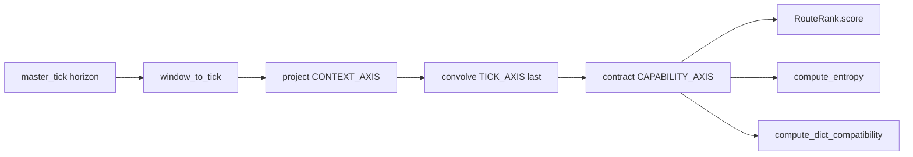

If convolution is disabled, the leader is the latest cell. That is the costume the P7 / RTA landings forbade. `select_who_acts` therefore hard-passes `DEFAULT_DECAY_KERNEL`.

---

<div style="background:#0d1117;border:1px solid #9f1239;border-radius:8px;padding:16px 20px;margin:22px 0;font-family:'Courier New',monospace;color:#fecdd3;">
  <div style="color:#e879f9;letter-spacing:4px;font-size:10px;margin-bottom:10px;">ASSESSMENT</div>
  <div><span style="color:#f472b6;">Target</span> &nbsp; Sacred Timeline Substrate — in-process runtime</div>
  <div><span style="color:#f472b6;">Freeze</span> &nbsp; origin/main fdd81ff · 2026-09-19</div>
  <div><span style="color:#f472b6;">Verdict</span> &nbsp; <span style="color:#f9a8d4;">SUBSYSTEM FRONTIER SIGNED — packet-local</span></div>
  <div><span style="color:#f472b6;">Refuse</span> &nbsp; operator-gate PASS · Heart C as ACP · wider Somnus done</div>
  <div><span style="color:#f472b6;">Thicken</span> &nbsp; Daeron defense-doc v1.1 · omniscient concurrent · source wins</div>
</div>

<div align="center">

<svg width="720" height="56" viewBox="0 0 720 56" xmlns="http://www.w3.org/2000/svg">
  <defs>
    <linearGradient id="omni-foot" x1="0%" y1="0%" x2="100%" y2="0%">
      <stop offset="0%" stop-color="#1a0518"/>
      <stop offset="100%" stop-color="#7a1048"/>
    </linearGradient>
  </defs>
  <rect width="720" height="56" fill="url(#omni-foot)" rx="8"/>
  <text x="360" y="34" text-anchor="middle" font-family="'Courier New', monospace" font-size="12" fill="#f9a8d4" letter-spacing="3">DAERON  ·  SPEC THICKEN  ·  NOT AN OPERATOR-GATE PASS</text>
</svg>

</div>
