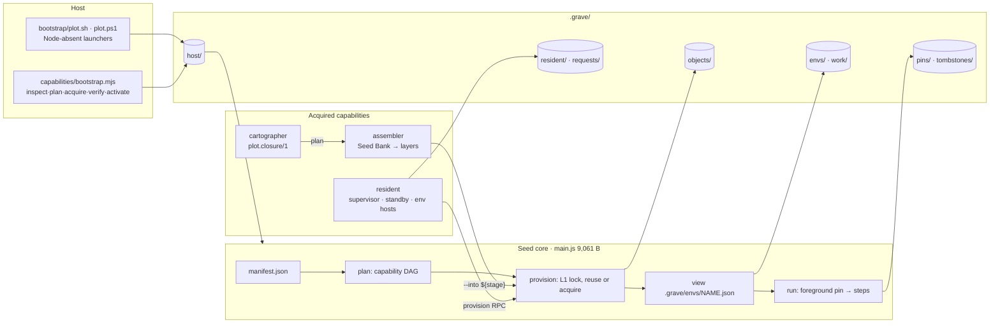

<div align="center">

<svg width="920" height="248" viewBox="0 0 920 248" xmlns="http://www.w3.org/2000/svg" role="img" aria-label="Somnus Plot architecture banner">
  <defs>
    <linearGradient id="plot-banner-soil" x1="0%" y1="0%" x2="100%" y2="100%">
      <stop offset="0%" stop-color="#07090c"/>
      <stop offset="40%" stop-color="#14181d"/>
      <stop offset="72%" stop-color="#2a2016"/>
      <stop offset="100%" stop-color="#6b4a1f"/>
    </linearGradient>
    <linearGradient id="plot-banner-text" x1="0%" y1="0%" x2="100%" y2="0%">
      <stop offset="0%" stop-color="#e7d3a8"/>
      <stop offset="50%" stop-color="#f5b94a"/>
      <stop offset="100%" stop-color="#9fd8c4"/>
    </linearGradient>
    <radialGradient id="plot-banner-flash" cx="50%" cy="40%" r="70%">
      <stop offset="0%" stop-color="#f5b94a" stop-opacity="0.30"/>
      <stop offset="100%" stop-color="#0d1117" stop-opacity="0"/>
    </radialGradient>
  </defs>
  <rect width="920" height="248" fill="#0d1117" rx="16"/>
  <rect x="2" y="2" width="916" height="244" fill="url(#plot-banner-soil)" rx="14" opacity="0.94"/>
  <ellipse cx="190" cy="44" rx="220" ry="90" fill="url(#plot-banner-flash)"/>
  <line x1="60" y1="214" x2="860" y2="214" stroke="#6b4a1f" stroke-width="1" opacity="0.7"/>
  <line x1="60" y1="222" x2="860" y2="222" stroke="#6b4a1f" stroke-width="1" opacity="0.45"/>
  <line x1="60" y1="230" x2="860" y2="230" stroke="#6b4a1f" stroke-width="1" opacity="0.25"/>
  <text x="460" y="78" text-anchor="middle" font-family="'Courier New', ui-monospace, monospace" font-size="42" font-weight="700" fill="url(#plot-banner-text)" letter-spacing="9">SOMNUS PLOT</text>
  <text x="460" y="116" text-anchor="middle" font-family="'Courier New', ui-monospace, monospace" font-size="20" fill="#e7d3a8" letter-spacing="8">THE SEVENTH FLASH</text>
  <line x1="210" y1="138" x2="710" y2="138" stroke="#f5b94a" stroke-width="2" opacity="0.5"/>
  <text x="460" y="164" text-anchor="middle" font-family="'Courier New', ui-monospace, monospace" font-size="13" fill="#d6c7a1" letter-spacing="3">ARCHITECTURE / SPEC  ·  v0.7.0  ·  DOC v1.0</text>
  <text x="460" y="190" text-anchor="middle" font-family="'Courier New', ui-monospace, monospace" font-size="12" fill="#9fd8c4">9,061 / 9,063 bytes  ·  acquire into the grave  ·  compose, never enlarge  ·  six-millisecond bell</text>
  <text x="460" y="208" text-anchor="middle" font-family="'Courier New', ui-monospace, monospace" font-size="10" fill="#8a6a3a" letter-spacing="4">SOMNUS FLASH  ·  DAERON BLACKFYRE  ·  THE COLONY</text>
</svg>

</div>

<p align="center">
  
  
  
  
</p>

---

**Author:** Daeron Blackfyre and the Wonderful Mailmen in the Mail-Room
**Program:** Somnus Flash (Plot is the first Flash experiment; see `docs/Plot-Fable.md`)
**Version described:** somnus-plot `0.7.0` "The Seventh Flash", closed 2026-10-22 by operator acceptance with named exceptions
**This document:** v1.2, 2026-11-05
**Classification:** INTERNAL (default)

This file is the **architecture spec** for Plot. It describes what the code on disk does. It does not replace the source, the tests or the evidence, and when it disagrees with them, they win.

| This file | Does |
| --- | --- |
| `ARCHITECTURE.md` | Living spec. Topology, components, schemas, contracts, hazards, evidence pointers |
| `AGENTS.md` | Session bootstrap and execution router. Not runtime |
| `docs/Plot-Fable.md` | Constitutional narrative. Operator canon |
| `docs/MEMORY.md` | Durable laws and vocabulary |
| `docs/V07-CONTRACTS.md` | Frozen v0.7 shared interfaces (contracts v1.10). Authoritative for wire/disk formats |
| `STAGE-1.md` | Acquisition, view and Python-tenant contract (v0.5 origin, still current) |
| `PERSISTENT-NATIVE.md` | Resident command surface, ownership, recovery and limits (v0.6 origin, v0.7 additions) |
| `WHITEPAPER.md` | v0.7 closeout paper (v1.1). Measured tables and open items O-1..O-19 |
| `PLAN.md` | v0.6 → v0.7 design history. Not current authority |
| `TASK.md` | Packet board (P07-00..P07-09, all landed) |
| `docs/NOTEPAD.md` | Append-only execution ledger |
| `evidence/` | Generated evidence of record (2026-10-22). Never hand-edited |

| Label | Meaning |
| --- | --- |
| CONFIRMED | In source and exercised by a named suite in `evidence/` |
| REPRODUCED | Re-run outside the evidence host for this document (§9.3) |
| INFERRED | Read from code; no dedicated check cited |
| NOT RUN | Route exists; never executed on that host |
| NAMED EXCEPTION | Unmet gate closed by operator acceptance. Not a pass (Law 11) |

---

## TABLE OF CONTENTS

1. [Executive Summary](#1-executive-summary)
2. [System Flow](#2-system-flow)
3. [Core Technical Innovations](#3-core-technical-innovations)
4. [Component Catalog](#4-component-catalog)
5. [Data Structures and Schemas](#5-data-structures-and-schemas)
6. [Integration Challenges](#6-integration-challenges)
7. [Operational Hazards](#7-operational-hazards)
8. [Security and Threat Considerations](#8-security-and-threat-considerations)
9. [Validation](#9-validation)
10. [Roadmap](#10-roadmap)
11. [Glossary](#11-glossary)
12. [Change Log](#12-change-log)

---

## 1. EXECUTIVE SUMMARY

### 1.1 Architectural intent

Plot is a **seed that builds execution environments by composition**. A 9,061-byte Node standard-library core (`main.js`, generated from `src/plot.mjs`) reads a manifest, resolves a capability DAG, acquires each capability once into `.grave/objects/`, and binds a named **view** over those objects. Everything heavier than that is itself an acquired capability that lives outside the core:

- **resident** — a supervisor with single-use standby workers for isolated jobs, and Environment Hosts that keep Python/Node tenant heaps alive across turns.
- **cartographer** — a pure, offline npm dependency-closure planner.
- **assembler** — an offline wheel and npm layer installer reading from a read-only Seed Bank.
- **bootstrap** — host inspect → plan → acquire → verify → activate, plus launchers for hosts with no Node.

The governing idea from the Fable: *do not make Plot broader by putting more things inside it; make it better at finding the shortest chain by which small things become large capability.* The core does not grow with the catalog (Law 2). The byte ceiling is pressure, not a number to negotiate (Law 3).

Plot is a **laboratory experiment**. It has no assignment in broader Somnus; Somnus may learn from it but must not depend on it (Law 1). It is the first Flash experiment, not the Flash runtime and not the Flash package manager.

### 1.2 Governing laws (from `docs/MEMORY.md`, WHITEPAPER §4)

| # | Law | What it forces in code |
| --- | --- | --- |
| 1 | No assignment | No Somnus imports; no exported mandatory service |
| 2 | Core cannot grow with the catalog | All four capabilities live in `capabilities/` and are acquired |
| 3 | Byte ceiling pressure (9,063) | `build.mjs` fails above the ceiling; rebuild must be byte-identical |
| 4 | Derivable from bootstrap | No capability borrowed from a pre-provisioned host in proofs |
| 5 | Obsidian is the mountain, not the father | Scale reference only; Node stdlib only, `package.json` has no deps |
| 6 | Not a sandbox | `execution:"trusted"` + `permissions.spawn:true` required; fields are declarations |
| 7 | Six-millisecond bell | p95 < 6 ms per *named* boundary; cold/birth/execution never merged |
| 8 | Cross-device in grammar before proof | Unrun hosts are NOT RUN |
| 9 | No fabricated recovery | PIDs never signal targets; nothing replayed or silently restarted |
| 10 | No content hash as identity | Identity = recipe + host + dependency paths; SHA-256 is integrity only |
| 11 | Acceptance with named exceptions is not a pass | O-11/O-12/O-13 stay named and open |
| 12 | Synchronous ownership before submit returns | Satisfied by one durable `claimed.json` (operator, O-10) |

Law 11 in WHITEPAPER numbering is "strict wall between isolated jobs and stateful sessions"; MEMORY.md numbers the acceptance rule as 11. Both hold. This file follows MEMORY for 1–11 and lists the job/session wall in §3.5.

### 1.3 What v0.7 is allowed to say

v0.7 is **closed by operator acceptance with named exceptions** (2026-10-22). It may say:

- The seed composes environments from small acquired pieces at 9,061 bytes, deterministically. CONFIRMED.
- 146/146 suite checks passed on the Linux x64 evidence host and the full gate passed in a fresh Debian 12 container with Node absent. CONFIRMED.
- 8 of 9 frozen p95 < 6 ms boundaries passed on the evidence host. CONFIRMED.

It may **not** say: that sustained admission holds the bell (O-11, p95 16.365 ms), that any non-Linux family works (O-12), or that state survives power loss (O-13).

---

## 2. SYSTEM FLOW



### 2.1 Phase 1 — ignite

A host with Node runs `node main.js` directly. A host without Node runs `sh bootstrap/plot.sh` (or `plot.ps1`), which verifies a pinned Node archive against `SHA256SUMS`, unpacks it into `.grave/host/`, and execs the same seed. `node capabilities/bootstrap.mjs plan` reports every prerequisite, source, size and network need before anything is written. CONFIRMED on Linux x64; NOT RUN elsewhere (§9.4).

### 2.2 Phase 2 — plan and provision

`openPlot(root).provision(name, spec)` (`src/plot.mjs:80`):

1. Read the manifest (`:52`), require trusted execution (`:53`), expand the Python tenant into the reserved `python` and `python-packages` capabilities (`:55`).
2. Topologically order the requested capabilities, rejecting cycles and missing nodes, and select host-specific recipes through `on[platform/arch]`, `on[platform]`, `on['*']` (`:56`).
3. Take L1 (`mkdir .grave/.lock`), refusing if `.grave/.recovery` exists. Stamp `owner.json` with pid and every stage allocated.
4. For each capability compute `key = stable([recipe, [platform, arch], needs.map(path)])`. Reuse in order: the ledger entry; then any historical `.grave/objects/<cap>-*` whose `.plot.json` validates for that key (zero child spawns); otherwise acquire into a fresh `mkdtemp` stage and stamp `.plot.json` last.
5. Write the view, update `data.json` only if something changed, release the lock, and delete any unstamped stage in `finally`.

### 2.3 Phase 3 — run

`run(name, steps)` (`:99`) writes a `foreground` pin with the view's object paths, fsyncs its directory, **then** checks `.grave/tombstones/<obj>.json` for every path and fails `tombstoned` if prune has claimed one. Steps resolve against the view (`:95`): `python` is rewritten to the view interpreter with `-I -S` and an embedded runner that injects exactly one package layer and `PLOT_STATE`. The pin is removed in `finally`.

### 2.4 Phase 4 — resident (optional)

`node capabilities/resident.mjs start` launches a supervisor (`--serve`). From then on:

- **submit** leases a pre-booted standby (`--standby`), which durably writes `claimed.json` before the reply. The worker owns the job; the supervisor owns admission only.
- **activate** starts one Environment Host (`--env-host`) per incarnation with Python and/or Node tenants (`--tenant-node`) that keep their heaps across **interact** turns and across supervisor death.
- **prune** is a dry run unless `apply:true`, and never touches a pinned object.

### 2.5 Phase 5 — composition (v0.7)

The end-to-end suite proves the full chain on one fresh root: bootstrap acquires Node 24.22.0 and CPython 3.12.15 from the offline kit → `planWheels` and the cartographer emit `plot.closure/1` plans → seed recipes run the assembler `--into ${stage}` over an owned `--without-pip` venv → resident jobs and environments under the owned Node consume both layers. CONFIRMED (`tests/e2e.mjs`, 12/12, x64).

### 2.6 What this is not

Not a sandbox, VM, container runtime, package registry, or general npm/pip replacement. Not a Flash package manager. Not infrastructure other Somnus systems depend on.

---

## 3. CORE TECHNICAL INNOVATIONS

### 3.1 Identity by derivation, not content

An object's identity is the canonical JSON of its recipe, the host signature and the **paths** of its dependencies (`stable()` sorts object keys, `src/plot.mjs:12`). Two plots on the same host with the same recipe chain converge on the same key; a changed dependency produces a new key without hashing a single byte. SHA-256 appears only as an integrity check on downloads, wheels and kit archives. CONFIRMED (Law 10).

### 3.2 Complete-or-invisible publication

A stage becomes an object only when `.plot.json` is written last, atomically (`atom`: temp `wx` 0600 → fsync → rename → fsync parent, `:19`). `valid()` (`:62`) requires the record to parse, match the key, resolve inside `.grave/objects`, and point at an existing interpreter when it names one. A SIGKILLed installer leaves an unstamped stage that is never adopted. CONFIRMED (integration "interrupted publication not adopted"; e2e seed-publication crash).

### 3.3 Historical multi-version reuse at zero spawn

Switching a view from v1 to v2 and back does not reinstall anything: the scan finds the still-valid historical object and rebinds the ledger. `multi_version_switch` p95 0.495 ms with 0 child spawns. CONFIRMED.

### 3.4 Separating readiness from process birth

v0.6 spawned a worker *after* submit (~85–103 ms cold). v0.7 keeps a bounded pool of independent, single-use standby workers (`PLOT_RESIDENT_READY` 2, `MAX_STARTING` 2, `MAX_WAITING` 16). On submit the supervisor leases one synchronously; the standby writes the write-once `claimed.json` (owner, rid, rotated control endpoint) and only then does the supervisor reply. Warm reply p95 3.322 ms. Under sustained Poisson 10/s the 2/2 pool empties and p95 rises to 16.365 ms (O-11). Standby birth is about 42 ms (Node boot + eval ~26, setup ~7, claim warm-up ~6), so any arrival that finds the pool empty pays most of it.

### 3.5 Inverting view and job: resident environments

A passive view can be **activated** into a living incarnation: a detached Environment Host owning an env pin and direct-child tenants. Python tenants run `-I -S -u` with persistent globals and last-expression results; Node tenants run `vm.runInThisContext` with `__plot_session__`, `__plot_assets__` and `require`. Control is u32-length + JSON frames on **fd 3**; fd 1/2 are captured per turn with raw end-of-turn markers, so `os.write(1)`, a replaced `sys.stdout` and late output are attributed to the right turn.

The wall: `submit` never runs in a mutated heap. State reuse exists only inside `activate`/`interact` under an explicit incarnation token (`expectIncarnation`). Tenant death, host death or a deadline retires the incarnation `interrupted` with `stateEffect:"lost"`; nothing restarts with an empty heap. CONFIRMED (`tests/resident-env.mjs`, 21/21).

### 3.6 Pin-then-validate, lock-free

Readers protect objects by writing a pin file *before* validating; prune writes tombstone intents *before* re-reading pins. Whichever side moves second sees the other. Pins take no lock. The seed's foreground pin closed the last gap (ALARM 51 / O-15). CONFIRMED.

### 3.7 Closure planning before installation

The cartographer answers "what is the smallest capability closure that satisfies this environment?" from `package.json` documents and USTAR members alone, without executing package code, running lifecycle scripts or touching the network. Output is byte-identical across runs and corpus creation order. CONFIRMED (12/12).

---

## 4. COMPONENT CATALOG

| Component | Bytes | Lines | Role |
| --- | ---: | ---: | --- |
| `src/plot.mjs` → `main.js` | 12,216 → 9,061 | 110 | Seed core |
| `build.mjs` | 4,586 | — | Compactor; enforces ceiling and determinism |
| `capabilities/resident.mjs` | 70,243 | 328 | Supervisor, workers, standby, env hosts, tenants, prune |
| `capabilities/assembler.mjs` | 51,459 | 389 | Wheel/npm layer assembler, Seed Bank |
| `capabilities/bootstrap.mjs` | 37,922 | 325 | Host bootstrap |
| `capabilities/cartographer.mjs` | 31,126 | 325 | npm closure planner |
| `bootstrap/plot.sh`, `plot.ps1` | — | — | Node-absent launchers |
| `bootstrap/recipes/*.json` | — | — | Pinned node, python, git, zlib recipes (`plot.host-recipe/1`) |
| `bootstrap/hosts/certify.{sh,ps1}` | — | — | Host certification runners |
| `scripts/gate.sh` | 3,139 | — | Integrated gate |
| `adapters/cli/plot.mjs` | — | — | Extension: installable `plot` CLI and global root manager (not seed, not a capability; §4.9) |

Capability bytes are counted separately and do not count against the 9,063 ceiling.

### 4.1 `src/plot.mjs` — seed core

**Exports:** `openPlot(root)` → `{plan, provision, run, view, resolve}`. CLI: `node main.js [--root DIR] [run|plan|provision] [NAME] [CMD ARGS…]`.

| Symbol | Line | Contract |
| --- | ---: | --- |
| `stable` | 12 | Canonical JSON, object keys sorted |
| `id` | 13 | Names `[A-Za-z0-9_-]{1,64}` |
| `inside` | 14 | Path containment check |
| `syncdir`, `create`, `atom` | 17–19 | Durability primitives; no dir fsync on Windows (disclosed) |
| `exec` | 20 | Sync child; failure message falls back stderr → stdout → status |
| `probe` | 22 | Python identity `[executable, version, SOABI, platform]` |
| `untar` | 25 | Bounded gzip+USTAR (256 MiB, 100,000 entries); rejects absolute, `..`, `\`, `:` paths, duplicates, link ancestors, non-file/dir/symlink types; links created last |
| `runner` | 49 | Embedded Python runner: `-c`, `-m`, `--entry` console scripts, or a script path |
| `definitions` | 55 | Python tenant → reserved `python` (`pip:false` when no packages) + `python-packages` |
| `plan` | 56 | DFS topological order, cycle/missing detection, host recipe selection |
| `valid` | 62 | Object completeness (§3.2) |
| `expand` | 63 | `${root}`, `${stage}`, `${cap:NAME}` |
| `acquire` | 64 | Shallow venv over host Python, deep Python from TAR/https (256 MiB, sha256 optional), pip `--target` for packages, or literal `install` + `check` steps |
| `provision` | 80 | §2.2 |
| `view` | 94 | Rejects host change and missing assets |
| `resolve` | 95 | Step expansion, Python rewriting, `PLOT_STATE` |
| `run` | 99 | §2.3 |

### 4.2 `capabilities/resident.mjs` — resident

**Process roles (argv):** `--serve` supervisor · `--worker` job worker · `--standby <root> <slot>` single-use standby · `--acquire` cold acquisition · `--env-host` Environment Host · `--tenant-node` Node tenant.

**Exports:** `start(root, corePath)`, `request(endpoint, msg)`, `recover`, `fence`, `prune`, `cli`.

**Supervisor ops:** `submit`, `list`, `inspect`, `output`, `cancel`, `provision`, `recover`, `prune`, `ping`, `stop`, `activate`, `interact`, `env_inspect`, `deactivate`. Internal: `claim`, `ready`, `warm`, `done`, `alive`, `turn`, `shutdown`.

**CLI:** `start | stop | provision NAME SPEC | submit NAME CMD… | list | inspect ID | output ID STREAM OFF LEN | cancel ID | prune [JSON] | recover | request` (JSON on stdin). `--root DIR` selects another plot.

**Admission.** O(1): an admission map is rebuilt at serve start and reservation is synchronous. p50 3.022 ms with 1,000 historical jobs vs 2.926 ms empty. Capacity rejections are retryable, never silent.

**Reconciler.** 250 ms tick, 8 entries per tick, 500 ms budget, fenced by job status revision. A worker's done-notification goes only to the supervisor named in `submission.json`; after a supervisor replacement the reconciler settles the job (measured repair ~68–72 ms).

**Standby claim.** Lost ACK adopts `claimed.json`. A second worker is tried only when the first is proven gone without a claim; three proven-gone attempts fence the job `interrupted`. A live, silent standby yields `determinate:false` and keeps holding capacity. Standbys retire on `shutdown`, supervisor instance change, or 5 s unreachable.

**Environments.** 1 turn in flight + 8 queued (overflow `busy`, retryable); 1 MiB per stream per turn; default deadline 30 s. Tenants exit on fd-3 EOF.

**Recovery authority.** Identity is pid + birth (Linux: boot id + start ticks). Cancellation signals only the worker's own `ChildProcess` handle: SIGTERM, then SIGKILL after 500 ms. Descendants holding pipes are disconnected after 500 ms (`inheritedPipesClosed:true`), never signalled.

**Test hooks.** `PLOT_TEST_CLAIM_CRASH`, `PLOT_TEST_CLAIM_NOACK`, `PLOT_TEST_TURN_CRASH`, `PLOT_TEST_PRUNE_CRASH`. Each one requires a fresh marker file, and each is a self-SIGKILL, never a signal to a recorded PID.

### 4.3 `capabilities/cartographer.mjs` — dependency cartographer

**Exports:** `planClosure`, `inspectCorpus`, `parseVersion`, `parseRange`, `satisfies`, `compareVersions`, `serialize`. Emits `plot.closure/1`, `plot.corpus/1`.

Reads `dependencies`, `optionalDependencies`, `peerDependencies`, `bundleDependencies`, `bin`, `os`/`cpu`/`libc`/`engines`, and conditional `exports`/`imports` (resolved in manifest key order for `import` vs `require`). Diamonds collapse onto objects already in `.grave`; conflicting ranges keep distinct nodes with nested placement; peers resolve as siblings; host-incompatible and absent optional branches are pruned with exact reasons; cycles and missing mandatory deps fail closed with structured diagnostics. Unsupported range forms are reported, never guessed. `.tgz` corpora are read through gzip+USTAR (pax, scoped, bundled) without extraction. Writes nothing. No claim of dynamic-import completeness.

### 4.4 `capabilities/assembler.mjs` — offline assembler and Seed Bank

**Exports:** `verifyWheel`, `installWheels`, `assembleFromBank`, `assembleInto`, `planWheels`, `parseWheelName`, `compatibleTags`, `targetIdentity`, `readZip`, `LIMITS`, `AssemblyError`. Emits `plot.closure/1` wheel nodes and `plot.python/1` target identity.

No pip, ensurepip, npm or network: Node stdlib plus the target Python only. Wheels (PEP 427) are verified against `RECORD` digests and sizes before any write; incompatible ABI/platform/python tags are rejected before writing; traversal, symlink, special, duplicate and colliding entries are rejected; `.data` relocates purelib/platlib/scripts (with `#!python` rewrite)/data/headers; console and GUI entrypoints are generated (with an `sh` trampoline for interpreters on spaced paths). ZIP subset: stored + deflate, no zip64, no encryption, no multi-disk.

npm nodes publish one component object per `name@version` (option (a)). Reuse re-verifies recorded input digests and refuses `BANK_CHANGED` if bank bytes changed under unchanged names. Bank material is read-only to consumers. `planWheels` supports a PEP 440 subset (`== != >= <= > <`, comma-joined); extras, `~=`, `===`, wildcards and markers are recorded unsupported, not evaluated. glibc Linux wheel tags only.

Publication takes L1 and reclaims a dead-owner lock under L0 by archiving it to `.grave/interrupted/acquisition-*`.

### 4.5 `capabilities/bootstrap.mjs` — host bootstrap

**Exports:** `detect`, `loadKit`, `loadRecipes`, CLI. Subcommands `inspect | plan | acquire | verify | activate | kit`, each emitting its `plot.bootstrap-*/1` schema.

Recipes pin Node 24.22.0 (official binaries), CPython 3.12.15 (python-build-standalone `install_only`), zlib 1.3.2 and Git 2.56.0 (source build, `NO_CURL`, `NO_RUST`, `RUNTIME_PREFIX`, static zlib; needs host `sh`/`cc`/`make`). Every pin was verified against its publisher checksum list on 2026-10-20. Installs are user-local under `.grave/host/` through a slot lock (pid + birth, stale break under `.break`): stage → rename → probe → completion marker last. Downloads resume. No sudo, no package-manager mutation, no undeclared remote script.

### 4.6 `bootstrap/plot.sh` and `plot.ps1`

`plot.sh` masks `PATH` to 22 declared tools (no node), installs Node from `PLOT_KIT` or online, verifies sha256 and refuses on mismatch or Android, then execs `main.js`. `plot.ps1` mirrors the protocol for PowerShell 5.1 (CreateDirectoryW lock, ranged HttpWebRequest, Expand-Archive). It has only been parsed (pwsh 7.6.7 on Linux, 0 errors), never executed on Windows. NOT RUN.

### 4.7 `build.mjs` and `scripts/gate.sh`

`build.mjs` compacts `src/plot.mjs` into `main.js`, prints `{"core_bytes","ceiling_bytes"}` and fails above 9,063. Comments are stripped, so source comments cost no core bytes. `gate.sh` copies the tree into a disposable temp dir (tests rewrite evidence and `main.js`), checks that the rebuild equals the committed `main.js`, then runs integration → resident → resident-env → cartographer → assembler → bootstrap → e2e → package-smoke. `--bench` adds benchmarks. `--evidence` runs in place and regenerates `evidence/`.

### 4.8 Tests

| Suite | Checks | Evidence |
| --- | ---: | --- |
| `tests/integration.mjs` | 24 | `integration.json` |
| `tests/resident.mjs` | 41 | `resident-integration.json` |
| `tests/resident-env.mjs` | 21 | `resident-env.json` |
| `tests/cartographer.mjs` | 12 | `cartographer.log` |
| `tests/assembler.mjs` | 15 | `assembler.log` |
| `tests/bootstrap.mjs` | 21 | `bootstrap.log` |
| `tests/e2e.mjs` | 12 | `e2e.json` |
| `tests/package-smoke.mjs` | smoke | `package-smoke.json` |
| `tests/benchmark.mjs`, `resident-benchmark.mjs`, `v07-benchmark.mjs` | — | `*benchmark.json` |
| `tests/report.mjs` | — | `RESULTS.md` |

No mocks: real processes, sockets, wheels, a compiled CPython extension, and real TAR/ZIP fixtures (`tests/helpers.mjs`).

### 4.9 `adapters/` — extension surface (added 2026-11-05)

`somnus-plot-cli` 0.1.0, `bin: plot`, zero dependencies. A front door over the seed and the four capabilities, plus a manager that keeps `plot.registry/1` at `$PLOT_HOME/registry.json` (default `~/.plot`) listing one shared global root and any number of per-project `.plot/` roots. Root resolution: `--root` → `--global` → `PLOT_ROOT` → nearest `.plot/` up the tree → global. Project resolution reads the filesystem, so the registry is an index and never an authority. Objects are reused within a root's grave, not across roots. It adds nothing to `main.js` and edits nothing under `src/` or `capabilities/`. CONFIRMED by `adapters/test/cli.mjs` 17/17 (Linux aarch64, Node v22.23.3), which covers real resident jobs and a persistent Node session. The MCP server (`adapters/mcp/server.mjs`, stdio JSON-RPC 2.0, 19 tools, each a child run of the same CLI) is CONFIRMED by `adapters/test/mcp.mjs` 10/10, and `skills/plot/SKILL.md` gives agents a short when-to-invoke note. Details: `adapters/README.md`.

---

## 5. DATA STRUCTURES AND SCHEMAS

### 5.1 The grave

```
<root>/
├── manifest.json                 plot definition
├── data.json                     ledger: { assets: { <cap>: object record } }
└── .grave/
    ├── .lock/owner.json          L1 writer {pid, birth?, stages[]}
    ├── .recovery/                L0 recovery guard
    ├── objects/<cap>-XXXXXX/     acquired objects, each with .plot.json
    ├── envs/<name>.json          views
    ├── work/<name>/              per-view writable state (PLOT_STATE)
    ├── pins/*.json               reference pins
    ├── tombstones/               prune intents + moved objects
    ├── interrupted/acquisition-* archived stale locks (resources retained)
    ├── requests/<rid>.json       job rid lookups (write-once)
    ├── host/                     bootstrap-acquired tools
    └── resident/
        ├── .lock/                L2 supervisor singleton
        ├── service.json          endpoint, instance, token (private)
        ├── standby/<slot>/standby.json
        ├── jobs/<id>/            submission, claimed, control, status, stdout/stderr.log
        ├── acquisitions/<id>.json
        ├── reconciliation.json
        └── envs/<name>/          reserve, current.json, inc/<inc>/{instance,owner,control,status}.json, turns/, requests/
```

### 5.2 Object record (`.plot.json`)

```json
{"key":"[{recipe},[\"linux\",\"x64\"],[\"/abs/.grave/objects/python-AbC\"]]",
 "path":"/abs/.grave/objects/python-packages-XyZ",
 "python":"/abs/.grave/objects/python-AbC/bin/python3",
 "identity":["/…/python3","3.12.15 …","cpython-312-x86_64-linux-gnu","linux"]}
```

`python`/`identity` appear only on a Python runtime object. Assembler layers add `inputs[]` (recorded bank digests).

### 5.3 View (`.grave/envs/NAME.json`)

```json
{"schema":1,"host":["linux","x64"],"assets":{"<cap>":{"…object record…"}},
 "python":"/abs/…/bin/python3","packages":"/abs/…/python-packages-XyZ","state":"/abs/.grave/work/NAME"}
```

### 5.4 Pin (contracts §4)

```json
{"schema":1,"kind":"job|env|acquisition|foreground|explicit",
 "owner":{"pid":123,"birth":"bootid:ticks|null"},
 "ref":"<job id | env.incarnation | acquisition id | fg | label>",
 "paths":["/abs/.grave/objects/x-AbC"],"created":"ISO-8601"}
```

The file name is `<kind>-<ref-or-pid>-<random>.json`. The seed uses `foreground-<pid>-<hrtime ns>.json` to fit the ceiling.

### 5.5 Request record (contracts §5)

```json
{"rid":"…","kind":"submit|turn","target":"<job id | env/inc/turnId>","digest":"stable(request)","created":"ISO"}
```

Same rid + same digest returns the existing target. A different digest returns `request conflict`. If the record was evicted, the result is `request expired` (never re-executes).

### 5.6 Named schemas

| Schema | Producer | Consumer |
| --- | --- | --- |
| `plot.closure/1` | cartographer, `planWheels` | assembler |
| `plot.corpus/1` | cartographer `inspectCorpus` | diagnostics |
| `plot.python/1` | assembler `targetIdentity` | assembler tag selection |
| `plot.host/1` | bootstrap `detect` | plan |
| `plot.host-recipe/1` | `bootstrap/recipes/*.json` | bootstrap |
| `plot.kit/1` | `bootstrap kit` (`kit.json`) | bootstrap, `plot.sh`/`plot.ps1` via `SHA256SUMS` |
| `plot.bootstrap-{inspect,plan,acquire,verify,activate,kit}/1` | bootstrap CLI | operator, certify |
| `plot.registry/1` | `adapters/cli/plot.mjs` | `plot roots`, `plot maintain` |

The full field definitions are in `docs/V07-CONTRACTS.md` §§3–12.

### 5.7 Lock order (contracts §2)

| Rank | Lock | Scope |
| --- | --- | --- |
| L0 | `.grave/.recovery/` | Acquisition-lock reconciliation |
| L1 | `.grave/.lock/` | Object publication, ledger, views, tombstoning |
| L2 | `.grave/resident/.lock/` | Supervisor admission authority |
| L3 | env `reserve`, `requests/<rid>.json`, `claimed.json` (write-once) | One entity each |

Locks are acquired only in rank order. Pins are lock-free.

### 5.8 Environment variables

| Variable | Set by / read by | Meaning |
| --- | --- | --- |
| `PLOT_STATE` | seed, resident → steps | View writable state dir |
| `PLOT_JOB_STATE`, `PLOT_STEP_INDEX`, `PLOT_STEP_OUT` | resident → job steps | Per-job scratch and step conduit |
| `PLOT_ASSETS` | resident → tenants | Asset map |
| `PLOT_RESIDENT_READY` / `_MAX_STARTING` / `_MAX_WAITING` / `_MAX_ACTIVE` | operator | Pool 2 / 2 / 16, active cap 16 |
| `PLOT_KIT`, `PLOT_OFFLINE` | operator → bootstrap | Offline kit path, forbid network |
| `PLOT_REQUIRE_SEED_COUPLED`, `PLOT_ASSERT_LATENCY`, `PLOT_BENCH_QUICK` | operator → tests | Gate strictness / harness mode |

---

## 6. INTEGRATION CHALLENGES

| # | Seam | Current handling | Status |
| --- | --- | --- | --- |
| 6.1 | Seed ↔ assembler | Seed recipes call the assembler with `--into ${stage}`. The assembler publishes into the stage the seed stamps | CONFIRMED (assembler "seed capability recipe", e2e) |
| 6.2 | Cartographer → assembler | Dir sources skip their own `node_modules`/`.git`; bundled deps must appear as their own nodes with nested placement. Dir sources with non-null integrity are rejected as unverifiable | CONFIRMED |
| 6.3 | Bootstrap → seed | Same seed under acquired Node; `activate` exports tool paths | CONFIRMED x64 |
| 6.4 | Resident ↔ seed | Warm `provision` calls the core in-process after a cache check; cold acquisitions run in separate processes | CONFIRMED |
| 6.5 | Job pins vs owner death | The worker outlives the admitting supervisor, so job pins are released on durable terminal status, not owner death (LEAP 49) | INFERRED-by-design, tested |
| 6.6 | `sample-plan.json` portability | The fixture carries absolute corpus paths (rebased by the test) **and a pinned `linux/x64` target**, so it fails on any other arch | **Defect found 2026-11-05 (§9.3)** |
| 6.7 | Owned vs shallow Python | Assembler suite runs `shallow-host` only; owned-runtime is exercised in e2e. Warm-Python benchmark used host 3.14.4 (O-17) | Disclosed |

---

## 7. OPERATIONAL HAZARDS

| Hazard | Effect | Mitigation / note |
| --- | --- | --- |
| 2 bytes of core headroom | Any seed change needs bytes found first | Source comments are free; reclaim through responsibility moves, never by hiding payload (Law 3) |
| Sustained load empties the pool | p95 16.365 ms at 10/s (O-11) | Named exception. Tuning the pool cannot satisfy the frozen 2/2 row |
| tmpfs scratch on the evidence host | Durable-row timings exclude stable-storage fsync (O-19) | Re-measure with `TMPDIR` on disk |
| Uncertain jobs hold capacity | A live, silent worker blocks a slot indefinitely | The operator archives the job dir after proving its processes are gone |
| Submission metadata holds inherited env | It may contain credentials | Files are 0600/0700; never export `.grave/resident/jobs` |
| Node env tenant shares one event loop | A turn's timers outlive the turn | By design: the heap persists |
| Python `SystemExit` in a turn | Reported `failed`, not exit | Disclosed |
| Run-to-run spread on a non-idle desktop | Tuned row moved 4.572 → 6.295 ms between same-day runs | Cite only evidence files |
| `.grave` on Windows | No directory fsync | Disclosed in `atom` |

---

## 8. SECURITY AND THREAT CONSIDERATIONS

### 8.1 Trust model (CONFIRMED)

Plot executes **trusted** native code. `manifest.execution` must be `"trusted"` and `permissions.spawn` must be `true`, or provision and run refuse. `permissions.fs` is a declaration, not confinement. No CPU, RAM or network quotas exist. Tenants inherit OS authority.

### 8.2 What is enforced

- Archive extraction: path traversal, absolute paths, duplicates, link ancestors, special entries, size and count limits (seed `untar`, assembler ZIP, bootstrap extractors).
- Download and wheel integrity: sha256 pins, RECORD digests, declared-size checks.
- Resident endpoints: per-service and per-worker random tokens, loopback only, frames ≤ 1 MiB, ≤ 64 sockets per endpoint.
- Signals only to owned `ChildProcess` handles. Recorded PIDs are never targets.

### 8.3 STRIDE sketch (local, single-user)

| Threat | Surface | Position |
| --- | --- | --- |
| Spoofing | Standby adoption | Requires spawned pid + this supervisor's instance + live identity |
| Tampering | Seed Bank, kit | Digest re-verification, `BANK_CHANGED`, sha256 refuse |
| Repudiation | Jobs/turns | Write-once claim, request and outcome records |
| Information disclosure | `service.json`, `submission.json` | Private file modes; tokens kept out of evidence (sentinel checked) |
| DoS | Admission | Bounded pool, queue and active caps; retryable rejection |
| Elevation | Native steps | Out of scope: trusted execution (Law 6) |

### 8.4 Secrets

No secrets ship in the repo. Endpoint tokens must not be copied into prompts or shared logs.

---

## 9. VALIDATION

### 9.1 Gate

```sh
node build.mjs                 # {"core_bytes":9061,"ceiling_bytes":9063}
scripts/gate.sh                # disposable copy; all suites + smoke
scripts/gate.sh --bench        # + benchmarks
scripts/gate.sh --evidence     # in place; regenerates evidence/
```

Prerequisites: node, python3 with venv, pip and `Python.h`, cc. Bootstrap and e2e also need the offline kit (`$TMPDIR/plot-bootstrap-kit`) or network.

### 9.2 Evidence of record (2026-10-22, Linux 7.0.0-38 x64, Ryzen 5 5625U × 12, bare metal, Node v24.14.0, Python 3.14.4)

| Boundary (p95, ms) | Value | Gate |
| --- | ---: | --- |
| `view_lookup` | 0.170 | PASS |
| `cached_view_provision` (mixed) | 0.406 | PASS |
| `multi_version_switch` (0 spawns) | 0.495 | PASS |
| `resident_cached_view_rpc` | 0.680 | PASS |
| `durable_submit_and_claim` reply | 3.322 | PASS |
| `durable_submit_and_claim` control-ready | 3.364 | PASS |
| `warm_env_interact` python | 1.156 | PASS |
| `warm_env_interact` node | 0.899 | PASS |
| `sustained_submit` (2/2, Poisson 10/s, 1,200) | 16.365 | **FAIL — O-11** |
| control endpoint first answer | 10.918 | no gate |
| `sustained_submit_tuned` (4/4) | 6.295 | no gate |
| cold worker / complete job / cold acquisition / replenish | 45.4 / 28.8 / 20.7 / 46.1 | no 6 ms claim |
| `bootstrap_cold` | 1,877.6 | no 6 ms claim |

Saturation max stable rate: 35/s. Supervisor peak RSS: 75,528 KiB sustained, 102,220 KiB after saturation. Full tables are in WHITEPAPER §7.3 and `evidence/RESULTS.md`.

### 9.3 Reproduction outside the evidence host (2026-11-05)

Run on Linux **aarch64**, 2 vCPU, Debian (glibc 2.41), Node v22.23.3, Python 3.12.15, gcc 14.2.0. This is the first non-x64 run on record. It is **not** a `certify.sh` record and not evidence of record.

| Step | Result |
| --- | --- |
| `node build.mjs` | 9,061 B, byte-identical to shipped `main.js` — REPRODUCED |
| integration | 24/24 — REPRODUCED |
| resident | 41/41 — REPRODUCED |
| resident-env | 21/21 — REPRODUCED |
| cartographer | 12/12 — REPRODUCED |
| assembler | **14/15**: `cartographer sample-plan.json assembled` fails with `AssemblyError: closure target linux/x64 is not this host linux/arm64` (fixture pinned to x64; §6.6) |
| package-smoke | PASS — REPRODUCED |
| bootstrap | NOT RUN in effect: offline kit carried no `node-v24.22.0-linux-arm64` or aarch64 CPython; `plan` correctly reports both `blocked` |
| e2e | NOT RUN (needs kit) |

What this changes: the core, resident and cartographer behave the same on arm64 Linux, and the assembler failure is a test-fixture defect, not a code fault. This is still not a second **OS family**, so O-12 stays open.

### 9.4 Host matrix

| Host | Status |
| --- | --- |
| Linux x64 glibc, bare metal | RUN — 146/146, evidence of record |
| Linux x64, fresh Debian 12 container, Node absent | RUN — `certify.sh` 14/14 steps exit 0, gate PASS |
| Linux arm64 glibc | PARTIAL — §9.3, not certified |
| Windows x64 | NOT RUN (O-12) |
| macOS arm64/x64 | NOT RUN (O-12) |
| Android/Termux aarch64 | NOT RUN (O-12) |

### 9.5 Invariants and where they are checked

| Invariant | Check |
| --- | --- |
| Core ≤ 9,063, deterministic | gate `build` + `cmp` |
| Unstamped stages never adopted | integration, e2e publication crash |
| Historical reuse spawns nothing | `multi_version_switch` spawns = 0 |
| Run never spawns against a tombstoned object | integration "foreground pin" |
| Success only after durable worker ownership | resident claim checks, SIGKILL after reply |
| Lost ACK never makes a second worker | resident, e2e claim crash |
| Supervisor death preserves env heap | resident-env, e2e activation crash |
| Submit never shares a tenant heap | resident-env |
| Prune never evicts pinned objects; crash at intents/moved recovers | resident prune, e2e prune crashes |
| Planner output byte-stable | cartographer repeat check |

---

## 10. ROADMAP

v0.7 is canon to reuse and is not reopened for new scope. Open items that belong to Plot itself:

- **O-11** sustained admission p95: worker birth (~42 ms) or pool policy under the unchanged frozen workload.
- **O-12** a non-Linux family through `certify.sh` / `certify.ps1`.
- **O-13** power-loss and reboot durability.
- **O-17 / O-19** owned-runtime warm timing; disk-backed durable rows.
- **New, 2026-11-05:** make `tests/fixtures/closure/sample-plan.json` arch-neutral, and add linux-arm64 to the kit so bootstrap/e2e can run on arm64.

Horizon numbering (v0.8–v1.0 vs v10) is deferred by the operator. The next stage takes a new form.

### Explicit non-goals for this document

This document does not define the Flash Program, Flash Packs or a Flash package manager. Plot is cited there as a lineage exemplar, not a dependency.

---

## 11. GLOSSARY

| Term | Meaning |
| --- | --- |
| Plot | The seed: `main.js` + `manifest.json` + its root |
| Seed / core | `main.js`, generated from `src/plot.mjs`, under the 9,063-byte ceiling |
| `.grave/` | Where acquired things persist after the process that summoned them dies |
| Object | A stamped, immutable-by-contract acquisition under `.grave/objects/` |
| View | Named environment `.grave/envs/NAME.json` over shared objects plus own state |
| Tenant | A runtime living in the grave (Python; Node in resident envs) |
| Shallow / deep Python | venv over host Python / owned runtime extracted from TAR |
| Resident | Optional acquired supervisor capability |
| Standby | Pre-booted single-use worker awaiting a claim |
| Incarnation | One live activation of an environment; retired, never revived |
| Pin / tombstone | Reader's protection record / prune's deletion intent |
| Seed Bank | Read-only local store of wheels and npm archives the assembler draws from |
| Closure | Smallest set of capability nodes satisfying a request (`plot.closure/1`) |
| Flash | A tiny ignition that makes a much larger capable world constructible without carrying it |
| Six-millisecond bell | p95 < 6 ms per named boundary |
| Named exception | Unmet gate accepted by the operator and kept open |

---

## 12. CHANGE LOG

| Date | Doc | Change |
| --- | --- | --- |
| 2026-11-05 | v1.2 | §4.9: MCP server + agent skill landed |
| 2026-11-05 | v1.1 | Added §4.9 adapters (`plot` CLI + global manager) and `plot.registry/1` |
| 2026-11-05 | v1.0 | First consolidated spec for v0.7.0, written against the shipped tree (closeout 2026-10-22). Adds the arm64 reproduction (§9.3) and the `sample-plan.json` arch defect (§6.6) |
