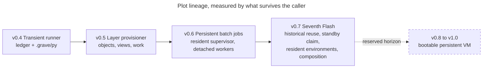
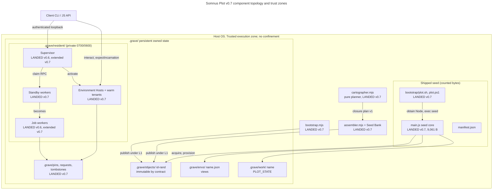
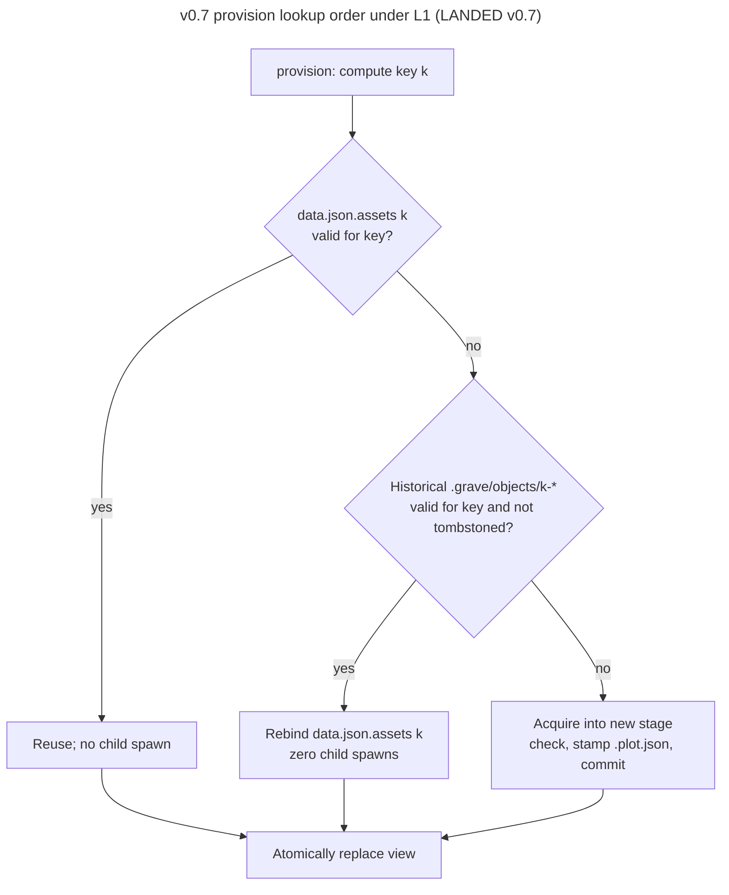
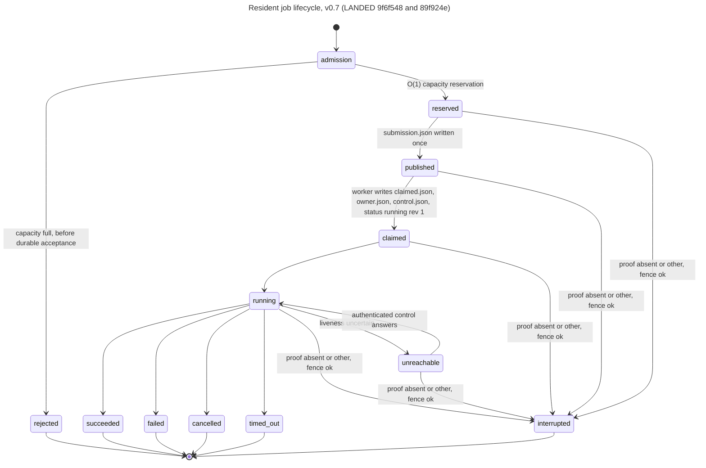
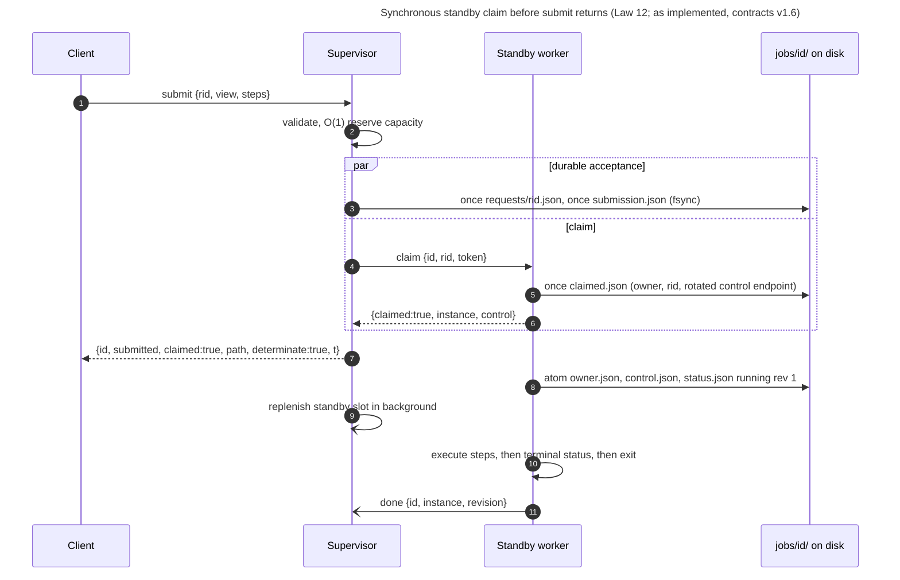
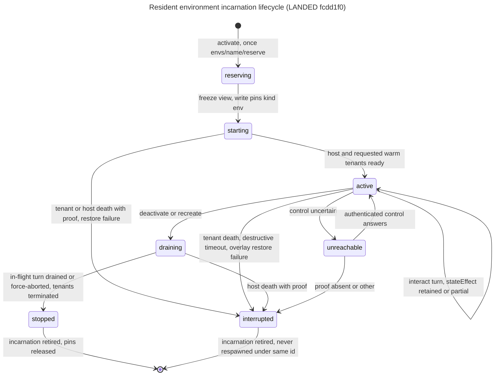
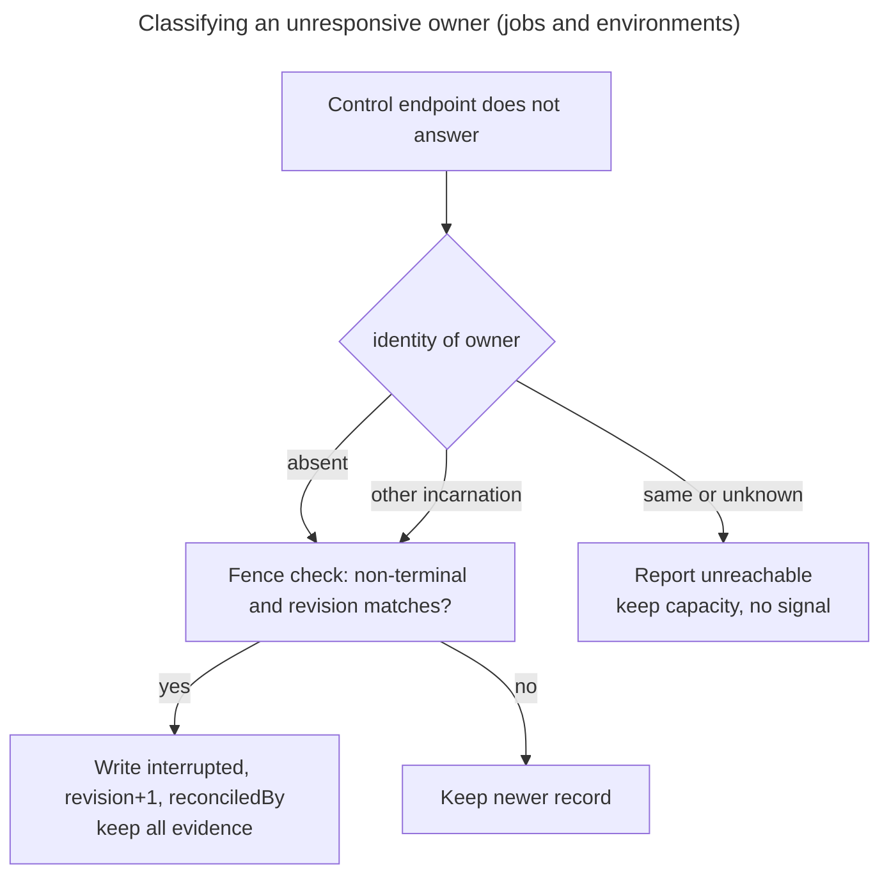

# Somnus Plot v0.7 "The Seventh Flash": A Seed That Composes Execution Environments

```
DOCUMENT TITLE   Somnus Plot v0.7 Completed-System Whitepaper (Closeout)
Classification:  INTERNAL (default; no classification was supplied)
Version:         1.1 (closeout)
Date:            2026-10-22
Author/Origin:   chronicler-1 (skeleton, v0.1); Keeper (P07-08 results, v1.0; closeout, v1.1)
Status:          v0.7 CLOSED by operator acceptance (2026-10-22) with named exceptions
                 O-11, O-12 (non-Linux families) and O-13 (App C). Acceptance with named
                 exceptions is not a pass: one frozen gate FAILS (§7.3) and non-Linux
                 families are NOT RUN. Not cross-host verified.
Scope:           PLAN.md P07-08 / §8.2 "Whitepaper" row. Every v0.7 number is copied from
                 evidence generated by scripts/gate.sh --evidence on 2026-10-22 [E7].
```

> **STATUS NOTICE.** Every v0.7 mechanism in Section 5 has landed in a named commit and is covered by generated evidence [E7]. Every v0.7 number in this paper is copied from `evidence/*.json` or `evidence/RESULTS.md` produced by `scripts/gate.sh --evidence` on the evidence host (§7.1). v0.7 is closed by operator acceptance with named exceptions, and each exception stays visible: the frozen `sustained_submit` p95 gate FAILS (16.365 ms against 6 ms; O-11); Windows, macOS and Android/Termux are NOT RUN (O-12); power loss and reboot are untested (O-13). Linux ran on the evidence host and in a fresh Debian 12 container. v0.6 numbers remain labelled **v0.6 evidence of record**.

---

## 0. Document Control and Provenance

### 0.1 How each claim is known

Every claim in this paper carries one provenance tag. A claim with no tag is editorial framing, not a technical assertion.

| Tag | Source | Epistemic standing |
| --- | --- | --- |
| **[E6]** | `evidence/RESULTS.md` as of commit `b72a98d` (`git show b72a98d:evidence/RESULTS.md`), generated by `tests/report.mjs` from the 2026-10-17 v0.6 runs | v0.6 evidence of record. Measured on the host stated in that file. Not re-run. The working-tree `evidence/RESULTS.md` is now the v0.7 report [E7]. |
| **[E7]** | `evidence/*.json`, `evidence/*.log` and `evidence/RESULTS.md` generated by `scripts/gate.sh --evidence` on 2026-10-22 (v0.7 benchmark run 08:13:33Z–08:23:32Z) | v0.7 evidence of record. Linux x64 only: the evidence host (§7.1), plus the fresh-container certification record in `bootstrap/hosts/records/`. The earlier 2026-10-20 run on the P07-00 Xeon KVM guest is superseded and stays readable at `git show 3613c3d:evidence/`. |
| **[E5]** | `baseline/v0.5-evidence/` and `docs/MEMORY.md` version lineage | v0.5 evidence of record (frozen lineage). Not re-run. |
| **[B4]** | `baseline/REPORT.md` (v0.4 audit, 2026-10-12) | Hands-on audit of the original v0.4 archive. Not re-run. |
| **[K5]** | `STAGE-1.md` (v0.5 contract) | Contract text for behavior that v0.5 implemented and tested. |
| **[K6]** | `PERSISTENT-NATIVE.md` (v0.6 contract) | Contract text for behavior that v0.6 implemented and tested. |
| **[C7]** | `docs/V07-CONTRACTS.md`, contracts v1 (P07-00 freeze) | Frozen interface. It specifies design and does not certify behavior. §0 of that file records facts the P07-00 coordinator observed on 2026-10-20. |
| **[P7]** | `PLAN.md` (v0.7 master plan, 2026-10-20 edition) | Operator-supplied specification. It describes required outcomes and candidate mechanisms. Its v0.6 figures are described there as "supplied baseline claims". |
| **[L]** | `docs/MEMORY.md` laws, citing `docs/Plot-Fable.md` | Durable law. |
| **[T]** | Observed directly by the author during drafting (v0.1), result filling (v1.0) or closeout (v1.1) | Limited to: `package.json` declares version `0.7.0` with no dependencies; `node --version` returned `v24.22.0` on the v1.0 host; host facts in §7.1 read from `/proc/meminfo`, `findmnt`, `systemd-detect-virt`, `/sys/class/power_supply` and `/sys/block` (v1.1) and `python3 --version`; byte counts from `wc -c`; commit hashes from `git log`. |

**Status tags.**

- **[LANDED v0.7 `<commit>`]**: implemented in that commit and covered by [E7].
- **[DESIGN — pending implementation evidence]**: specified in [P7]/[C7]. No landed code or test proves it. (No Section 5 mechanism carries this tag in v1.0.)
- **[UNVERIFIED — CONFIRM BEFORE OPERATIONAL USE]**: asserted by a source but not measured or traced.
- **[REQUIRES INPUT]**: a gap only the operator or a later packet can fill.
- **[CONTRADICTION — CONFIRM BEFORE OPERATIONAL USE]**: two sources disagree. Both readings are given.
- **NOT RUN** / **NOT VERIFIABLE**: the host lane did not execute, or it cannot execute in the available environment (Law 8).

### 0.2 State of the record for v1.1 of this paper

| Item | State | How known |
| --- | --- | --- |
| Version | 0.7.0 "The Seventh Flash" | [T] `package.json`, `manifest.json` |
| v0.7 packets | P07-00 `d97981f`/`e4665cd`; P07-01 `2b9b384`; P07-02 `eef36b8`; P07-03 `c323f7d`; P07-04 `9f6f548`; P07-05 `89f924e`; P07-06 `fcdd1f0`; P07-07 `dca7cb2`; P07-09 `7e13d89`; P07-08 `3613c3d`; closeout changes (O-15 seed fix, test-defect fixes, tuned sustained row) on top of `7c266f1` (App D 1.1) | [T] `git log` |
| Functional checks | 146/146 PASS (24 core integration, 41 resident, 21 resident environments, 12 end-to-end, 12 cartographer, 15 assembler, 21 bootstrap); clean-package smoke PASS (2026-10-22) | [E7] |
| v0.7 frozen workloads | Run valid. 8 of 9 p95 < 6 ms boundaries PASS; `sustained_submit` successful p95 FAIL (16.365 ms; named exception O-11) | [E7] `v07-benchmark.json`, §7.3 |
| Host families | Linux x64 glibc RUN on the evidence host and in a fresh Debian 12 container; Windows, macOS, Android/Termux NOT RUN (named exception O-12) | [E7]; §7.3-E |
| PLAN §8.3 status reached | v0.7 closed by operator acceptance (2026-10-22) with named exceptions O-11, O-12 and O-13; O-10 accepted. Integrated candidate, evidence-host measured with one FAIL row. Not cross-host verified. The strict §8.3 "v0.7 complete" status (every applicable §8.2 row passing) is not reached | Operator decision 2026-10-22; this paper |

---

## Table of Contents

1. Abstract
2. Problem Formulation
3. Lineage: v0.4 to v0.7
4. Constitutional Laws 1–12
5. System Architecture
   - 5.1 Topology and trust zones
   - 5.2 Seed core
   - 5.3 Acquisition and historical reuse
   - 5.4 Views
   - 5.5 Resident jobs
   - 5.6 Standby claim
   - 5.7 Resident environments
   - 5.8 Pins, prune and tombstones
   - 5.9 Dependency Cartographer
   - 5.10 Offline Assembler and Seed Bank
   - 5.11 Host bootstrap
   - 5.12 Lock order and durability primitives
6. Failure Boundaries and Non-Claims
7. Evaluation Methodology
8. Reproducibility
9. Horizon: v0.8 to v1.0
- Appendix A. Glossary
- Appendix B. Source register
- Appendix C. Open items and LEAPs
- Appendix D. Change log

---

## 1. Abstract

Somnus Plot is a Node.js seed whose shipped core (`main.js`, 9,061 bytes against a 9,063-byte ceiling, standard library only) constructs, persists and executes environments by composing material it acquires into `.grave/`, instead of carrying that material. v0.7 adds, as separately counted acquired capabilities: historical exact-key object reuse; a pure dependency cartographer; an offline layer assembler over a local Seed Bank; a host bootstrap that acquires pinned Node, Python and Git; an O(1) admission map with a fenced reconciler; pin-safe prune with crash-recoverable tombstones; single-use standby workers that durably claim a job before `submit` replies; and named Resident Environments whose Python and Node tenants keep their heaps across turns and supervisor restarts.

On one Linux x64 evidence host (bare-metal AMD Ryzen 5 5625U, 12 logical CPUs; test and benchmark scratch on tmpfs `/tmp`), 146 of 146 functional checks pass, including twelve end-to-end crash-injection checks over a kit-acquired runtime. The full host certification, gate included, also passed in a fresh Debian 12 container that had no Node before the run. Eight of nine frozen p95 < 6 ms boundaries pass, among them a multi-version switch at 0.495 ms with zero child spawns, warm durable submit-and-claim at 3.322 ms (reply) and 3.364 ms (claim record), and warm turns at 1.156 ms (Python) and 0.899 ms (Node). Sustained Poisson admission at 10 submissions/s with the frozen 2-slot pool accepted all 1,200 submissions with no correctness failures, but its successful p95 was 16.365 ms; that gate FAILS, and v0.7 was closed with it as a named exception. Windows, macOS and Android/Termux are NOT RUN. Plot is not a sandbox, and power-loss durability is untested [E7].

---

## 2. Problem Formulation

### 2.1 Statement

The problem is to build the **smallest capable portable execution environment that is derived by composition**. Formally, given:

- a seed `S` of bounded size (`|main.js| ≤ 9,063 bytes`, Node standard library only) [L][C7 §0];
- a host `H` with declared irreducible prerequisites (Node, or the Entry B launcher prerequisites in §5.11) [P7 §6.3];
- a set of declared recipes and sources `R` (manifest, capability recipes, Seed Bank) [K5];

the goal is for `S` to construct, under `H` and `R`, a persistent environment `E` that satisfies all of the following:

1. **Derivability.** Every capability that `E` exercises is constructed from `R` through explicit bootstrap steps. None is assumed pre-installed unless it is declared as a shallow host dependency (Law 4).
2. **Composition over carriage.** Growth of `E` comes from acquired objects in `.grave/`, never from growth of `S` (Laws 2, 3).
3. **Persistence of ownership.** Accepted work and named live sessions outlive the caller that initiated them, and they survive replacement of the supervisor (Laws 9, 12).
4. **Isolation of identity.** Isolated jobs never share interpreter state. Stateful continuity exists only inside an explicitly activated environment with an incarnation token (Law 11).
5. **Bounded latency per boundary.** Each named cached or warm operation meets p95 < 6 ms on a declared reference host. Cold, startup and completion costs are reported separately (Law 7).
6. **Honest scope.** Execution is trusted, not sandboxed (Law 6). Portability is claimed only for host families that actually ran (Law 8).

### 2.2 What "smallest" means

"Smallest" refers to the universal seed, not to the deployed closure. PLAN §4.5 requires that source bytes, generated core bytes, acquired capability bytes, bootstrap bytes and the required shipped file set are each reported separately, and that no hidden mandatory payload is excluded in order to meet the ceiling [P7 §4.5]. v0.6 reported a 9,061-byte core, a separately counted 20,708-byte resident module, and 29,769 bytes of deployed executable JavaScript for resident use [E6, v0.6 evidence of record].

v0.7 reports each class separately [E7][T]:

| Class | Item | Bytes |
| --- | --- | ---: |
| Generated core | `main.js` | 9,061 |
| Acquired capability | `capabilities/resident.mjs` | 70,243 |
| Acquired capability | `capabilities/assembler.mjs` | 51,459 |
| Acquired capability | `capabilities/bootstrap.mjs` | 37,922 |
| Acquired capability | `capabilities/cartographer.mjs` | 31,126 |
| Bootstrap launcher | `bootstrap/plot.sh` | 10,516 |
| Bootstrap launcher | `bootstrap/plot.ps1` | 12,209 |
| Deployed executable JS for resident use | core + resident | 79,304 |

The clean-package smoke deploys `main.js`, `manifest.json`, `package.json`, the four capabilities and `bootstrap/`, and needs no npm install [E7]. The resident module grew 3.4× from v0.6; it is outside the core ceiling by law (Law 2), and its size is disclosed rather than excluded.

### 2.3 What "complete" means for v0.7

PLAN §1.1 sets the bar at a level of completeness that a systems engineer would regard as a finished, self-contained portable execution environment. It explicitly excludes bytecode interpreters, WASI runtimes, hardware emulators and simulated kernel sandboxes, all of which belong to v0.8–v1.0 [P7 §1.1]. PLAN §8.3 defines completion as a set of distinct statuses (packet checkpoint, integrated candidate, reference-host performance verified, cross-host verified, v0.7 complete). Full completion requires every applicable §8.2 row to pass [P7 §8.3].

---

## 3. Lineage: v0.4 to v0.7

### 3.1 Stage table

| Version | Stage | Persists across invocations | Dies after each invocation | Core bytes (ceiling 9,063) | How known |
| --- | --- | --- | --- | --- | --- |
| v0.4 | Transient script runner | `data.json` ledger; one shallow Python directory `.grave/py` | Every foreground process and environment | about 9 KiB; the ceiling is defined by this bundle | [B4]; [L] Law 3 |
| v0.5 | Transactional layer provisioner | Immutable-by-contract objects `.grave/objects/`, views `.grave/envs/`, writable state `.grave/work/` | Every foreground step runner and child | 9,036 | [E5] `docs/MEMORY.md` lineage; [K5] |
| v0.6 | Persistent detached batch jobs | Optional acquired supervisor, detached per-job workers, captured logs `.grave/resident/jobs/` | The worker and tenant heap at job end; views remain passive JSON | 9,061 | [E6, v0.6 evidence of record] |
| v0.7 | Resident execution environments and compositional substrate | Historical objects reusable by exact key; pre-booted single-use standby workers; live Resident Environments with warm tenants; pins and tombstones | Only single-use job workers after completion, or explicitly deactivated or interrupted environment incarnations | 9,061 | [E7]; commits `2b9b384`…`dca7cb2` |
| v0.8–v1.0 | Independently bootable persistent VM (reserved) | Linear memory snapshots, virtualized mounts, cross-host resumable state | Nothing unless explicitly destroyed | Governed by future seed law | [P7 §1.1]; see §9 |



*Legend:* solid nodes are versions with evidence of record. Dashed nodes are design or reserved horizon.

### 3.2 What each turn fixed and what it left open

**v0.4 → v0.5.** The v0.4 audit reproduced three issues: permissions that were not enforced (`spawn:false` still launched a child), a chained-symlink escape in the TAR extractor, and stale tenant reuse after a depth or pin change [B4]. v0.5 separated acquisition from views. It introduced the canonical identity `[recipe, [platform, arch], dependency_paths]` with no content hash, a conservative USTAR subset that rejects links beneath archive symlinks, hardlinks, PAX and GNU long names, and fail-closed tenant identity [K5]. The permission finding was settled by declaring Plot trusted rather than by attempting confinement (Law 6) [K5][L].

**v0.5 → v0.6.** v0.6 added an optional acquired resident supervisor with one detached Node worker per job. Accepted work outlives the client and survives supervisor `SIGKILL`/restart. PID-free authority, conservative `interrupted`/`unreachable` classification and direct-child cancellation came with it [K6]. All 37 checks passed (18 v0.5 regressions and 19 resident checks) [E6, v0.6 evidence of record].

**Open at v0.6, inherited by v0.7.** The five ceilings in PLAN §1.3 were confirmed by source reading during P07-00 [C7 §0]. The chronicler did not re-trace them.

| Ceiling | v0.6 defect | v0.6 evidence of record | v0.7 response and evidence [E7] |
| --- | --- | --- | --- |
| C-01 | The ledger holds one object per capability, so switching back to a prior version re-acquires it | STAGE-1 states the ledger keeps the latest resource and that history is not indexed [K5] | Historical object reuse (§5.3): 300 v1↔v2 switches, 0 child spawns, p95 0.495 ms |
| C-02 | The shallow venv always runs ensurepip; `exec` drops stdout on failure; core `atom()` has no parent-directory fsync | RESULTS lists core parent-dir fsync as unimplemented [E6] | POSIX parent-directory fsync in `atom`, stdout fallback in `exec`, `venv --without-pip` for package-less tenants (§5.2); integration checks PASS |
| C-03 | The process-birth cliff | Durable submission p95 7.861 ms; accepted-to-control-ready p95 103.325 ms; complete native job p95 192.701 ms [E6, v0.6 evidence of record] | Standby claim (§5.6): warm reply p95 3.322 ms. Resident environments (§5.7): warm turns p95 ≤ 1.156 ms. Process birth remains under load (§7.3-B) |
| C-04 | Each submit scans all job directories, with a 500 ms probe per unreachable job; interrupted jobs consume capacity | PERSISTENT-NATIVE: "uncertain jobs consume capacity" [K6] | O(1) admission map plus a bounded reconciler (§5.5): submit p50 3.022 ms with 1,000 historical and 4 unreachable jobs, 2.926 ms empty |
| C-05 | Concurrent jobs collide in shared scratch; no garbage collection | RESULTS: "Resource/job garbage collection: Not implemented" [E6] | `PLOT_JOB_STATE`; pins, prune and tombstones (§5.8); resident and end-to-end prune checks PASS |

> **Measurement-host caveat.** The v0.6 evidence of record was measured on linux/x64, INTEL XEON PLATINUM 8573C, kernel 6.18.55, Node v24.19.0, on a container scratch filesystem [E6]. The v0.7 reference host frozen in P07-00 is Linux 6.1.158+ x64, Intel Xeon @ 2.60GHz, 4 vCPU, ext4, Node v24.22.0 [C7 §0]. These are different hosts. No v0.6-to-v0.7 speedup claim may be made unless both sides are measured on the same host. RESULTS applies the same rule to its own comparison with v0.5 [E6]. The v0.7 evidence of record [E7] was re-measured on 2026-10-22 on a third host, a bare-metal AMD Ryzen 5 5625U (§7.1), which is not the P07-00 reference host.

---

## 4. Constitutional Laws 1–12

Laws 1–10 are the durable laws in `docs/MEMORY.md` [L]. Laws 11 and 12 are new in v0.7 [P7 §2]. The enforcement column paraphrases PLAN §2.

| # | Law | Enforcement rule | Source | How it is checked |
| --- | --- | --- | --- | --- |
| 1 | No assignment in Somnus | Plot has no runtime dependency on broader Somnus and exports no mandatory service to it | [L] Fable | Review; no Somnus import exists in the source tree |
| 2 | The core cannot grow with the catalog | Cartographer, assembler, resident environment host, standby pool and bootstrap live in `capabilities/` and are acquired into `.grave/objects/` | [L] STAGE-1 c.1 | Ownership map [C7 §13]; byte gate |
| 3 | 9,063-byte ceiling pressure | `node build.mjs` produces `main.js` ≤ 9,063 bytes deterministically. An increase must answer: "did the seed learn a more general law, or was an organ stuffed in?" | [L] Fable | Gate: build determinism and `core_bytes` |
| 4 | Derivable from bootstrap | Capability comes from local recipes, declared sources and explicit bootstrap steps | [L] Fable | Package smoke; bootstrap self-establishment proof [P7 §6.3] |
| 5 | Obsidian is the mountain, not the father | Node standard library only; `package.json` has no dependencies | [L] | [T] `package.json` has no `dependencies` key |
| 6 | Not a sandbox | No claim of kernel confinement, untrusted-code isolation or VM hardware isolation | [L]; [B4][K5][K6] | Document review (Section 6) |
| 7 | The six-millisecond bell is cruel by design | p95 < 6 ms per named boundary; cold, startup and completion are never merged | [L] STAGE-1 c.4 | §7 workload rows [C7 §12] |
| 8 | Cross-device in grammar before proof | Report unrun host lanes as NOT RUN or NOT VERIFIABLE | [L] | Host matrix [C7 §11] |
| 9 | No fabricated recovery | PIDs are never signal targets; crashed workers or environments are never replayed or silently restarted | [L] PERSISTENT-NATIVE | Resident, resident-environment and end-to-end suites [E6][E7] |
| 10 | No content hash as identity | Identity is `[recipe, [platform, arch], dependency_paths]`; SHA-256 is an integrity check only | [L] STAGE-1 | Core source; [C7 §3] |
| 11 | Strict wall between isolated jobs and stateful sessions (new) | `submit` never runs in a previously mutated heap. State reuse is allowed only inside `activate`/`interact` under an explicit incarnation token. Warm tenants can be terminated independently of their host. | [P7 §2] | Resident-environment checks "submit jobs never share a tenant heap", incarnation guard, destructive timeout [E7] |
| 12 | Synchronous ownership handoff before submit returns (new) | Before `submit` replies, an independent worker has durably written `claimed.json`, `owner.json` and `control.json` | [P7 §2] | Resident checks "standby claim replies only after an independent worker durably owns the job", claim-stage crash, lost ACK [E7]. Implemented through one durable `claimed.json` record, accepted by the operator on 2026-10-22; see §5.6 and App C O-10 |

> **Wording note.** PLAN §2 gives Law 3 as a fixed "9,063-Byte Core Ceiling". MEMORY gives it as "byte ceiling pressure" and allows the number to move under an operator decision. These are compatible: the number is binding for v0.7 under PLAN §8.2, and any change is an operator decision recorded in MEMORY.

---

## 5. System Architecture

Status key for this section. **[LANDED v0.6]** means implemented and covered by [E6]. **[LANDED v0.7 `commit`]** means implemented in that commit and covered by [E7]. No mechanism in this section remains specified only.

### 5.1 Topology and trust zones



*Legend:* the only enforced boundary is authentication on loopback control endpoints, using private tokens and file modes 0600/0700 on POSIX [K6][C7 §1]. Everything inside HOST runs with inherited OS authority.

**Component ownership** [C7 §13]:

| Component | Surface | Owner packet | Status |
| --- | --- | --- | --- |
| Seed core | `src/plot.mjs` → `build.mjs` → `main.js` | P07-01 | LANDED v0.7 `2b9b384` (24/24 integration) |
| Cartographer | `capabilities/cartographer.mjs` | P07-02 | LANDED v0.7 `eef36b8` (12/12) |
| Assembler / Seed Bank | `capabilities/assembler.mjs` | P07-03 | LANDED v0.7 `c323f7d` (15/15) |
| Bootstrap | `capabilities/bootstrap.mjs`, `bootstrap/` | P07-09 | LANDED v0.7 `7e13d89` (21/21) |
| Resident (admission, standby, environments) | `capabilities/resident.mjs` | P07-04 → 05 → 06, serial | LANDED v0.7 `9f6f548`, `89f924e`, `fcdd1f0` (41/41 resident, 21/21 environments) |
| Gate and cross-host proof | `scripts/gate.sh`, host runners | P07-07 | LANDED v0.7 `dca7cb2` (12/12 end-to-end). Fresh Linux container RUN at closeout; non-Linux cross-host proof NOT RUN |
| Measurement and this paper | benchmarks, `tests/report.mjs`, `WHITEPAPER.md` | P07-08 | LANDED v0.7 `3613c3d`; refreshed at closeout (v1.1) |

### 5.2 Seed core

**[LANDED v0.6]** The core reads the manifest, selects host recipes, validates the capability DAG, takes the writer lock `.grave/.lock/`, reuses or acquires objects, runs installation checks, writes `.plot.json` completion markers, commits `data.json` and atomically replaces the named view. It also runs literal-argument steps and the Python tenant (`-I -S`, package layer on `sys.path`), and extracts the conservative USTAR subset [K5]. In v0.6 every JSON commit used a temporary file, a file fsync and a rename, and parent directories were not fsynced [K5][E6].

**v0.7 changes [LANDED v0.7 `2b9b384`]** [P7 §4][C7 §3, v1.2]:

- `atom()` adds a POSIX parent-directory fsync after the rename. The seed exports a write-once `create` primitive (`wx` 0600, file fsync; callers fsync the parent); capabilities implement `once` with the parent-directory fsync built in (§5.12).
- `exec()` failure messages fall back to `error.message`, then stderr, then stdout, then status.
- Shallow Python uses `venv --without-pip` when no pip invocation is required.
- Historical object reuse (§5.3).
- `run()` writes a mandatory `foreground` pin naming the transitive object closure and removes it afterwards [C7 §4, v1.1]. Foreground pins carry `owner.birth:null` and are retained while the PID is alive [C7 v1.2].
- Budget: 9,061 of 9,063 bytes at base `b72a98d` (2 bytes of headroom) [C7 §0]. After P07-01 the core was 9,008 bytes (55 bytes of headroom), with the new behavior included. The bytes came from a stronger compactor (collision-free alphabet, `;}` removal, `let` joining, numeric folding) and from removing repeated forms in the source, not from moving required payload out of the counted bundle [P7 §4.5].
- Closeout fix for O-15 (ALARM 51): after writing and syncing the foreground pin, `run()` checks the `.grave/tombstones/<obj>.json` intents of the pinned objects and fails `tombstoned` before any step spawns; the pin is removed in `finally`. Prune writes its intents before it re-reads pins, so one side always sees the other (a Dekker pairing). Prune's post-move restoration pass remains as a second line. The bytes for the check were found by naming the pin `foreground-<pid>-<hrtime ns>.json` instead of using a base-36 random suffix. The core is now 9,061 bytes (2 bytes of headroom) [E7].
- Evidence: integration checks for v1→v2→v1 capability and Python package switches that spawn nothing, unstamped or forged stages never adopted, the stdout diagnostic, the foreground pin (which now also asserts that no step spawns against a tombstoned object), and the package-less venv without ensurepip all PASS [E7].

### 5.3 Acquisition and historical reuse

**[LANDED v0.6]** Identity is `stable([recipe, [platform, arch], needs.map(n => assets[n].path)])`. Random directory suffixes allocate unique paths and carry no provenance meaning. Failed transactions remove their own new objects and preserve the earlier ledger, views and state [K5].

**[LANDED v0.7 `2b9b384`]** Lookup inside `provision` under lock L1 follows this order [C7 §3]:



*Legend:* an object is complete only if `.plot.json` parses, equals `{key, path, ...}` with `path` equal to its realpath inside `.grave/objects`, and any recorded `python` executable exists. Unstamped stages are never adopted. An index, if one is introduced, is advisory only: a miss falls back to the directory scan [C7 §3]. v0.7 ships the directory scan without an index. A pruned object is renamed out of `.grave/objects/` into `.grave/tombstones/` and is therefore invisible to the scan.

Evidence: `multi_version_switch` ran 300 v1↔v2 switches with 0 child spawns (a positive control spawned 1) at p95 0.495 ms; a historical v1 object stays reusable after a default prune [E7].

### 5.4 Views

**[LANDED v0.6]** A view, `.grave/envs/<name>.json`, is a passive executable descriptor: schema, host, asset references, Python and package selection, and the writable-state location. `.grave/work/<name>/` is exposed to tenants as `PLOT_STATE` [K5]. Objects are shared under an application-level read-only contract that the OS does not enforce [K5]. Moving `.grave/` to another root or device invalidates absolute references and requires reprovisioning [K5].

**v0.7 [LANDED]**: views remain passive. Activation into a living environment is a separate resident operation (§5.7). Prune never deletes `.grave/work/*` [C7 §6]. Validated view lookup measured p95 0.170 ms (n 1,000) on the evidence host [E7].

### 5.5 Resident jobs

**[LANDED v0.6]** The supervisor owns discovery and submission. It does not own job lifetime. Each job gets one detached Node worker, which owns its direct child handles, bounded output and execution state. The submission snapshot freezes the resolved view, resource keys, absolute executables, arguments, cwd, environment and limits. Retrying with the same ID and an identical request returns the existing job. Recovery uses authenticated control plus Linux boot-ID and start-tick identity. PIDs are never signal targets [K6]. v0.6 evidence covers: a job outliving its submitting CLI, supervisor `SIGKILL`/restart reconnecting to a live worker, a single execution under retried submission, and a worker crash classified as interrupted with no replay [E6, v0.6 evidence of record].

**v0.7 extensions [LANDED v0.7 `9f6f548`]** [C7 §7, v1.4][P7 §5.1, §5.1.1, §5.3]:

- The admission map `Map<id, state>` is built once at `serve` start, before writes are accepted. It is updated by submit, by authenticated `{op:'done', id, instance, revision}` notifications, and by a background reconciler (250 ms interval, at most 8 entries per tick, 500 ms per-entry probe, never on the submit path). Capacity defaults to `maxActive` 16 and counts active, reserved and uncertain jobs. A rejection is structured as `{error:'capacity', retryable:true}` and is returned before any durable acceptance.
- Reconciler fence: `interrupted` may be written only with proof that the owner is `absent` or `other`, a matching non-terminal `revision`, and a `revision+1` write that carries `reconciledBy`.
- Request IDs `rid` with durable lookups in `.grave/requests/<rid>.json` (§5.12).
- Job-private scratch `PLOT_JOB_STATE = jobs/<id>/work/`, plus `PLOT_STEP_INDEX` and `PLOT_STEP_OUT`.
- `PLOT_RESIDENT_MAX_ACTIVE` overrides `maxActive`; `.grave/resident/launch.json` records the launch [C7 v1.4].

Evidence [E7]: 20 killed-worker recoveries release capacity and job 21 succeeds; a missed completion notification is repaired by the reconciler in 68.6 ms; 8 simultaneous last-slot submissions admit exactly one before durable acceptance; submit p50 is 3.022 ms with 1,000 historical and 4 unreachable jobs against 2.926 ms empty, and no submit waits on a probe; the revision fence rejects stale, terminal and uncertain overwrites.



*Legend:* `unreachable` is an observation, not a persisted terminal state, and it keeps holding admission capacity. Terminal states are `succeeded`, `failed`, `cancelled`, `timed_out` and `interrupted` [C7 §7]. Only the worker writes live transitions. The reconciler writes only `interrupted`, and only under the fence. The `unreachable → running` edge represents a later successful authenticated inspection. The implementation computes `unreachable` at inspection time and never writes it to `status.json`, so a later answering inspection simply reports the worker's own record [C7 §7]. `rejected` is not a job state: no job directory exists for it.

### 5.6 Standby claim

**[LANDED v0.7 `89f924e`]** [C7 §8, v1.6][P7 §5.2, §5.2.1]

Standby workers are started with `--standby <root> <supervisorInstance>`. Each publishes `standby/<slot>/standby.json` and then idles. A standby exits on `{op:'shutdown'}`, or when the supervisor instance changes or the supervisor endpoint stays unreachable for 5 s. Pool bounds: `ready` 2, `maxStarting` 2, `maxWaiting` 16. These are contract defaults, not measurements. Workers are single use: after its job, a worker exits and never returns to the pool.



*Legend:* the reply waits for both branches of the `par` block. Law 12 is met through `claimed.json`, which is write-once, durable before the reply, and carries the owner identity, the `rid` and the rotated control endpoint. `owner.json`, `control.json` and `status.json` follow immediately after the reply, and readers treat a claim without a status record as running [C7 v1.6]. This is narrower than PLAN §2's wording, which names three files before the reply; it carries the same facts in one durable record. The operator accepted this record as satisfying Law 12 on 2026-10-22 (App C O-10).

**Failure branches** [C7 §8]:

| Condition | Required behavior |
| --- | --- |
| Claim timeout or lost acknowledgement, and `claimed.json` exists | Adopt the existing claim. Never start a second worker. |
| `claimed.json` absent and the standby is proven gone | Retry with another worker |
| Uncertain | Reply `{determinate:false}` and keep capacity reserved |
| Pool empty | Spawn cold only if `starting < maxStarting`; otherwise wait (bounded) or reject retryably. `path` reports `standby`, `cold` or `waited`. |

> **Disclosed limit.** Sustainable isolated-job admission is bounded by how fast replacement workers become ready and by hardware capacity. The reservoir moves process-birth cost off individual warm submissions but cannot remove it [P7 §5.2.1].

Evidence [E7]: the warm reply p95 was 3.322 ms over 300 standby-path submissions (margin 2.678 ms). The claim-stage crash, lost claim ACK, duplicate simultaneous `rid`, supervisor SIGKILL after reply, idle-standby expiry (5,005 ms after supervisor death) and restart dispatch checks pass. Bursts never exceeded `maxStarting` 2. Under sustained 10/s Poisson load with the frozen 2/2 pool, 95 leases found no idle standby and the successful p95 rose to 16.365 ms (§7.3-B). With a 4/4 pool on the same schedule (reported, no gate), no lease found the pool empty, yet p95 was still 6.295 ms: on this non-idle host, pool tuning alone did not hold the bell. The disclosed limit is therefore observed, not hypothetical; App C O-11 records the measured cost of standby birth.

### 5.7 Resident environments

**[LANDED v0.7 `fcdd1f0`]** [C7 §9, v1.7, v1.8][P7 §5.4, §5.4.1]

The resident capability adds four operations: `activate`, `interact`, `env_inspect` and `deactivate`. An independent Environment Host (`--env-host <root> <name>`) owns the warm tenants. Python and Node tenants are separate processes, and they speak length-prefixed JSON frames (`u32` length, `{v:1, id, ...}`, maximum 1 MiB) on a dedicated control channel (implemented as a bidirectional fd-3 socketpair [C7 v1.7]). The tenants' stdout and stderr are captured separately, capped at 1 MiB per turn by default. One turn is in flight at a time, with `maxQueued` 8; overflow returns `{error:'busy', retryable:true}`. Every turn requires `expectIncarnation`.

Records are scoped per incarnation: `envs/<name>/current.json`, `reserve`, and `inc/<incarnation>/{instance,owner,control,status}.json`, with outcomes in `turns/<turnId>.json`. Activating a name again never overwrites earlier history.



*Legend:* any retirement releases the `env` pin. A crashed tenant is never silently respawned under the same incarnation. A destructive timeout (SIGTERM, then SIGKILL after 500 ms) reports `stateEffect:'lost'`. If the supervisor dies, live Environment Hosts and their tenants are preserved. Heap continuity does not survive tenant death, host reboot or power loss [P7 §1.2]. The `reserving` state is the chronicler's label for the period while the once-reservation is held. The contract states are `starting`, `active`, `draining`, `stopped` and `interrupted`, plus the `unreachable` observation [C7 §9].

**Turn semantics** [P7 §5.4.1], summarized:

| Boundary | Contracted semantics |
| --- | --- |
| Persistent state | Namespace, imports, heap and process-global mutations persist. Arbitrary interpreter state is not guaranteed to be restored. |
| Exception | Structured error with `stateEffect:'partial'`. Heap rollback is not offered. |
| Timeout | The host terminates the tenant, even inside native blocking calls. The incarnation becomes interrupted and memory loss is reported. |
| Background activity | Late output is marked asynchronous and unattributed. Detached descendants are outside guaranteed cleanup. |
| Retry | Turn request IDs and retained outcomes. Caller disconnect does not cancel or replay the turn. A turn retried by `rid` on a stopped or interrupted incarnation returns the recorded outcome (`retried:true`) when one exists, and otherwise faults with the `turnId` and `stateEffect:'lost'`; it never re-executes [C7 v1.8]. |

Evidence [E7]: the resident-environment suite (21/21) covers heap persistence across independent clients in Python and Node, native-extension and acquired-package imports, conflicting package sessions on one runtime, supervisor SIGKILL with the heap preserved, raw `os.write(1)` and replaced `sys.stdout` capture, a capped 3 MiB flood, duplicate turn `rid`, the incarnation guard, the queue bound, destructive timeouts (≈506 ms for a busy Node loop and ≈504 ms for a blocked native call), tenant and host death, and deactivation. The end-to-end suite adds supervisor SIGKILL during activation and crashes before and after the turn record. Warm turn p95 was 1.156 ms (Python, shallow host 3.14.4) and 0.899 ms (Node) [E7].

### 5.8 Pins, prune and tombstones

**[LANDED v0.7 `9f6f548`; foreground pin `2b9b384`; environment pin `fcdd1f0`]** [C7 §4, §6][P7 §5.5]

- **Pins.** `.grave/pins/<kind>-<ref>-<random>.json` records `paths` as the transitive object closure. Pins are lock-free: the holder writes the pin and then validates it. If validation fails, the holder removes the pin and fails retryably.
- **Prune.** Dry-run by default. With `apply`, under L1, prune computes roots, writes tombstone intents, re-reads pins, renames candidates into `.grave/tombstones/`, and deletes them physically outside the lock. Every intent is crash-recoverable. Prune never deletes `.grave/work/*`, interrupted evidence or bank material. Default prune keeps historical cached objects so that multi-version reuse survives maintenance.
- **Audit.** `.grave/resident/prune.json` records each run.
- **CLI.** `node capabilities/resident.mjs prune` (dry run) and `node capabilities/resident.mjs prune '{"apply":true,"cache":{"maxAgeDays":30}}'`.
- **Evidence [E7].** Dry run changes nothing; default apply deletes 0 cached objects; policy apply deletes only reclaimable ones; a pinned object keeps its transitive closure; concurrent provision and prune serialize on `.grave/.lock` without losing a publication; tombstone recovery withdraws unmoved intents and finishes moved deletions, including after a SIGKILL during prune in the end-to-end suite.

### 5.9 Dependency Cartographer

**[LANDED v0.7 `eef36b8`]** [C7 §10, v1.3][P7 §6.1]. The Cartographer is a pure planner. It runs no lifecycle scripts, imports no package code, makes no network calls and writes no files. Its input is a local Node package corpus. Its output is a `plot.closure/1` plan containing target identity, nodes, placement, a deterministic topological `order`, `pruned` and `unsupported` entries, fail-closed `diagnostics`, and `ok`. The supported range grammar is exact, `^`, `~`, `x`/`*`, comparators, hyphen ranges and `||`; anything else is reported as `unsupported`. Presence is detected through canonical keys, never through content hashes. A wheel-node producer, `planWheels`, emits Python closures in the same plan form [C7 §10, v1.1]. Evidence: 12/12 cartographer checks, and its plans are consumed by the assembler and by the end-to-end suite [E7].

### 5.10 Offline Assembler and Seed Bank

**[LANDED v0.7 `c323f7d`]** [P7 §6.2][C7 v1.5]. The Assembler composes `.grave/objects/` layers from a local Seed Bank of component tarballs, wheels and recipes, without network access, npm or pip. Its wheel handling follows actual RECORD rules. It verifies supplied digests and sizes without inventing missing ones. It validates tags against the recorded runtime identity, relocates `.data/` paths, preserves executable bits, and rejects traversal, symlink escapes and duplicates before atomic publication. It never builds from source implicitly. It consumes only plans with `ok:true`. Shared banks are read-only to consumers [C7 §2]. Layer records list their inputs with SHA-256 integrity values, which are re-verified at reuse; a mismatch fails with `BANK_CHANGED` and publishes nothing [C7 v1.5]. Evidence: 15/15 assembler checks with real pure and native wheels, a console entry and a crash retry; the end-to-end suite assembles wheel and npm layers over an owned venv without pip [E7].

### 5.11 Host bootstrap

**[LANDED v0.7 `7e13d89`; host runners `dca7cb2`]** [C7 §11][P7 §6.3]

| Entry | Condition | Mechanism | Declared irreducible inputs |
| --- | --- | --- | --- |
| A | Node present | `node main.js` or `node capabilities/bootstrap.mjs inspect\|plan\|acquire\|verify\|activate` | Node |
| B | Node absent | `bootstrap/plot.sh` or `bootstrap/plot.ps1` obtains Node into `.grave/host/node-<ver>-<plat>-<arch>/`, then execs the seed | POSIX sh, `tar`, `gzip`, `curl` or `wget` (or an offline kit); or PowerShell 5+ with `Expand-Archive` or `tar.exe` |

The pipeline is inspect → plan → acquire → verify → activate. Installs are user-local, with no sudo and no package-manager edits. The artifact source is locked for the duration of an attempt. Interrupted acquisition cannot become a valid completed object. No claim is made of installation from literally nothing.

Evidence [E7]: 21/21 bootstrap checks on Linux x64 glibc. They acquire and verify pinned Node, Python (python-build-standalone) and Git archives, run the Node-absent `plot.sh` route from an offline kit, and fetch pinned Node from nodejs.org in one online check. The end-to-end suite runs every later stage on the kit-acquired Node 24.22.0 and Python 3.12.15. `bootstrap_cold` measured p95 1,877.571 ms. At closeout, `certify.sh` ran in full, gate included, in a fresh `debian:bookworm-slim` container with Node absent before the run: all 14 recorded steps exited 0, Node 24.22.0 and CPython 3.12.15 were acquired online, and the gate passed (record `bootstrap/hosts/records/linux-x86_64-debian12-container-20261022T074031Z/`). The declared apt host inputs were python3, python3-venv, python3-dev, python3-pip, gcc, libc6-dev, make, wget, ca-certificates, curl and xz-utils; without make and wget, `bootstrap plan` refused and named the declared prerequisites. The container shares the Linux kernel family, so it is not a second OS family. `plot.ps1` and `certify.ps1` ship, but Windows, macOS and Android/Termux are NOT RUN.

### 5.12 Lock order and durability primitives

**[LANDED v0.7]** [C7 §1, §2]:

| Rank | Lock | Holder | Scope |
| --- | --- | --- | --- |
| L0 | `.grave/.recovery/` | `recover()` | Acquisition-lock reconciliation (exists in v0.6 [K6]) |
| L1 | `.grave/.lock/` | seed `provision`, prune apply, assembler and bootstrap publication | Objects, ledger, views, tombstones (writer lock exists in v0.6 [K5]) |
| L2 | `.grave/resident/.lock/` | supervisor singleton | Admission authority |
| L3 | per-entity once-reservations | supervisor, env host, worker | One entity each |

Locks are acquired only in ascending rank. Pins never take L1. `atom` = temp `wx` 0600 → fsync → rename → parent-directory fsync (POSIX). `once` = `wx` 0600 → fsync → parent-directory fsync (capabilities). In the seed, the write-once `create` fsyncs the file and its callers fsync the parent directory (`atom` after the rename, the foreground pin after creation). Windows has no directory fsync, and this is disclosed.

---

## 6. Failure Boundaries and Non-Claims

These boundaries are part of the system's definition, not caveats added afterwards.

| # | Non-claim | Basis | How known |
| --- | --- | --- | --- |
| N1 | **Plot is not a sandbox.** Native execution is trusted and inherits OS authority. `permissions.fs` is a declaration, not confinement. Environment Hosts and warm tenants are trusted processes, not kernel isolation. | Law 6 | [B4] bypass reproduced in v0.4; [K5][K6]; [P7 §5.4.1] |
| N2 | **No power-loss or reboot guarantee.** Process-crash testing proves process-crash behavior only. v0.6 did not test reboot or power-loss recovery and did not implement core parent-directory fsync. v0.7 adds that fsync to `atom` and `once` on POSIX, which still does not certify power-loss durability; no power-loss or reboot test was run for v0.7 (named exception O-13). tmpfs runs are diagnostic only. | [E6]; [P7 §8.1]; [C7 §1] | [E6] "Unimplemented or unverified" |
| N3 | **No cross-host claim from Linux evidence.** Windows, macOS and Android/Termux are NOT RUN. Cross-host verification is not reached until at least one non-Linux family passes; v0.7 was closed with this gap as a named exception (O-12), which is not a pass. The fresh Debian 12 container run does not count as a second family. | Law 8 | [C7 §11]; [P7 §6.3] |
| N4 | **No exactly-once side effects.** Claims establish at most one worker execution per accepted submission. External side effects are not exactly-once. | [K6]; [P7 §5.1.1] | [E6] retried-submission test (v0.6) |
| N5 | **No replay and no silent restart.** Interrupted jobs and incarnations are never replayed or restarted under the same identity. | Law 9 | [E6] (v0.6 jobs); [E7] jobs, environments and turns |
| N6 | **No process-tree ownership or quotas.** Cancellation covers direct children only. CPU, RAM and network quotas are not implemented. Detached descendants are outside guaranteed cleanup. | [K6][E6] | [E6] |
| N7 | **No heap migration across hosts.** Warm state does not survive tenant death, host reboot or power loss, and it is not portable between hosts. | [P7 §1.2, §8.2 Portability] | Specification |
| N8 | **No universal six-millisecond claim.** The bell applies to named, bounded reference operations on a declared host. Cold acquisition, bootstrap, process birth, full job completion and heavy user work are not claimed below 6 ms. | Law 7 | [E6] explicitly states this for v0.6 |
| N9 | **No immutable host executables.** Absolute command resolution does not freeze host binaries or libraries. | [K6] | [K6] |
| N10 | **No complete wheel or PEP 427 platform coverage** from a pure-Python fixture plus one Linux C-extension fixture. No implicit source builds. | [P7 §6.2] | Specification |
| N11 | **No complete Python CLI or venv emulation.** Interactive Python, `.pth` hooks, editable installs and shebang rewriting are out of scope. | [K5] | [K5] |
| N12 | **Secrets in metadata.** Submission snapshots can contain inherited environment credentials. They are private (0700/0600) but they are not an export surface, and tokens must not be copied into shared logs. | [K6] | [K6] |



*Legend:* no branch sends a signal to a persisted PID, and no branch replays work [L Law 9][C7 §7]. On hosts without `/proc` incarnation data, a live but unresponsive PID is classified `unknown` and remains `unreachable` [K6].

---

## 7. Evaluation Methodology

### 7.1 Measurement contract

The following rules are taken from [P7 §8.1] and [C7 §12]:

- Timing uses the monotonic timer `process.hrtime.bigint()`, measured from client request initiation.
- Percentiles are nearest-rank over all successful samples. Failures, rejections and timeouts are reported as counts next to the percentiles. Client timeouts are censored observations and are never deleted.
- Every sample is retained. Warmup count, interarrival schedule, output size and tracing overhead are declared.
- Fresh CLI startup is measured separately from persistent-client RPC.
- Durable semantics (file and parent-directory fsync) may not be weakened to improve timing.
- Workloads were frozen in P07-00, before any tuning. The nominal rate may not be reduced after results are seen.

**Host disclosure required for each run:** CPU model and core count, RAM, OS and kernel, Node and Python versions, filesystem and mount options, storage device class, virtualization or container layer, power mode, timer, concurrency, pool limits, source identity and durability policy.

| Reference-host field | Value | How known |
| --- | --- | --- |
| P07-00 frozen reference host | Linux 6.1.158+ x64, Intel Xeon @ 2.60GHz, 4 vCPU, 7.9 GiB, ext4 on `/dev/root`, container/VM layer (device class not observable), Node v24.22.0, Python 3.12.3 | [C7 §0], as recorded by the P07-00 coordinator |
| Host for the 2026-10-22 evidence run | Not the P07-00 host: Linux 7.0.0-38-generic x64, AMD Ryzen 5 5625U with Radeon Graphics, 12 logical CPUs, 15,657 MiB RAM (15,656,576 kB) | [E7] environment block; [T] `/proc/meminfo` |
| Virtualization | None (bare metal) | [T] `systemd-detect-virt` |
| Filesystem and storage | Checkout on ext4 `/dev/nvme0n1p2`, mounted `rw,relatime`; NVMe SSD (non-rotational). Every suite and benchmark creates its scratch root under `os.tmpdir()`, recorded as `/tmp`, and `/tmp` on this host is tmpfs (`rw,noatime,inode64`), so the timed rows did not write to the NVMe device | [E7] `environment.filesystem`; [T] `findmnt -T /tmp`, `findmnt`, `/sys/block`; `tests/*.mjs` source |
| Power mode | AC power online | [T] `/sys/class/power_supply` |
| Runtimes | Node v24.14.0 (host); shallow host Python 3.14.4; owned Python 3.12.15 and Node 24.22.0 from the offline kit (end-to-end suite and `bootstrap_cold`) | [E7]; [T] |
| Load at v0.7 benchmark start | Load average 2.51 / 2.38 / 1.78. The host was not idle when the run began | [E7] |
| Pool limits | Defaults: `ready` 2, `maxStarting` 2, `maxWaiting` 16, `maxActive` 16 | [C7 §7, §8] |
| Durability policy | File fsync and POSIX parent-directory fsync, not weakened for timing | [C7 §1] |
| Concurrency | One benchmark process; open-loop dispatcher for sustained and saturation rows | [E7] |
| Source identity | Working tree at `7c266f1` (P07-08 landed at `3613c3d`) plus the closeout changes listed in App D 1.1 | [T] |

> **Host change.** The superseded 2026-10-20 run (`git show 3613c3d:evidence/`) was measured on the P07-00 4-vCPU Xeon KVM guest; the 2026-10-22 run was measured on the bare-metal 12-thread Ryzen host above. Differences between the two runs are not a speedup claim, because the hosts differ. An earlier same-day run on this host (07:48:21Z–07:58:15Z) was superseded by the 08:13:33Z–08:23:32Z run after the host-description fix (App C O-18) and is not evidence of record.
>
> **Host description in evidence.** The generated evidence now records the benchmark filesystem from the run itself: `evidence/benchmark.json` `environment.filesystem` reads "scratch under /tmp; locally warm filesystem cache", `limits[0]` reads "Single linux/x64 host measurement; not a device-wide guarantee.", and the `evidence/RESULTS.md` host line reads "Filesystem: scratch under /tmp, warm local cache". On this host `/tmp` is tmpfs, not the ext4 root, so the file and parent-directory fsyncs in the timed rows ran against memory-backed storage. Under N2, tmpfs runs are diagnostic for durability: the durable-submission rows show the protocol cost with the fsync calls made, not the cost of reaching stable storage (App C O-19).

### 7.2 Workload families

| Family | Purpose | Contract parameters | Source |
| --- | --- | --- | --- |
| Warm reservoir | Warm handoff only | ≥300 eligible submissions; record the ready state for each | [P7 §8.1 (1)] |
| Burst and sustained admission | Admission under load | Bursts of 2/8/16/32; open-loop Poisson arrivals, mean 10 submissions/s, 120 s nominal (≥1,200 offered), interarrival seed `0x5eed07` fixed before the run, default pool, empty-pool start; a run where the pool is never observed empty is invalid; job `node -e "process.stdout.write('ok')"`, output ≤64 B | [C7 §12, v1.1] |
| Saturation | Capacity ceiling and recovery | Ramp 5→40/s in 5/s steps, 30 s per step, then drain | [C7 §12] |
| Warm sessions | Resident environment turns | ≥300 sequential turns per runtime. Python: a real native-extension call. Node: a session counter plus a call into an acquired npm-style package under `.grave/objects` (not a Node built-in). Output ≤64 B. | [C7 §12, v1.1] |
| Cold and full boundaries | Separate distributions | Cold worker spawn, complete isolated job, cold acquisition, cold bootstrap, replenish; ≥40 samples each | [C7 §12] |

> **Nominal-rate rationale.** This is quoted from the contract and is a design input, not a v0.7 result. With the v0.6 worker readiness p95 of 103 ms and `maxStarting=2`, replenishment capacity is roughly 19 workers/s. A mean of 10/s is therefore roughly 52% of replenishment capacity, the 2-slot pool turns over 5 times per second, and Poisson bursts empty the pool so that cold and waited paths are exercised [C7 §12]. The rate was amended once, before tuning (contracts v1.1, Fletcher TEMPO 18), and was not reduced after results. The 103 ms input is **v0.6 evidence of record** (103.325 ms p95) [E6].
>
> **Implementation note.** The benchmark offers exactly 1,200 arrivals from the seeded schedule. Their span was 126.573 s rather than 120 s, because the Poisson draw is not truncated. Dispatch lag p95 was 0.038 ms [E7].

### 7.3 Gate tables (evidence host, v0.7 evidence of record)

Every value below is copied from evidence generated by `scripts/gate.sh --evidence` on 2026-10-22 [E7]: `evidence/benchmark.json` and `evidence/resident-benchmark.json` (v0.6 series re-run on this host) and `evidence/v07-benchmark.json` (frozen §12 rows). Times are in ms, nearest-rank over all successful samples. Failure and rejection counts are 0 unless stated. The v0.7 run is marked `valid: true`.

**Table 7.3-A: Warm and cached boundaries.**

| Row | Boundary | n | Gate | p50 | p95 | p99 | max | failures/rejections | Gate status |
| --- | --- | ---: | --- | ---: | ---: | ---: | ---: | --- | --- |
| `view_lookup` | validated `plot.view(name)` | 1000 | p95 < 6 ms (<1 ms stretch) | 0.126 | 0.170 | 0.237 | 0.343 | 0 | PASS (stretch met) |
| `cached_view_provision` | mixed-runtime persisted series | 1000 | p95 < 6 ms | 0.294 | 0.406 | 0.463 | 0.732 | 0 | PASS |
| `cached_view_provision` | native persisted series (direct API) | 1000 | p95 < 6 ms | 0.185 | 0.266 | 0.313 | 0.531 | 0 | PASS |
| `cached_view_provision` | mixed-runtime cached reprovision | 300 | reported | 0.283 | 0.390 | 0.457 | 0.552 | 0 | reported |
| `multi_version_switch` | v1↔v2, both acquired, child spawns = 0 | 300 | p95 < 6 ms; 0 spawns | 0.322 | 0.495 | 0.678 | 0.863 | 0; spawns 0 (positive control 1) | PASS |
| `resident_cached_view_rpc` | authenticated provision RPC | 300 | p95 < 6 ms | 0.511 | 0.680 | 0.915 | 2.488 | 0 | PASS |
| `durable_submit_and_claim` (reply) | request start → reply | 300 warm | p95 < 6 ms | 2.783 | 3.322 | 4.216 | 9.768 | 0; all 300 on the standby path | PASS (margin 2.678 ms) |
| `durable_submit_and_claim` (control-ready) | request start → durable claim record carrying the control endpoint | 300 warm | p95 < 6 ms | 2.818 | 3.364 | 4.250 | 9.909 | 0 | PASS (margin 2.636 ms) |
| control endpoint first answer | request start → first authenticated answer from the worker endpoint | 300 warm | no gate | 7.387 | 10.918 | 13.489 | 19.556 | 0 | reported |
| `warm_env_interact` python | `plot_native` native-extension call, shallow host Python 3.14.4 | 300 (+20 warmup discarded) | p95 < 6 ms | 0.794 | 1.156 | 1.480 | 1.857 | 0 | PASS |
| `warm_env_interact` node | session counter + acquired npm-style package under `.grave/objects` | 300 (+20 warmup discarded) | p95 < 6 ms | 0.681 | 0.899 | 1.145 | 1.330 | 0 | PASS |

*Notes.* "Warm" means the pool had at least 2 idle standbys and 0 starting before each sample. The control-ready row measures to the durable `claimed.json` record that carries the endpoint (§5.6), not to the endpoint's first answer; the first answer is reported separately at p95 10.918 ms, with no gate. Both durable rows pass with about 2.6 ms of margin on this host (App C O-14). The older `tests/resident-benchmark.mjs` series "Durable resident submission through response" (n 40, not warm-conditioned) measured p95 3.451 ms on this host; it is reported in `evidence/RESULTS.md` and is not the frozen row. In this table only the two durable rows' maxima (9.768 and 9.909 ms) and the ungated first-answer row exceed 6 ms; only p95 is gated.

**Table 7.3-B: Admission under load.**

| Row | Contract | Successful latency | Acceptance | Correctness failures | Path mix (standby/cold/waited) | RSS/CPU | Gate status |
| --- | --- | --- | --- | --- | --- | --- | --- |
| `sustained_submit` (default pool) | Poisson mean 10/s, 1,200 offered over 126.573 s, seed `0x5eed07` | p50 3.174, **p95 16.365**, p99 34.268, max 48.921 | 1,200 / 1,200 (100 %) | 0 | 1,105 / 10 / 85 | supervisor peak RSS 75,528 KiB (VmHWM); CPU not recorded | **FAIL** (p95). Acceptance PASS; correctness PASS; validity PASS (empty at start; 95 leases found no idle standby). Named exception O-11 |
| `sustained_submit_tuned` (`ready` 4, `maxStarting` 4) | same seeded schedule | p50 3.351, p95 6.295, p99 11.728, max 23.545 | 1,200 / 1,200 (100 %) | 0 | 1,200 / 0 / 0 | supervisor peak RSS 76,156 KiB; CPU not recorded | reported, no gate (0 leases found no idle standby; p95 above 6 ms on this run); does not satisfy the frozen row |
| `burst_submit` 2 | all requests accounted, bounded | accepted p95 7.156 | 2 / 2 | 0 | 2 / 0 / 0 | not recorded | PASS (peak starting 2) |
| `burst_submit` 8 | same | accepted p95 142.774 | 8 / 8 | 0 | 2 / 1 / 5 | not recorded | PASS (peak starting 2) |
| `burst_submit` 16 | same | accepted p95 315.640 | 15 / 16; 1 rejected retryably (capacity) | 0 | 2 / 1 / 12 | not recorded | PASS (accounted, bounded, peak starting 2) |
| `burst_submit` 32 | same | accepted p95 321.084 | 16 / 32; 16 rejected retryably (capacity) | 0 | 2 / 1 / 13 | not recorded | PASS (accounted, bounded, peak starting 2) |
| `saturation` | 5→40/s in 5/s steps, 30 s each, then drain | successful p95 per step: 5/s 3.976; 10/s 14.380; 15/s 35.861; 20/s 42.734; 25/s 50.440; 30/s 124.822; 35/s 129.249; 40/s 291.290 | 100 % up to 35/s; 98.5 % at 40/s | 0 after drain (2,520 ms) | per step in evidence | supervisor peak RSS after saturation 102,220 KiB; CPU not recorded | Max stable rate **35/s** (no gate) |

*Reading.* Admission stays correct and accounted under load, but the six-millisecond bell does not hold for the default pool at a mean of 10/s. In this run 95 leases found no idle standby, and those submissions paid for waiting on or starting a worker. The workload was frozen before tuning and was not reduced. A 4/4 pool on the same seeded schedule was run as a reported row: every submission took the standby path and no lease found the pool empty, yet p95 was 6.295 ms, at a supervisor peak RSS of 76,156 KiB against 75,528 KiB for the default pool. On this non-idle host (load 2.51 at start), pool tuning alone did not hold the bell. The 4.572 ms tuned p95 from the earlier same-day run (07:48:21Z) is not evidence of record. The tuned row has no gate and cannot satisfy the frozen row in any case, because the frozen contract fixes the default pool at 2/2 and requires the pool to be observed empty (App C O-11). Tuned-pool bursts and saturation were not run.

**Table 7.3-C: Cold and full boundaries (no 6 ms claim).**

| Row | n | p50 | p95 | p99 | max | Scope (resource cost not recorded) | Status |
| --- | ---: | ---: | ---: | ---: | ---: | --- | --- |
| `cold_worker_spawn` | 40 | 41.978 | 45.395 | 47.504 | 47.504 | `PLOT_RESIDENT_READY=0`: request start → reply after a worker is spawned for this job and claims it | reported |
| `complete_isolated_job` | 40 | 27.748 | 28.752 | 29.170 | 29.170 | request start → terminal `succeeded`, observed by 2 ms inspect polling | reported |
| `cold_acquisition` | 40 | 19.136 | 20.680 | 21.915 | 21.915 | one native installer child and commit per acquisition | reported |
| `bootstrap_cold` | 40 | 1810.974 | 1877.571 | 2157.697 | 2157.697 | fresh process: verify SHA-256, extract pinned Node archive from the kit into `<root>/.grave/host`, completion marker | reported |
| `replenish` | 40 | 43.278 | 46.072 | 46.267 | 46.267 | claimed reply → pool idle back at `ready` 2, observed by 2 ms ping polling | reported |

**Table 7.3-D: Correctness and coverage floors (§8.2).**

| Category | Floor / proof | Result [E7] | Status |
| --- | --- | --- | --- |
| Seed | deterministic `main.js` ≤ 9,063 bytes; byte-identical rebuild | 9,061 bytes (2 bytes headroom, O-15 fix included); gate rebuild compares identical | PASS |
| Compatibility | all valid v0.5/v0.6 regressions retained | 24/24 core integration (v0.5 set plus 6 v0.7 checks); 41/41 resident (v0.6 set plus v0.7 checks) | PASS |
| Cartographer | ≥10 substantive cases + real assembler consumption | 12/12; plans consumed by assembler and end-to-end suites | PASS |
| Assembler | ≥8 cases; real pure and native modules; console entry | 15/15 | PASS |
| Resident jobs | all 19 baseline tests + every P07-04/05 adversarial contract | 41/41 | PASS |
| Resident environments | ≥10 cases + every §5.4.1 boundary | 21/21, plus 12/12 end-to-end crash and composition checks | PASS |
| Admission | O(1) independent of history size; bounded repair | p50 3.022 ms with 1,000 historical jobs vs 2.926 ms empty; missed notification repaired in 68.6 ms | PASS |
| Maintenance | concurrent publication safety, transitive pins, recovery after tombstone | resident prune checks and end-to-end prune crashes (intents and moved) | PASS |
| Bootstrap/package | real Node/Python/Git acquisition; no npm install; foreign cwd; offline and Node-absent routes | 21/21 bootstrap; clean-package smoke from a foreign cwd; full `certify.sh` with gate in a fresh Debian 12 container | PASS (Linux only) |
| Portability | Linux reference plus at least one non-Linux family | Linux evidence host RUN; fresh Debian 12 container RUN (14/14 steps exit 0, gate PASS); Windows, macOS, Android/Termux NOT RUN | Linux PASS; non-Linux NOT RUN, named exception O-12 (operator, 2026-10-22), not a pass |

**Table 7.3-E: Host matrix.**

| Host family | Contract target | Observed status |
| --- | --- | --- |
| Linux x64 glibc (evidence host) | RUN | RUN: 146/146 checks, package smoke PASS, benchmarks as above (bare metal, 2026-10-22) |
| Linux in fresh container | RUN if a container runtime exists, else NOT RUN | RUN: full `certify.sh` with gate in `debian:bookworm-slim`, Node absent before the run; 14/14 steps exit 0; gate PASS (2026-10-22). Same Linux kernel family, not a second OS family |
| Windows x64 | NOT RUN (kit + PowerShell runner shipped) | NOT RUN (named exception O-12) |
| macOS arm64/x64 | NOT RUN (kit + sh runner shipped) | NOT RUN (named exception O-12) |
| Android/Termux aarch64 | NOT RUN (kit + sh runner shipped) | NOT RUN (named exception O-12) |

Cross-host verification is not reached until at least one non-Linux family runs `bootstrap/hosts/certify.sh` or `certify.ps1` and its recorded output is reviewed. v0.7 was closed with that gap as a named exception; the gap is not a pass.

### 7.4 v0.6 evidence of record (comparison context only)

The values below are **v0.6 evidence of record** from `evidence/RESULTS.md` at commit `b72a98d`, generated on 2026-10-17 on the v0.6 measurement host (§3.2 caveat). They are not v0.7 results and are not comparable to v0.7 rows unless both are re-measured on the same host [E6].

| v0.6 operation | n | p50 ms | p95 ms | p99 ms | max ms |
| --- | ---: | ---: | ---: | ---: | ---: |
| Validated view lookup | 1000 | 0.077 | 0.253 | 0.500 | 0.859 |
| Mixed-runtime cached view creation | 1000 | 2.036 | 3.059 | 3.888 | 6.497 |
| Native cached view creation (direct API) | 1000 | 1.922 | 4.066 | 5.964 | 50.551 |
| Resident request through persisted cached view | 300 | 2.177 | 3.614 | 4.532 | 24.068 |
| Durable resident submission through response | 40 | 5.636 | 7.861 | 9.545 | 9.545 |
| Accepted submission to worker control readiness | 40 | 84.813 | 103.325 | 151.039 | 151.039 |
| Complete native job submission through child exit | 40 | 176.814 | 192.701 | 251.898 | 251.898 |
| Raw Node child startup through exit | 40 | 78.999 | 113.272 | 130.852 | 130.852 |

The v0.6 accepted-to-control-ready series used 1 ms polling of control-file creation, and complete-job timing includes that polling overhead [E6]. Under v0.7 the corresponding row becomes an invariant check rather than a latency gain, because readiness precedes the reply; a zero value is not an improvement in itself [P7 §8.1].

---

## 8. Reproducibility

### 8.1 Prerequisites

| Requirement | Purpose | How known |
| --- | --- | --- |
| Node ≥ 22 | Core, resident, tests | AGENTS.md |
| `python3` with `venv`, `pip`, headers (`Python.h`), and a C compiler | v0.5 optional-Python checks; real wheel and extension fixtures | AGENTS.md; [K6] |
| No npm install, no network | All suites | [K6]; [E6] |
| Idle host | Benchmarks | AGENTS.md; [K6] |

If the Python toolchain is missing, the optional-Python checks fail. Report that as NOT VERIFIABLE, not as a Plot regression (AGENTS.md).

### 8.2 v0.6 reproduction (at commit `b72a98d`; not re-run for this paper)

```sh
node build.mjs
node tests/integration.mjs
node tests/resident.mjs
node tests/benchmark.mjs
node tests/resident-benchmark.mjs
node tests/package-smoke.mjs
node tests/report.mjs
```

Source: [E6] and [K6]. Expected witnesses: `18/18 integration checks`, `19/19 resident integration checks`, package smoke output `clean package started` / `clean package survived` [E6].

### 8.3 Integrated gate

```sh
scripts/gate.sh             # disposable copy; does not touch tracked files; expects "gate: PASS"
scripts/gate.sh --bench     # adds benchmarks; run with no other workload
scripts/gate.sh --evidence  # rewrites evidence/ in place; review the diff
```

Source: AGENTS.md. Since P07-07 (`dca7cb2`) the gate runs build determinism, the core byte check and every suite: integration, resident, resident environments, cartographer, assembler, bootstrap, end-to-end and package smoke. `--bench` adds `tests/benchmark.mjs`, `tests/resident-benchmark.mjs` and `tests/v07-benchmark.mjs`. `--evidence` runs everything in place and then `tests/report.mjs`. Set `PLOT_REQUIRE_SEED_COUPLED=1` to make the seed-coupled resident checks mandatory. The 2026-10-22 run that produced [E7] ended with `gate: PASS`.

### 8.4 v0.7 reproduction

These commands are exercised by the landed suites on Linux x64 [E7]:

```sh
# Entry A, Node present [C7 §11]
node capabilities/bootstrap.mjs inspect
node capabilities/bootstrap.mjs plan
node capabilities/bootstrap.mjs acquire
node capabilities/bootstrap.mjs verify
node capabilities/bootstrap.mjs activate

# Entry B, Node absent [C7 §11]
sh bootstrap/plot.sh          # POSIX
# powershell -File bootstrap/plot.ps1   # Windows

# Resident environments and maintenance (PERSISTENT-NATIVE.md)
node capabilities/resident.mjs start
echo '{"op":"activate","name":"lab","view":"default"}' | node capabilities/resident.mjs request
echo '{"op":"interact","name":"lab","expectIncarnation":"INC","runtime":"python","code":"x=41\nx+1"}' | node capabilities/resident.mjs request
echo '{"op":"env_inspect","name":"lab"}' | node capabilities/resident.mjs request
echo '{"op":"deactivate","name":"lab"}' | node capabilities/resident.mjs request
node capabilities/resident.mjs prune                                   # dry run
node capabilities/resident.mjs prune '{"apply":true,"cache":{"maxAgeDays":30}}'

# Suites [C7 §13]
node tests/cartographer.mjs
node tests/assembler.mjs
node tests/bootstrap.mjs          # also builds the offline kit used below
node tests/resident-env.mjs
node tests/e2e.mjs
node tests/v07-benchmark.mjs      # PLOT_BENCH_QUICK=1 for a harness-only pass

# Host certification (records exit codes; never prints PASS)
sh bootstrap/hosts/certify.sh --quick
# powershell -File bootstrap/hosts/certify.ps1
```

Evidence files: `integration`, `resident-integration`, `resident-env`, `e2e`, `benchmark`, `resident-benchmark`, `v07-benchmark` and `package-smoke` (`.json` and `.log`), plus `cartographer.log`, `assembler.log` and `bootstrap.log`, all under `evidence/`.

### 8.5 Reproduction record required in the final paper

| Field | Value |
| --- | --- |
| Commit | `7c266f1` (P07-08 at `3613c3d`) plus the v0.7 closeout changes (App D 1.1) |
| Host | §7.1 |
| Gate | `scripts/gate.sh --evidence` → `gate: PASS` (146/146 checks; package smoke PASS) |
| Evidence | §8.4 file list; v0.7 benchmark 2026-10-22T08:13:33Z–08:23:32Z (valid, failures `[]`); report regenerated by `node tests/report.mjs` |
| Host families | Linux x64 glibc RUN on the evidence host and in a fresh Debian 12 container (`bootstrap/hosts/records/linux-x86_64-debian12-container-20261022T074031Z/`); Windows, macOS, Android/Termux NOT RUN |
| Known evidence defects | Resolved: `evidence/benchmark.json` `limits[2]` now reads "File fsync and POSIX parent-directory fsync are included; power-loss durability is not tested." Resolved: the host description now reads "Filesystem: scratch under /tmp, warm local cache" in RESULTS.md, with matching `environment.filesystem` and `limits[0]` (§7.1, App C O-18). |

---

## 9. Horizon: v0.8 to v1.0

**Reserved scope** [P7 §1.1]: an independently bootable persistent virtual machine. It would add hardware-abstracted linear memory snapshots, virtualized device and filesystem mounts, and cross-host resumable execution state. Under that design, nothing dies unless it is explicitly destroyed. The core ceiling would be governed by future seed law.

**Explicitly excluded from v0.7** [P7 §1.1]: bytecode interpreters, WASI runtimes, hardware emulators and simulated kernel sandboxes.

**Inheritance from v0.7 into the horizon.** This is the chronicler's framing, not a specification.

| v0.7 mechanism | Horizon relevance | Status |
| --- | --- | --- |
| Incarnation-scoped environment records | Natural anchor for snapshot identity | LANDED v0.7 `fcdd1f0`; horizon use is design |
| Pins and tombstones | Reachability for snapshot and mount material | LANDED v0.7 `9f6f548`; horizon use is design |
| Closure plans and the Seed Bank | Reproducible offline assembly of guest material | LANDED v0.7 `eef36b8`, `c323f7d`; horizon use is design |
| Host bootstrap kit | Entry path on hosts without Node | LANDED v0.7 `7e13d89` (Linux only); horizon use is design |
| Non-claim N7 (no heap migration) | The first boundary the horizon would have to cross | Binding for v0.7 |

> **[CONTRADICTION — CONFIRM BEFORE OPERATIONAL USE]** PLAN.md §1.1 places the bootable persistent VM in **v0.8–v1.0**. AGENTS.md ("v10 is the predicted completion") and `docs/MEMORY.md` lineage ("v10 | operator prediction | Total completion: persistent VM deployable on any device") place total completion at **v10**. Possible readings: (a) "v10" denotes v1.0; (b) v1.0 is a first bootable VM and v10 is total completion on any device. This paper uses PLAN's v0.8–v1.0 framing for the reserved horizon and does not resolve the conflict. The operator deliberately deferred the numbering on 2026-10-22 ("v0.7 is canon we reuse"; the next stage takes a new form), so it stays unresolved by decision (App C O-4).

---

## Appendix A. Glossary

| Term | Meaning | Source |
| --- | --- | --- |
| Seed | `main.js`, the universal Node stdlib core | [L] |
| Flash | A tiny ignition that makes a larger world constructible without carrying it | [L] |
| `.grave/` | Persistent owned state that outlives the summoning process | [L] |
| Object | Acquired capability material in `.grave/objects/<id>-<rand>/`, complete when `.plot.json` is present | [K5] |
| View | Passive named descriptor `.grave/envs/<name>.json` | [K5] |
| Tenant | A runtime living in `.grave/` (Python; Node in v0.7 environments) | [L] |
| Supervisor | Resident discovery and admission authority; does not own job lifetime | [K6] |
| Job worker | Detached single-job process that owns execution state | [K6] |
| Standby worker | Pre-booted single-use worker waiting for one claim | [C7 §8] |
| Resident Environment | Activated view backed by an Environment Host and warm tenants | [P7 §1.2] |
| Incarnation | Unique identity of one environment activation; required on every turn | [C7 §9] |
| Pin | Durable holder record protecting a transitive object closure from prune | [C7 §4] |
| Tombstone | Crash-recoverable detachment of an object selected by prune | [C7 §6] |
| Closure plan | `plot.closure/1` output of the Cartographer | [C7 §10] |
| Seed Bank | Offline directory of component archives, wheels and recipes | [P7 §6.2] |
| `rid` | Client request ID with a durable lookup record | [C7 §5] |
| Bell | The p95 < 6 ms objective per named boundary | [L] Law 7 |
| NOT RUN / NOT VERIFIABLE | Honest status for an unexecuted or unexecutable host lane | [L] Law 8 |

## Appendix B. Source Register

| Source | Version / date | Used for |
| --- | --- | --- |
| `PLAN.md` | Reconciled execution edition, 2026-10-20 | §1–§9 framing, laws 11–12, mechanisms, acceptance |
| `docs/V07-CONTRACTS.md` | contracts v1.9, 2026-10-20 | Lock order, primitives, lifecycles, claim, environments, closure, workloads, ownership, §14 amendments |
| `git show b72a98d:evidence/RESULTS.md` | v0.6, 2026-10-17 | v0.6 evidence of record and v0.6 non-claims |
| `evidence/RESULTS.md`, `evidence/*.json`, `evidence/*.log` | v0.7, 2026-10-22 (superseded 2026-10-20 run at `git show 3613c3d:evidence/`) | Every v0.7 number and check count [E7] |
| `bootstrap/hosts/records/linux-x86_64-debian12-container-20261022T074031Z/` | 2026-10-22 | Fresh-container certification (§5.11, §7.3-E) |
| `git log` | `d97981f`…`3613c3d` | Landing commits per packet |
| `STAGE-1.md` | v0.5, 2026-10-14 | Acquisition, views, Python, archive boundaries |
| `PERSISTENT-NATIVE.md` | v0.6 | Resident contract, recovery, limits |
| `baseline/REPORT.md` | v0.4 audit, 2026-10-12 | Lineage origin and defects |
| `docs/MEMORY.md` | current | Laws 1–10, vocabulary, lineage table |
| `AGENTS.md` | current | Prerequisites, gate commands, v10 horizon statement |

## Appendix C. Open Items and LEAPs

| ID | Item | Status | Resolution owner |
| --- | --- | --- | --- |
| O-1 | Abstract | Resolved in v1.0 from [E7] | — |
| O-2 | Every [DESIGN — pending implementation evidence] tag in Section 5 | Resolved: each mechanism tagged with its landing commit | — |
| O-3 | All Section 7 result cells | Resolved from [E7]. Supervisor peak RSS recorded for sustained (default and tuned) and saturation; CPU not recorded. Tuned-pool sustained row run (reported, no gate); tuned-pool bursts and saturation NOT RUN | — |
| O-4 | Horizon v0.8–v1.0 versus v10 contradiction (§9) | Deferred by the operator (2026-10-22): "v0.7 is canon we reuse"; the next stage takes a new form | Operator |
| O-5 | Final seed byte count and headroom | Resolved: 9,061 bytes, 2 bytes headroom after the O-15 fix (9,008 bytes, 55 bytes headroom at v1.0) | — |
| O-6 | Final CLI forms for environment operations and prune | Resolved (§8.4) | — |
| O-7 | `unreachable → running` and `reserving` diagram readings (§5.5, §5.7) | `unreachable` confirmed as an unpersisted observation. `reserving` stays a descriptive label, not a status value | — |
| O-8 | Run host disclosure, including mount options and power mode | Resolved (§7.1) for the 2026-10-22 bare-metal host; power mode AC online | — |
| O-9 | Classification level | Open; defaulted to INTERNAL | Operator |
| O-10 | Law 12 is implemented through one durable `claimed.json` record that carries the owner and control endpoint; `owner.json`/`control.json` follow the reply (§5.6) | Accepted by the operator (2026-10-22) as satisfying Law 12 | — |
| O-11 | `sustained_submit` (frozen 2/2 pool) successful p95 16.365 ms against 6 ms | FAIL, closed as a named exception to v0.7 by the operator (2026-10-22); not a pass. Diagnosis, measured on the evidence host with a scratch harness (not evidence of record): standby birth spawn→ready is about 42 ms, of which about 26 ms is Node boot and module evaluation, about 7 ms setup (listen), about 6 ms claim-path warm-up and under 1 ms record and notify. Under Poisson 10/s with a 2-slot pool, about 7 % of arrivals find no idle standby and wait 20–45 ms, which alone puts p95 above 6 ms. Deferring the warm-up (birth 39 ms) did not move p95; replenishing before the claim RPC made it worse. The frozen contract (§12) fixes the default pool at 2/2 and requires the pool to be observed empty, so pool tuning cannot satisfy the frozen row. The 4/4 row is reported without a gate; on the evidence-of-record run it measured p95 6.295 ms with no empty leases, so on this non-idle host tuning alone did not hold the bell either (§7.3-B; the 4.572 ms figure came from the superseded 07:48:21Z run) | Operator (named exception) |
| O-12 | Non-Linux host families and fresh container | Fresh Debian 12 container RUN (2026-10-22, full `certify.sh` with gate, 14/14 steps exit 0). The container runs exposed two test defects, both fixed: the assembler ABI test assumed host Python is not cp311 (Debian 12 ships 3.11), and the assembler sample-plan test depended on the absolute corpus path of the host that wrote `tests/fixtures/closure/sample-plan.json` (now rebased onto the checkout). A third run found a resident test race (the test polled atom temp files `*.json.<uuid>`; it now reads only `.json`). Windows, macOS, Android/Termux NOT RUN: named exception to v0.7 (operator, 2026-10-22), not a pass | Operator with access to those hosts |
| O-13 | Power-loss and reboot durability | Untested; named exception to v0.7 (operator, 2026-10-22) | Future packet |
| O-14 | Durable submit-and-claim margins and host load at start | Resolved on the 2026-10-22 run: margins 2.678 ms (reply) and 2.636 ms (control-ready). The host was still not idle at start (load 2.51 / 2.38 / 1.78) | — |
| O-15 | Seed `run()` did not check tombstone intents after writing the foreground pin (ALARM 51) | Resolved: `run()` checks intents after writing and syncing the pin and fails `tombstoned`; the integration check asserts that no step spawns against a tombstoned object; core 9,061 bytes (§5.2) | — |
| O-16 | `evidence/benchmark.json` `limits[2]` carried pre-v0.7 fsync wording (§8.5) | Resolved: the 2026-10-22 evidence carries the corrected wording | — |
| O-17 | Warm Python row runs on the shallow host interpreter (3.14.4 on the evidence host), not the kit-acquired one | Disclosed; owned-runtime warm turns are exercised functionally by the end-to-end suite, not timed | Next evidence run |
| O-18 | Generated host description says "container scratch" (`benchmark.json` `environment.filesystem`, `limits[0]`; RESULTS.md host line from `tests/report.mjs`) although the 2026-10-22 run was bare-metal ext4 | Resolved: source fixed in `tests/benchmark.mjs`, `tests/resident-benchmark.mjs` and `tests/report.mjs`; evidence regenerated (08:13:33Z run); the host line now reads "Filesystem: scratch under /tmp, warm local cache". The corrected line exposed that `/tmp` is tmpfs (O-19) | — |
| O-19 | On the 2026-10-22 host, every suite and benchmark scratch root is under tmpfs `/tmp`, so durable-row timings exclude stable-storage fsync cost | Disclosed (§7.1); a disk-backed measurement needs `TMPDIR` on the ext4/NVMe filesystem and was not run | Next evidence run |

## Appendix D. Change Log

| Version | Date | Author | Change |
| --- | --- | --- | --- |
| 0.1 | 2026-10-20 | chronicler-1 | Initial DRAFT skeleton. No v0.7 results; v0.6 numbers cited as evidence of record only. |
| 1.0 | 2026-10-20 | Keeper (P07-08) | Candidate. Abstract written; every Section 5 DESIGN tag resolved to its landing commit; §7.1 host disclosure; §7.2 aligned with contracts v1.1 (Poisson 10/s, acquired Node package); §7.3 tables filled from [E7]; §8.3–8.5 actual commands and record; [E6] now cites `b72a98d`; App C statuses and new items O-10 to O-17. |
| 1.1 | 2026-10-22 | Keeper (v0.7 closeout) | Every v0.7 number re-copied from the 2026-10-22 `--evidence` run (benchmark 08:13:33Z–08:23:32Z, load 2.51 / 2.38 / 1.78; it supersedes the same-day 07:48:21Z run) on a new bare-metal host (§7.1; the 2026-10-20 run stays at `3613c3d`, not comparable as a speedup); core 9,061 bytes after the O-15 seed fix (§5.2); `sustained_submit_tuned` row and supervisor RSS added (§7.3-B); fresh Debian 12 container certification recorded (§5.11, §7.3-E) and portability row added (§7.3-D); operator closeout: v0.7 closed with named exceptions O-11, O-12 and O-13, O-10 accepted, O-4 deferred; O-14, O-15, O-16 and O-18 resolved; O-19 (tmpfs scratch) added; contracts cited as v1.9. |
