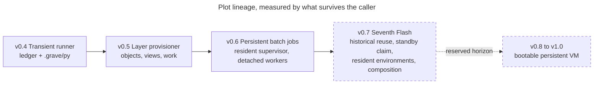
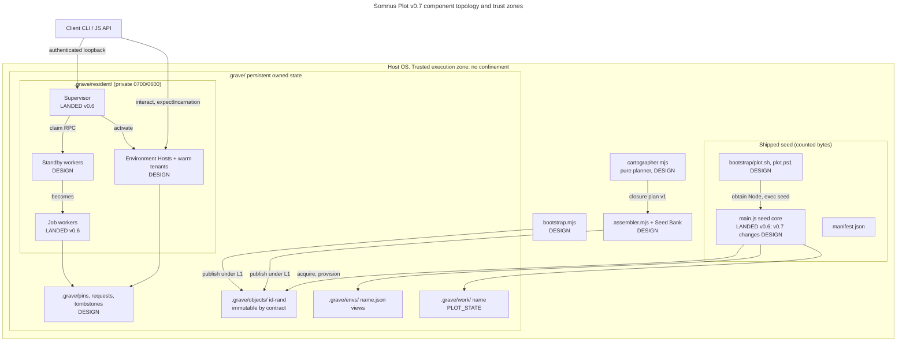
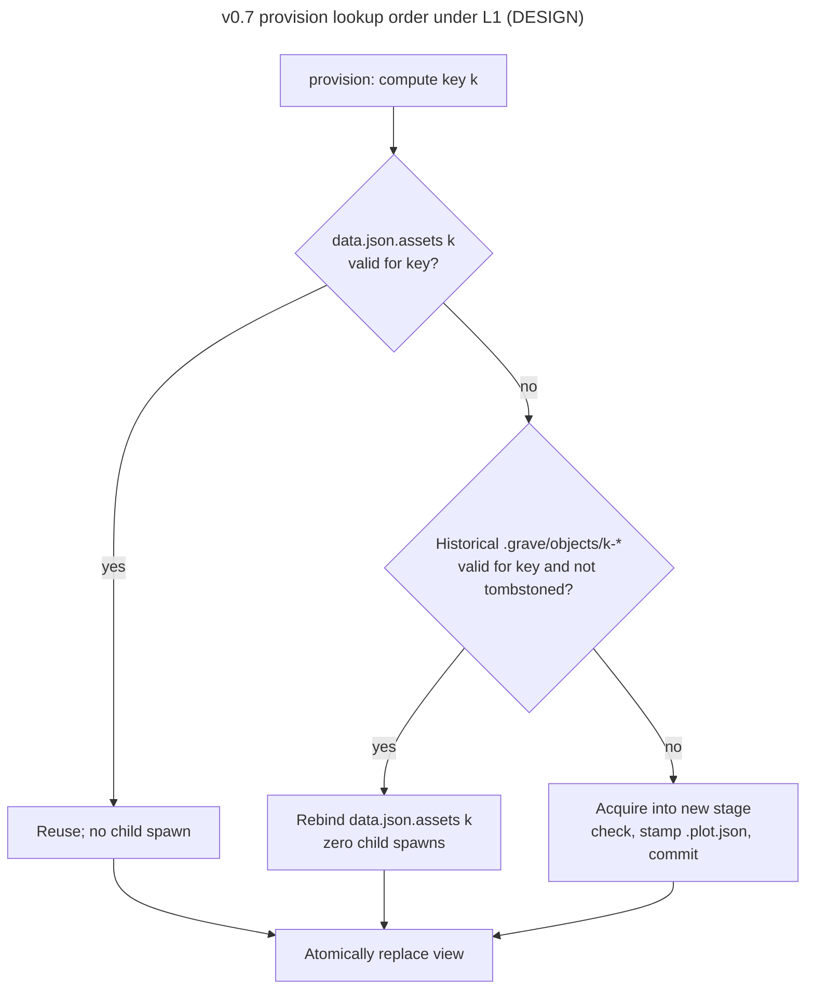
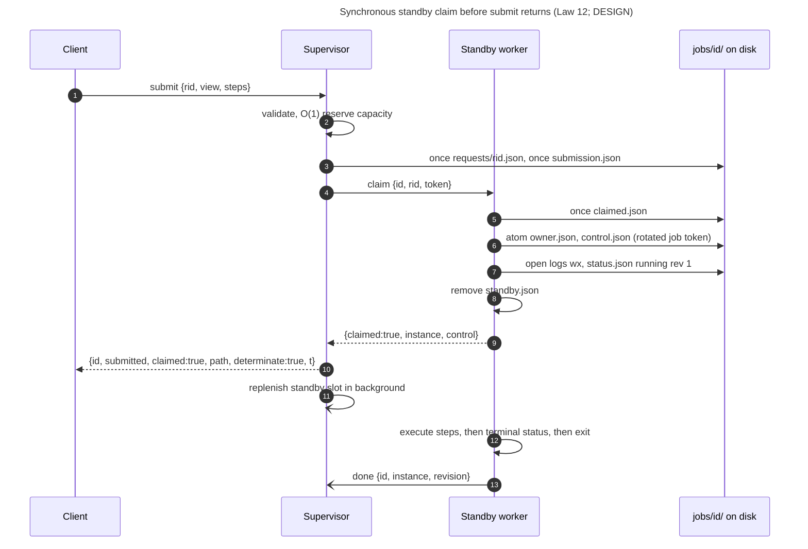
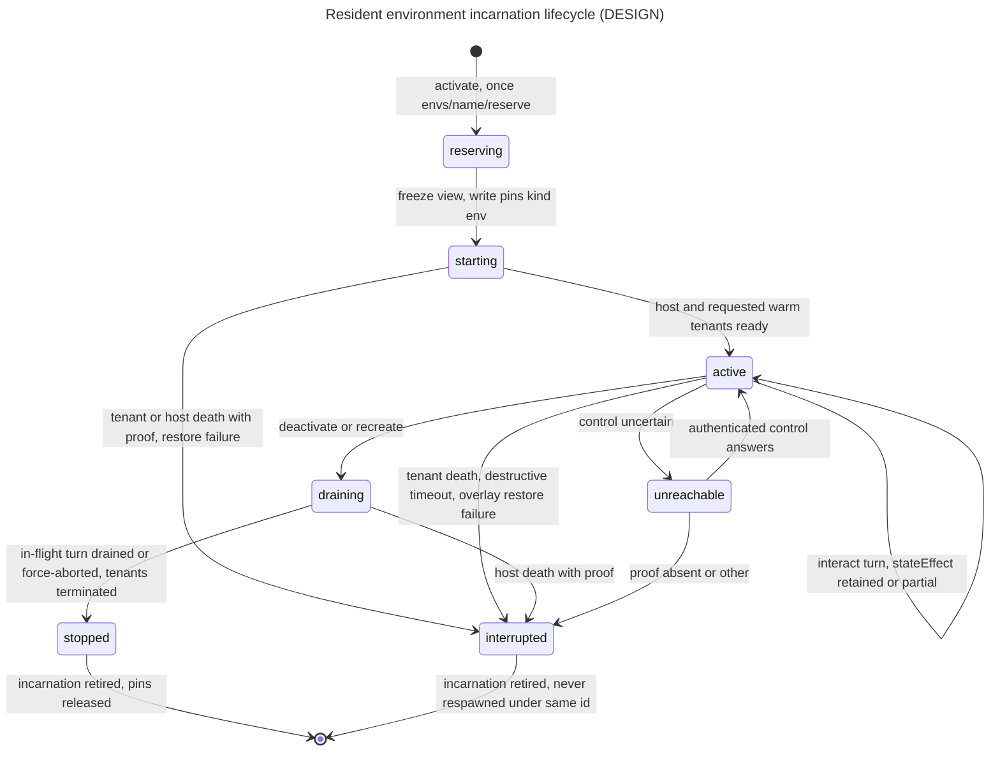
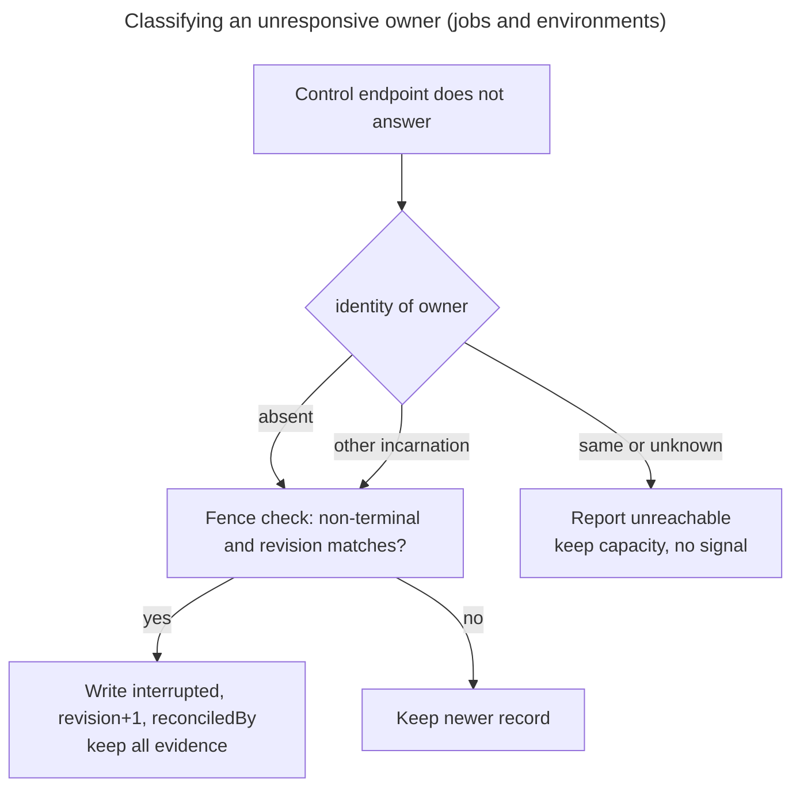

# Somnus Plot v0.7 "The Seventh Flash": A Seed That Composes Execution Environments

```
DOCUMENT TITLE   Somnus Plot v0.7 Completed-System Whitepaper (Skeleton)
Classification:  INTERNAL (default; no classification was supplied)
Version:         0.1 (skeleton)
Date:            2026-10-20
Author/Origin:   chronicler-1 (Somnus colony, P07-08 whitepaper lane)
Status:          DRAFT. This is a skeleton, not a results paper.
Scope:           Narrow reading of PLAN.md P07-08 / §8.2 "Whitepaper" row. Structure,
                 framing, lineage, laws, mechanisms and methodology only. No v0.7 result.
```

> **DRAFT STATUS NOTICE.** This document is written while the v0.7 implementation lanes (P07-01, P07-02, P07-03, P07-09) are in progress. No v0.7 mechanism had implementation evidence when it was written. Every v0.7 mechanism below is tagged **[DESIGN — pending implementation evidence]**, and every v0.7 result table is empty. The only numbers cited as measurements are v0.6 numbers from `evidence/RESULTS.md`, and each one is labelled **v0.6 evidence of record**. PLAN.md §8.2 requires the final paper to agree with the final implementation and its measured evidence. That requirement is open.

---

## 0. Document Control and Provenance

### 0.1 How each claim is known

Every claim in this paper carries one provenance tag. A claim with no tag is editorial framing, not a technical assertion.

| Tag | Source | Epistemic standing |
| --- | --- | --- |
| **[E6]** | `evidence/RESULTS.md`, generated by `tests/report.mjs` from the 2026-10-17 v0.6 runs | v0.6 evidence of record. Measured on the host stated in that file. The chronicler did not re-run it. |
| **[E5]** | `baseline/v0.5-evidence/` and `docs/MEMORY.md` version lineage | v0.5 evidence of record (frozen lineage). Not re-run. |
| **[B4]** | `baseline/REPORT.md` (v0.4 audit, 2026-10-12) | Hands-on audit of the original v0.4 archive. Not re-run. |
| **[K5]** | `STAGE-1.md` (v0.5 contract) | Contract text for behavior that v0.5 implemented and tested. |
| **[K6]** | `PERSISTENT-NATIVE.md` (v0.6 contract) | Contract text for behavior that v0.6 implemented and tested. |
| **[C7]** | `docs/V07-CONTRACTS.md`, contracts v1 (P07-00 freeze) | Frozen interface. It specifies design and does not certify behavior. §0 of that file records facts the P07-00 coordinator observed on 2026-10-20. |
| **[P7]** | `PLAN.md` (v0.7 master plan, 2026-10-20 edition) | Operator-supplied specification. It describes required outcomes and candidate mechanisms. Its v0.6 figures are described there as "supplied baseline claims". |
| **[L]** | `docs/MEMORY.md` laws, citing `docs/Plot-Fable.md` | Durable law. |
| **[T]** | Observed directly by the chronicler during this drafting session | Limited to: `WHITEPAPER.md` was absent before this draft; `package.json` declares version `0.6.0` with no dependencies; `node --version` on the drafting host returned `v24.22.0`. |

**Status tags.**

- **[DESIGN — pending implementation evidence]**: specified in [P7]/[C7]. No landed code or test proves it.
- **[UNVERIFIED — CONFIRM BEFORE OPERATIONAL USE]**: asserted by a source but not measured or traced.
- **[REQUIRES INPUT]**: a gap only the operator or a later packet can fill.
- **[CONTRADICTION — CONFIRM BEFORE OPERATIONAL USE]**: two sources disagree. Both readings are given.
- **NOT RUN** / **NOT VERIFIABLE**: the host lane did not execute, or it cannot execute in the available environment (Law 8).

### 0.2 State of the record when this draft was written

| Item | State | How known |
| --- | --- | --- |
| Landed version | v0.6.0 "Persistent Native Execution" | [T] `package.json`; AGENTS.md |
| v0.7 packets | P07-00 landed (commit `d97981f`); Wave 1 (P07-01/02/03/09) dispatched; P07-04..P07-08 queued | AGENTS.md; `git log` |
| TASTED v0.7 implementation marks in the colony scent | None. Only CLAIM marks were present at 2026-10-20T11:54Z. | [T] `colony scent` |
| v0.7 measurements | None exist | No v0.7 evidence file exists; P07-08 has not run |

---

## Table of Contents

1. Abstract (DRAFT placeholder)
2. Problem Formulation
3. Lineage: v0.4 to v0.7
4. Constitutional Laws 1–12
5. System Architecture
   - 5.1 Topology and trust zones
   - 5.2 Seed core
   - 5.3 Acquisition and historical reuse
   - 5.4 Views
   - 5.5 Resident jobs
   - 5.6 Standby claim
   - 5.7 Resident environments
   - 5.8 Pins, prune and tombstones
   - 5.9 Dependency Cartographer
   - 5.10 Offline Assembler and Seed Bank
   - 5.11 Host bootstrap
   - 5.12 Lock order and durability primitives
6. Failure Boundaries and Non-Claims
7. Evaluation Methodology
8. Reproducibility
9. Horizon: v0.8 to v1.0
- Appendix A. Glossary
- Appendix B. Source register
- Appendix C. Open items and LEAPs
- Appendix D. Change log

---

## 1. Abstract

> **[DRAFT — ABSTRACT PENDING P07-08 MEASUREMENT AND FINAL IMPLEMENTATION]**
>
> The final abstract will state, in 150–250 words: the problem (Section 2); the mechanisms that actually landed (Section 5, with every DESIGN tag resolved); the measured outcome of every §7 gate on the reference host, including any gate that stayed open; the host families that ran and those that were NOT RUN; and the non-claims (Section 6). It must not be written until P07-08 has produced generated evidence. [REQUIRES INPUT]

**Interim framing (non-normative).** Somnus Plot is a tiny Node.js seed with a hard 9,063-byte core ceiling. It constructs, persists and executes complete environments by composing material it acquires, instead of carrying that material with it. v0.7 sets out to turn v0.6's persistent batch jobs into a self-contained portable execution environment with three additions: multi-version object reuse; single-use standby workers that take ownership of a job before `submit` returns; and named Resident Environments that keep warm runtime sessions alive across turns. Each operation boundary is measured against a separate six-millisecond p95 bell.

---

## 2. Problem Formulation

### 2.1 Statement

The problem is to build the **smallest capable portable execution environment that is derived by composition**. Formally, given:

- a seed `S` of bounded size (`|main.js| ≤ 9,063 bytes`, Node standard library only) [L][C7 §0];
- a host `H` with declared irreducible prerequisites (Node, or the Entry B launcher prerequisites in §5.11) [P7 §6.3];
- a set of declared recipes and sources `R` (manifest, capability recipes, Seed Bank) [K5];

the goal is for `S` to construct, under `H` and `R`, a persistent environment `E` that satisfies all of the following:

1. **Derivability.** Every capability that `E` exercises is constructed from `R` through explicit bootstrap steps. None is assumed pre-installed unless it is declared as a shallow host dependency (Law 4).
2. **Composition over carriage.** Growth of `E` comes from acquired objects in `.grave/`, never from growth of `S` (Laws 2, 3).
3. **Persistence of ownership.** Accepted work and named live sessions outlive the caller that initiated them, and they survive replacement of the supervisor (Laws 9, 12).
4. **Isolation of identity.** Isolated jobs never share interpreter state. Stateful continuity exists only inside an explicitly activated environment with an incarnation token (Law 11).
5. **Bounded latency per boundary.** Each named cached or warm operation meets p95 < 6 ms on a declared reference host. Cold, startup and completion costs are reported separately (Law 7).
6. **Honest scope.** Execution is trusted, not sandboxed (Law 6). Portability is claimed only for host families that actually ran (Law 8).

### 2.2 What "smallest" means

"Smallest" refers to the universal seed, not to the deployed closure. PLAN §4.5 requires that source bytes, generated core bytes, acquired capability bytes, bootstrap bytes and the required shipped file set are each reported separately, and that no hidden mandatory payload is excluded in order to meet the ceiling [P7 §4.5]. v0.6 reported a 9,061-byte core, a separately counted 20,708-byte resident module, and 29,769 bytes of deployed executable JavaScript for resident use [E6, v0.6 evidence of record].

### 2.3 What "complete" means for v0.7

PLAN §1.1 sets the bar at a level of completeness that a systems engineer would regard as a finished, self-contained portable execution environment. It explicitly excludes bytecode interpreters, WASI runtimes, hardware emulators and simulated kernel sandboxes, all of which belong to v0.8–v1.0 [P7 §1.1]. PLAN §8.3 defines completion as a set of distinct statuses (packet checkpoint, integrated candidate, reference-host performance verified, cross-host verified, v0.7 complete). Full completion requires every applicable §8.2 row to pass [P7 §8.3].

---

## 3. Lineage: v0.4 to v0.7

### 3.1 Stage table

| Version | Stage | Persists across invocations | Dies after each invocation | Core bytes (ceiling 9,063) | How known |
| --- | --- | --- | --- | --- | --- |
| v0.4 | Transient script runner | `data.json` ledger; one shallow Python directory `.grave/py` | Every foreground process and environment | about 9 KiB; the ceiling is defined by this bundle | [B4]; [L] Law 3 |
| v0.5 | Transactional layer provisioner | Immutable-by-contract objects `.grave/objects/`, views `.grave/envs/`, writable state `.grave/work/` | Every foreground step runner and child | 9,036 | [E5] `docs/MEMORY.md` lineage; [K5] |
| v0.6 | Persistent detached batch jobs | Optional acquired supervisor, detached per-job workers, captured logs `.grave/resident/jobs/` | The worker and tenant heap at job end; views remain passive JSON | 9,061 | [E6, v0.6 evidence of record] |
| v0.7 | Resident execution environments and compositional substrate | Multi-version indexed objects; pre-booted single-use standby workers; live Resident Environments with warm tenants | Only single-use job workers after completion, or explicitly deactivated environment incarnations | ≤ 9,063 required; actual pending P07-01 | [P7 §1.1] [DESIGN — pending implementation evidence] |
| v0.8–v1.0 | Independently bootable persistent VM (reserved) | Linear memory snapshots, virtualized mounts, cross-host resumable state | Nothing unless explicitly destroyed | Governed by future seed law | [P7 §1.1]; see §9 |



*Legend:* solid nodes are versions with evidence of record. Dashed nodes are design or reserved horizon.

### 3.2 What each turn fixed and what it left open

**v0.4 → v0.5.** The v0.4 audit reproduced three issues: permissions that were not enforced (`spawn:false` still launched a child), a chained-symlink escape in the TAR extractor, and stale tenant reuse after a depth or pin change [B4]. v0.5 separated acquisition from views. It introduced the canonical identity `[recipe, [platform, arch], dependency_paths]` with no content hash, a conservative USTAR subset that rejects links beneath archive symlinks, hardlinks, PAX and GNU long names, and fail-closed tenant identity [K5]. The permission finding was settled by declaring Plot trusted rather than by attempting confinement (Law 6) [K5][L].

**v0.5 → v0.6.** v0.6 added an optional acquired resident supervisor with one detached Node worker per job. Accepted work outlives the client and survives supervisor `SIGKILL`/restart. PID-free authority, conservative `interrupted`/`unreachable` classification and direct-child cancellation came with it [K6]. All 37 checks passed (18 v0.5 regressions and 19 resident checks) [E6, v0.6 evidence of record].

**Open at v0.6, inherited by v0.7.** The five ceilings in PLAN §1.3 were confirmed by source reading during P07-00 [C7 §0]. The chronicler did not re-trace them.

| Ceiling | v0.6 defect | v0.6 evidence of record | v0.7 response (all [DESIGN — pending implementation evidence]) |
| --- | --- | --- | --- |
| C-01 | The ledger holds one object per capability, so switching back to a prior version re-acquires it | STAGE-1 states the ledger keeps the latest resource and that history is not indexed [K5] | Historical object reuse with zero child spawns (§5.3) |
| C-02 | The shallow venv always runs ensurepip; `exec` drops stdout on failure; core `atom()` has no parent-directory fsync | RESULTS lists core parent-dir fsync as unimplemented [E6] | Parent-directory fsync, stdout-aware diagnostics, a no-pip venv route (§5.2) |
| C-03 | The process-birth cliff | Durable submission p95 7.861 ms; accepted-to-control-ready p95 103.325 ms; complete native job p95 192.701 ms [E6, v0.6 evidence of record] | Standby claim (§5.6); resident environments (§5.7) |
| C-04 | Each submit scans all job directories, with a 500 ms probe per unreachable job; interrupted jobs consume capacity | PERSISTENT-NATIVE: "uncertain jobs consume capacity" [K6] | O(1) admission map plus a bounded reconciler (§5.5) |
| C-05 | Concurrent jobs collide in shared scratch; no garbage collection | RESULTS: "Resource/job garbage collection: Not implemented" [E6] | `PLOT_JOB_STATE`; pins, prune and tombstones (§5.8) |

> **Measurement-host caveat.** The v0.6 evidence of record was measured on linux/x64, INTEL XEON PLATINUM 8573C, kernel 6.18.55, Node v24.19.0, on a container scratch filesystem [E6]. The v0.7 reference host frozen in P07-00 is Linux 6.1.158+ x64, Intel Xeon @ 2.60GHz, 4 vCPU, ext4, Node v24.22.0 [C7 §0]. These are different hosts. No v0.6-to-v0.7 speedup claim may be made unless both sides are measured on the same host. RESULTS applies the same rule to its own comparison with v0.5 [E6].

---

## 4. Constitutional Laws 1–12

Laws 1–10 are the durable laws in `docs/MEMORY.md` [L]. Laws 11 and 12 are new in v0.7 [P7 §2]. The enforcement column paraphrases PLAN §2.

| # | Law | Enforcement rule | Source | How it is checked |
| --- | --- | --- | --- | --- |
| 1 | No assignment in Somnus | Plot has no runtime dependency on broader Somnus and exports no mandatory service to it | [L] Fable | Review; no Somnus import exists in the source tree |
| 2 | The core cannot grow with the catalog | Cartographer, assembler, resident environment host, standby pool and bootstrap live in `capabilities/` and are acquired into `.grave/objects/` | [L] STAGE-1 c.1 | Ownership map [C7 §13]; byte gate |
| 3 | 9,063-byte ceiling pressure | `node build.mjs` produces `main.js` ≤ 9,063 bytes deterministically. An increase must answer: "did the seed learn a more general law, or was an organ stuffed in?" | [L] Fable | Gate: build determinism and `core_bytes` |
| 4 | Derivable from bootstrap | Capability comes from local recipes, declared sources and explicit bootstrap steps | [L] Fable | Package smoke; bootstrap self-establishment proof [P7 §6.3] |
| 5 | Obsidian is the mountain, not the father | Node standard library only; `package.json` has no dependencies | [L] | [T] `package.json` has no `dependencies` key |
| 6 | Not a sandbox | No claim of kernel confinement, untrusted-code isolation or VM hardware isolation | [L]; [B4][K5][K6] | Document review (Section 6) |
| 7 | The six-millisecond bell is cruel by design | p95 < 6 ms per named boundary; cold, startup and completion are never merged | [L] STAGE-1 c.4 | §7 workload rows [C7 §12] |
| 8 | Cross-device in grammar before proof | Report unrun host lanes as NOT RUN or NOT VERIFIABLE | [L] | Host matrix [C7 §11] |
| 9 | No fabricated recovery | PIDs are never signal targets; crashed workers or environments are never replayed or silently restarted | [L] PERSISTENT-NATIVE | Resident suites (v0.6: [E6]) |
| 10 | No content hash as identity | Identity is `[recipe, [platform, arch], dependency_paths]`; SHA-256 is an integrity check only | [L] STAGE-1 | Core source; [C7 §3] |
| 11 | Strict wall between isolated jobs and stateful sessions (new) | `submit` never runs in a previously mutated heap. State reuse is allowed only inside `activate`/`interact` under an explicit incarnation token. Warm tenants can be terminated independently of their host. | [P7 §2] | [DESIGN — pending implementation evidence]: P07-05/P07-06 suites |
| 12 | Synchronous ownership handoff before submit returns (new) | Before `submit` replies, an independent worker has durably written `claimed.json`, `owner.json` and `control.json` | [P7 §2] | [DESIGN — pending implementation evidence]: P07-05 claim-ordering tests |

> **Wording note.** PLAN §2 gives Law 3 as a fixed "9,063-Byte Core Ceiling". MEMORY gives it as "byte ceiling pressure" and allows the number to move under an operator decision. These are compatible: the number is binding for v0.7 under PLAN §8.2, and any change is an operator decision recorded in MEMORY.

---

## 5. System Architecture

Status key for this section. **[LANDED v0.6]** means implemented and covered by [E6]. **[DESIGN — pending implementation evidence]** means specified only.

### 5.1 Topology and trust zones



*Legend:* the only enforced boundary is authentication on loopback control endpoints, using private tokens and file modes 0600/0700 on POSIX [K6][C7 §1]. Everything inside HOST runs with inherited OS authority. "DESIGN" labels mean pending implementation evidence.

**Component ownership** [C7 §13]:

| Component | Surface | Owner packet | Status |
| --- | --- | --- | --- |
| Seed core | `src/plot.mjs` → `build.mjs` → `main.js` | P07-01 | LANDED v0.6; v0.7 changes [DESIGN — pending implementation evidence] |
| Cartographer | `capabilities/cartographer.mjs` | P07-02 | [DESIGN — pending implementation evidence] |
| Assembler / Seed Bank | `capabilities/assembler.mjs` | P07-03 | [DESIGN — pending implementation evidence] |
| Bootstrap | `capabilities/bootstrap.mjs`, `bootstrap/` | P07-09 | [DESIGN — pending implementation evidence] |
| Resident (admission, standby, environments) | `capabilities/resident.mjs` | P07-04 → 05 → 06, serial | LANDED v0.6 for jobs; v0.7 changes [DESIGN — pending implementation evidence] |
| Gate and cross-host proof | `scripts/gate.sh`, host runners | P07-07 | [DESIGN — pending implementation evidence] |
| Measurement and this paper | benchmarks, `tests/report.mjs`, `WHITEPAPER.md` | P07-08 | Skeleton only |

### 5.2 Seed core

**[LANDED v0.6]** The core reads the manifest, selects host recipes, validates the capability DAG, takes the writer lock `.grave/.lock/`, reuses or acquires objects, runs installation checks, writes `.plot.json` completion markers, commits `data.json` and atomically replaces the named view. It also runs literal-argument steps and the Python tenant (`-I -S`, package layer on `sys.path`), and extracts the conservative USTAR subset [K5]. Every JSON commit uses a temporary file, a file fsync and a rename. Parent directories are not fsynced [K5][E6].

**v0.7 changes [DESIGN — pending implementation evidence]** [P7 §4][C7 §3]:

- `atom()` adds a POSIX parent-directory fsync. A new `once()` primitive provides write-once records (§5.12).
- `exec()` failure messages fall back to `error.message`, then stderr, then stdout, then status.
- Shallow Python uses `venv --without-pip` when no pip invocation is required.
- Historical object reuse (§5.3).
- `run()` writes a `foreground` pin. If the byte budget cannot afford the pin, P07-01 records why, and prune refuses object eviction whenever an unstamped foreground run cannot be excluded [C7 §4].
- Budget: 9,061 of 9,063 bytes were used at base `b72a98d` (2 bytes of headroom) [C7 §0, as recorded by the P07-00 coordinator]. PLAN §4.5 requires reclaiming bytes by removing redundancy and relocating catalog-specific work, not only by shortening identifiers [P7 §4.5]. The v0.7 byte outcome is [REQUIRES INPUT] from P07-01.

### 5.3 Acquisition and historical reuse

**[LANDED v0.6]** Identity is `stable([recipe, [platform, arch], needs.map(n => assets[n].path)])`. Random directory suffixes allocate unique paths and carry no provenance meaning. Failed transactions remove their own new objects and preserve the earlier ledger, views and state [K5].

**[DESIGN — pending implementation evidence]** Lookup inside `provision` under lock L1 follows this order [C7 §3]:



*Legend:* an object is complete only if `.plot.json` parses, equals `{key, path, ...}` with `path` equal to its realpath inside `.grave/objects`, and any recorded `python` executable exists. Unstamped stages are never adopted. An index, if one is introduced, is advisory only: a miss falls back to the directory scan [C7 §3].

### 5.4 Views

**[LANDED v0.6]** A view, `.grave/envs/<name>.json`, is a passive executable descriptor: schema, host, asset references, Python and package selection, and the writable-state location. `.grave/work/<name>/` is exposed to tenants as `PLOT_STATE` [K5]. Objects are shared under an application-level read-only contract that the OS does not enforce [K5]. Moving `.grave/` to another root or device invalidates absolute references and requires reprovisioning [K5].

**v0.7 [DESIGN — pending implementation evidence]**: views remain passive. Activation into a living environment is a separate resident operation (§5.7). Prune never deletes `.grave/work/*` [C7 §6].

### 5.5 Resident jobs

**[LANDED v0.6]** The supervisor owns discovery and submission. It does not own job lifetime. Each job gets one detached Node worker, which owns its direct child handles, bounded output and execution state. The submission snapshot freezes the resolved view, resource keys, absolute executables, arguments, cwd, environment and limits. Retrying with the same ID and an identical request returns the existing job. Recovery uses authenticated control plus Linux boot-ID and start-tick identity. PIDs are never signal targets [K6]. v0.6 evidence covers: a job outliving its submitting CLI, supervisor `SIGKILL`/restart reconnecting to a live worker, a single execution under retried submission, and a worker crash classified as interrupted with no replay [E6, v0.6 evidence of record].

**v0.7 extensions [DESIGN — pending implementation evidence]** [C7 §7][P7 §5.1, §5.1.1, §5.3]:

- The admission map `Map<id, state>` is built once at `serve` start, before writes are accepted. It is updated by submit, by authenticated `{op:'done', id, instance, revision}` notifications, and by a background reconciler (250 ms interval, at most 8 entries per tick, 500 ms per-entry probe, never on the submit path). Capacity defaults to `maxActive` 16 and counts active, reserved and uncertain jobs. A rejection is structured as `{error:'capacity', retryable:true}` and is returned before any durable acceptance.
- Reconciler fence: `interrupted` may be written only with proof that the owner is `absent` or `other`, a matching non-terminal `revision`, and a `revision+1` write that carries `reconciledBy`.

```mermaid
---
title: Resident job lifecycle, v0.7 contract (DESIGN; reserved, published, claimed ordering pending P07-04/05 evidence)
---
stateDiagram-v2
  [*] --> admission
  admission --> rejected: capacity full, before durable acceptance
  rejected --> [*]
  admission --> reserved: O(1) capacity reservation
  reserved --> published: submission.json written once
  published --> claimed: worker writes claimed.json, owner.json, control.json, status running rev 1
  claimed --> running
  running --> succeeded
  running --> failed
  running --> cancelled
  running --> timed_out
  reserved --> interrupted: proof absent or other, fence ok
  published --> interrupted: proof absent or other, fence ok
  claimed --> interrupted: proof absent or other, fence ok
  running --> interrupted: proof absent or other, fence ok
  running --> unreachable: liveness uncertain
  unreachable --> running: authenticated control answers
  unreachable --> interrupted: proof absent or other, fence ok
  succeeded --> [*]
  failed --> [*]
  cancelled --> [*]
  timed_out --> [*]
  interrupted --> [*]
```

- Request IDs `rid` with durable lookups in `.grave/requests/<rid>.json` (§5.12).
- Job-private scratch `PLOT_JOB_STATE = jobs/<id>/work/`, plus `PLOT_STEP_INDEX` and `PLOT_STEP_OUT`.



*Legend:* `unreachable` is an observation, not a persisted terminal state, and it keeps holding admission capacity. Terminal states are `succeeded`, `failed`, `cancelled`, `timed_out` and `interrupted` [C7 §7]. Only the worker writes live transitions. The reconciler writes only `interrupted`, and only under the fence. The `unreachable → running` edge represents a later successful authenticated inspection. That is the chronicler's reading of "observation only" in [C7 §7] [UNVERIFIED — CONFIRM BEFORE OPERATIONAL USE]. `rejected` is not a job state: no job directory exists for it.

### 5.6 Standby claim

**[DESIGN — pending implementation evidence]** [C7 §8][P7 §5.2, §5.2.1]

Standby workers are started with `--standby <root> <supervisorInstance>`. Each publishes `standby/<slot>/standby.json` and then idles. A standby exits on `{op:'shutdown'}`, or when the supervisor instance changes or the supervisor endpoint stays unreachable for 5 s. Pool bounds: `ready` 2, `maxStarting` 2, `maxWaiting` 16. These are contract defaults, not measurements. Workers are single use: after its job, a worker exits and never returns to the pool.



**Failure branches** [C7 §8]:

| Condition | Required behavior |
| --- | --- |
| Claim timeout or lost acknowledgement, and `claimed.json` exists | Adopt the existing claim. Never start a second worker. |
| `claimed.json` absent and the standby is proven gone | Retry with another worker |
| Uncertain | Reply `{determinate:false}` and keep capacity reserved |
| Pool empty | Spawn cold only if `starting < maxStarting`; otherwise wait (bounded) or reject retryably. `path` reports `standby`, `cold` or `waited`. |

> **Disclosed limit.** Sustainable isolated-job admission is bounded by how fast replacement workers become ready and by hardware capacity. The reservoir moves process-birth cost off individual warm submissions but cannot remove it [P7 §5.2.1].

### 5.7 Resident environments

**[DESIGN — pending implementation evidence]** [C7 §9][P7 §5.4, §5.4.1]

The resident capability adds four operations: `activate`, `interact`, `env_inspect` and `deactivate`. An independent Environment Host (`--env-host <root> <name>`) owns the warm tenants. Python and Node tenants are separate processes, and they speak length-prefixed JSON frames (`u32` length, `{v:1, id, ...}`, maximum 1 MiB) on a dedicated control channel (fd 3 or authenticated loopback). The tenants' stdout and stderr are captured separately, capped at 1 MiB per turn by default. One turn is in flight at a time, with `maxQueued` 8; overflow returns `{error:'busy', retryable:true}`. Every turn requires `expectIncarnation`.

Records are scoped per incarnation: `envs/<name>/current.json`, `reserve`, and `inc/<incarnation>/{instance,owner,control,status}.json`, with outcomes in `turns/<turnId>.json`. Activating a name again never overwrites earlier history.



*Legend:* any retirement releases the `env` pin. A crashed tenant is never silently respawned under the same incarnation. A destructive timeout (SIGTERM, then SIGKILL after 500 ms) reports `stateEffect:'lost'`. If the supervisor dies, live Environment Hosts and their tenants are preserved. Heap continuity does not survive tenant death, host reboot or power loss [P7 §1.2]. The `reserving` state is the chronicler's label for the period while the once-reservation is held. The contract states are `starting`, `active`, `draining`, `stopped` and `interrupted`, plus the `unreachable` observation [C7 §9].

**Turn semantics** [P7 §5.4.1], summarized:

| Boundary | Contracted semantics |
| --- | --- |
| Persistent state | Namespace, imports, heap and process-global mutations persist. Arbitrary interpreter state is not guaranteed to be restored. |
| Exception | Structured error with `stateEffect:'partial'`. Heap rollback is not offered. |
| Timeout | The host terminates the tenant, even inside native blocking calls. The incarnation becomes interrupted and memory loss is reported. |
| Background activity | Late output is marked asynchronous and unattributed. Detached descendants are outside guaranteed cleanup. |
| Retry | Turn request IDs and retained outcomes. Caller disconnect does not cancel or replay the turn. |

### 5.8 Pins, prune and tombstones

**[DESIGN — pending implementation evidence]** [C7 §4, §6][P7 §5.5]

- **Pins.** `.grave/pins/<kind>-<ref>-<random>.json` records `paths` as the transitive object closure. Pins are lock-free: the holder writes the pin and then validates it. If validation fails, the holder removes the pin and fails retryably.
- **Prune.** Dry-run by default. With `apply`, under L1, prune computes roots, writes tombstone intents, re-reads pins, renames candidates into `.grave/tombstones/`, and deletes them physically outside the lock. Every intent is crash-recoverable. Prune never deletes `.grave/work/*`, interrupted evidence or bank material. Default prune keeps historical cached objects so that multi-version reuse survives maintenance.
- **Audit.** `.grave/resident/prune.json` records each run.

### 5.9 Dependency Cartographer

**[DESIGN — pending implementation evidence]** [C7 §10][P7 §6.1]. The Cartographer is a pure planner. It runs no lifecycle scripts, imports no package code, makes no network calls and writes no files. Its input is a local Node package corpus. Its output is a `plot.closure/1` plan containing target identity, nodes, placement, a deterministic topological `order`, `pruned` and `unsupported` entries, fail-closed `diagnostics`, and `ok`. The supported range grammar is exact, `^`, `~`, `x`/`*`, comparators, hyphen ranges and `||`; anything else is reported as `unsupported`. Presence is detected through canonical keys, never through content hashes. P07-02 is in progress at the time of writing (CLAIM marks only) [T].

### 5.10 Offline Assembler and Seed Bank

**[DESIGN — pending implementation evidence]** [P7 §6.2]. The Assembler composes `.grave/objects/` layers from a local Seed Bank of component tarballs, wheels and recipes, without network access, npm or pip. Its wheel handling follows actual RECORD rules. It verifies supplied digests and sizes without inventing missing ones. It validates tags against the recorded runtime identity, relocates `.data/` paths, preserves executable bits, and rejects traversal, symlink escapes and duplicates before atomic publication. It never builds from source implicitly. It consumes only plans with `ok:true`. Shared banks are read-only to consumers [C7 §2].

### 5.11 Host bootstrap

**[DESIGN — pending implementation evidence]** [C7 §11][P7 §6.3]

| Entry | Condition | Mechanism | Declared irreducible inputs |
| --- | --- | --- | --- |
| A | Node present | `node main.js` or `node capabilities/bootstrap.mjs inspect\|plan\|acquire\|verify\|activate` | Node |
| B | Node absent | `bootstrap/plot.sh` or `bootstrap/plot.ps1` obtains Node into `.grave/host/node-<ver>-<plat>-<arch>/`, then execs the seed | POSIX sh, `tar`, `gzip`, `curl` or `wget` (or an offline kit); or PowerShell 5+ with `Expand-Archive` or `tar.exe` |

The pipeline is inspect → plan → acquire → verify → activate. Installs are user-local, with no sudo and no package-manager edits. The artifact source is locked for the duration of an attempt. Interrupted acquisition cannot become a valid completed object. No claim is made of installation from literally nothing.

### 5.12 Lock order and durability primitives

**[DESIGN — pending implementation evidence]**, except where marked [C7 §1, §2]:

| Rank | Lock | Holder | Scope |
| --- | --- | --- | --- |
| L0 | `.grave/.recovery/` | `recover()` | Acquisition-lock reconciliation (exists in v0.6 [K6]) |
| L1 | `.grave/.lock/` | seed `provision`, prune apply, assembler and bootstrap publication | Objects, ledger, views, tombstones (writer lock exists in v0.6 [K5]) |
| L2 | `.grave/resident/.lock/` | supervisor singleton | Admission authority |
| L3 | per-entity once-reservations | supervisor, env host, worker | One entity each |

Locks are acquired only in ascending rank. Pins never take L1. `atom` = temp `wx` 0600 → fsync → rename → parent-directory fsync (POSIX). `once` = `wx` 0600 → fsync → parent-directory fsync. Windows has no directory fsync, and this is disclosed.

---

## 6. Failure Boundaries and Non-Claims

These boundaries are part of the system's definition, not caveats added afterwards.

| # | Non-claim | Basis | How known |
| --- | --- | --- | --- |
| N1 | **Plot is not a sandbox.** Native execution is trusted and inherits OS authority. `permissions.fs` is a declaration, not confinement. Environment Hosts and warm tenants are trusted processes, not kernel isolation. | Law 6 | [B4] bypass reproduced in v0.4; [K5][K6]; [P7 §5.4.1] |
| N2 | **No power-loss or reboot guarantee.** Process-crash testing proves process-crash behavior only. v0.6 did not test reboot or power-loss recovery and did not implement core parent-directory fsync. v0.7 adds that fsync by design, which still does not certify power-loss durability. tmpfs runs are diagnostic only. | [E6]; [P7 §8.1]; [C7 §1] | [E6] "Unimplemented or unverified" |
| N3 | **No cross-host claim from Linux evidence.** Windows, macOS and Android/Termux are NOT RUN. Cross-host v0.7 acceptance stays open until at least one non-Linux family passes. A container or alternate Linux distribution does not count as a second family. | Law 8 | [C7 §11]; [P7 §6.3] |
| N4 | **No exactly-once side effects.** Claims establish at most one worker execution per accepted submission. External side effects are not exactly-once. | [K6]; [P7 §5.1.1] | [E6] retried-submission test (v0.6) |
| N5 | **No replay and no silent restart.** Interrupted jobs and incarnations are never replayed or restarted under the same identity. | Law 9 | [E6] (v0.6 jobs); environments [DESIGN — pending implementation evidence] |
| N6 | **No process-tree ownership or quotas.** Cancellation covers direct children only. CPU, RAM and network quotas are not implemented. Detached descendants are outside guaranteed cleanup. | [K6][E6] | [E6] |
| N7 | **No heap migration across hosts.** Warm state does not survive tenant death, host reboot or power loss, and it is not portable between hosts. | [P7 §1.2, §8.2 Portability] | Specification |
| N8 | **No universal six-millisecond claim.** The bell applies to named, bounded reference operations on a declared host. Cold acquisition, bootstrap, process birth, full job completion and heavy user work are not claimed below 6 ms. | Law 7 | [E6] explicitly states this for v0.6 |
| N9 | **No immutable host executables.** Absolute command resolution does not freeze host binaries or libraries. | [K6] | [K6] |
| N10 | **No complete wheel or PEP 427 platform coverage** from a pure-Python fixture plus one Linux C-extension fixture. No implicit source builds. | [P7 §6.2] | Specification |
| N11 | **No complete Python CLI or venv emulation.** Interactive Python, `.pth` hooks, editable installs and shebang rewriting are out of scope. | [K5] | [K5] |
| N12 | **Secrets in metadata.** Submission snapshots can contain inherited environment credentials. They are private (0700/0600) but they are not an export surface, and tokens must not be copied into shared logs. | [K6] | [K6] |



*Legend:* no branch sends a signal to a persisted PID, and no branch replays work [L Law 9][C7 §7]. On hosts without `/proc` incarnation data, a live but unresponsive PID is classified `unknown` and remains `unreachable` [K6].

---

## 7. Evaluation Methodology

### 7.1 Measurement contract

The following rules are taken from [P7 §8.1] and [C7 §12]:

- Timing uses the monotonic timer `process.hrtime.bigint()`, measured from client request initiation.
- Percentiles are nearest-rank over all successful samples. Failures, rejections and timeouts are reported as counts next to the percentiles. Client timeouts are censored observations and are never deleted.
- Every sample is retained. Warmup count, interarrival schedule, output size and tracing overhead are declared.
- Fresh CLI startup is measured separately from persistent-client RPC.
- Durable semantics (file and parent-directory fsync) may not be weakened to improve timing.
- Workloads were frozen in P07-00, before any tuning. The nominal rate may not be reduced after results are seen.

**Host disclosure required for each run:** CPU model and core count, RAM, OS and kernel, Node and Python versions, filesystem and mount options, storage device class, virtualization or container layer, power mode, timer, concurrency, pool limits, source identity and durability policy.

| Reference-host field | Value | How known |
| --- | --- | --- |
| P07-00 frozen reference host | Linux 6.1.158+ x64, Intel Xeon @ 2.60GHz, 4 vCPU, 7.9 GiB, ext4 on `/dev/root`, container/VM layer (device class not observable), Node v24.22.0, Python 3.12.3 | [C7 §0], as recorded by the P07-00 coordinator |
| Host for the P07-08 run | [REQUIRES INPUT] | Pending P07-08 |
| Filesystem mount options, power mode | [REQUIRES INPUT] | Not recorded in [C7 §0] |

### 7.2 Workload families

| Family | Purpose | Contract parameters | Source |
| --- | --- | --- | --- |
| Warm reservoir | Warm handoff only | ≥300 eligible submissions; record the ready state for each | [P7 §8.1 (1)] |
| Burst and sustained admission | Admission under load | Bursts of 2/8/16/32; open-loop 5 submissions/s for 200 s (1,000 offered), default pool, empty-pool start, job `node -e "process.stdout.write('ok')"`, output ≤64 B | [C7 §12] |
| Saturation | Capacity ceiling and recovery | Ramp 5→40/s in 5/s steps, 30 s per step, then drain | [C7 §12] |
| Warm sessions | Resident environment turns | ≥300 sequential turns per runtime. Python: a real native-extension call. Node: a session counter plus a real `node:zlib` call. Output ≤64 B. | [C7 §12] |
| Cold and full boundaries | Separate distributions | Cold worker spawn, complete isolated job, cold acquisition, cold bootstrap, replenish; ≥40 samples each | [C7 §12] |

> **Nominal-rate rationale.** This is quoted from the contract and is a design input, not a v0.7 result. With the v0.6 worker readiness p95 of 103 ms and `maxStarting=2`, replenishment capacity is roughly 19 workers/s. 5/s is therefore roughly 26% of replenishment capacity, and a 2-slot pool turns over 2.5 times per second [C7 §12]. The 103 ms input is **v0.6 evidence of record** (103.325 ms p95) [E6].

### 7.3 Gate tables (results pending P07-08 measurement)

The result cells below are intentionally blank. They are **pending P07-08 measurement** and must be filled only from generated evidence (`scripts/gate.sh --evidence` → `evidence/*.json` → `tests/report.mjs`).

**Table 7.3-A: Warm and cached boundaries.** pending P07-08 measurement

| Row | Boundary | n (contract) | Gate | p50 | p95 | p99 | max | failures/rejections | Gate status |
| --- | --- | --- | --- | --- | --- | --- | --- | --- | --- |
| `view_lookup` | validated `plot.view(name)` | 1000 | p95 < 6 ms (<1 ms stretch) | | | | | | pending P07-08 measurement |
| `cached_view_provision` | each persisted series | 1000 | p95 < 6 ms | | | | | | pending P07-08 measurement |
| `multi_version_switch` | v1↔v2, both acquired, child spawns = 0 | 300 | p95 < 6 ms; 0 spawns | | | | | | pending P07-08 measurement |
| `resident_cached_view_rpc` | authenticated provision RPC | 300 | p95 < 6 ms | | | | | | pending P07-08 measurement |
| `durable_submit_and_claim` (reply) | request start → reply | ≥300 warm | p95 < 6 ms | | | | | | pending P07-08 measurement |
| `durable_submit_and_claim` (control-ready) | request start → control-ready | ≥300 warm | p95 < 6 ms | | | | | | pending P07-08 measurement |
| `warm_env_interact` python | native-extension call | ≥300 | p95 < 6 ms | | | | | | pending P07-08 measurement |
| `warm_env_interact` node | session counter + `crc32` | ≥300 | p95 < 6 ms | | | | | | pending P07-08 measurement |

**Table 7.3-B: Admission under load.** pending P07-08 measurement

| Row | Contract | Successful p95 | Acceptance | Correctness failures | Path mix (standby/cold/waited) | RSS/CPU | Gate status |
| --- | --- | --- | --- | --- | --- | --- | --- |
| `sustained_submit` (default pool) | 5/s × 200 s, 1,000 offered | | | | | | pending P07-08 measurement |
| `sustained_submit` (tuned pool, if any) | same | | | | | | pending P07-08 measurement |
| `burst_submit` 2 / 8 / 16 / 32 | all requests accounted, bounded | | | | | | pending P07-08 measurement |
| `saturation` | 5→40/s, then drain; report max stable rate | | | | | | pending P07-08 measurement |

**Table 7.3-C: Cold and full boundaries (no 6 ms claim).** pending P07-08 measurement

| Row | n (contract) | p50 | p95 | p99 | max | Resource cost | Status |
| --- | --- | --- | --- | --- | --- | --- | --- |
| `cold_worker_spawn` | ≥40 | | | | | | pending P07-08 measurement |
| `complete_isolated_job` | ≥40 | | | | | | pending P07-08 measurement |
| `cold_acquisition` | ≥40 | | | | | | pending P07-08 measurement |
| `bootstrap_cold` | ≥40 | | | | | | pending P07-08 measurement |
| `replenish` | ≥40 | | | | | | pending P07-08 measurement |

**Table 7.3-D: Correctness and coverage floors (§8.2).** pending P07-08 measurement

| Category | Floor / proof | Result | Status |
| --- | --- | --- | --- |
| Seed | deterministic `main.js` ≤ 9,063 bytes; byte-identical rebuild | | pending P07-08 measurement |
| Compatibility | all valid v0.5/v0.6 regressions retained | | pending P07-08 measurement |
| Cartographer | ≥10 substantive cases + real assembler consumption | | pending P07-08 measurement |
| Assembler | ≥8 cases; real pure and native modules; console entry | | pending P07-08 measurement |
| Resident jobs | all 19 baseline tests + every P07-04/05 adversarial contract | | pending P07-08 measurement |
| Resident environments | ≥10 cases + every §5.4.1 boundary | | pending P07-08 measurement |
| Admission | O(1) independent of history size; bounded repair | | pending P07-08 measurement |
| Maintenance | concurrent publication safety, transitive pins, recovery after tombstone | | pending P07-08 measurement |
| Bootstrap/package | real Node/Python/Git acquisition; no npm install; foreign cwd; offline and Node-absent routes | | pending P07-08 measurement |

**Table 7.3-E: Host matrix.** pending P07-07/P07-08

| Host family | Contract target | Observed status |
| --- | --- | --- |
| Linux x64 glibc (reference) | RUN | pending P07-08 measurement |
| Linux in fresh container | RUN if a container runtime exists, else NOT RUN | pending P07-08 measurement |
| Windows x64 | NOT RUN (kit + PowerShell runner shipped) | pending P07-08 measurement |
| macOS arm64/x64 | NOT RUN (kit + sh runner shipped) | pending P07-08 measurement |
| Android/Termux aarch64 | NOT RUN (kit + sh runner shipped) | pending P07-08 measurement |

### 7.4 v0.6 evidence of record (comparison context only)

The values below are **v0.6 evidence of record** from `evidence/RESULTS.md`, generated on 2026-10-17 on the v0.6 measurement host (§3.2 caveat). They are not v0.7 results and are not comparable to v0.7 rows unless both are re-measured on the same host [E6].

| v0.6 operation | n | p50 ms | p95 ms | p99 ms | max ms |
| --- | ---: | ---: | ---: | ---: | ---: |
| Validated view lookup | 1000 | 0.077 | 0.253 | 0.500 | 0.859 |
| Mixed-runtime cached view creation | 1000 | 2.036 | 3.059 | 3.888 | 6.497 |
| Native cached view creation (direct API) | 1000 | 1.922 | 4.066 | 5.964 | 50.551 |
| Resident request through persisted cached view | 300 | 2.177 | 3.614 | 4.532 | 24.068 |
| Durable resident submission through response | 40 | 5.636 | 7.861 | 9.545 | 9.545 |
| Accepted submission to worker control readiness | 40 | 84.813 | 103.325 | 151.039 | 151.039 |
| Complete native job submission through child exit | 40 | 176.814 | 192.701 | 251.898 | 251.898 |
| Raw Node child startup through exit | 40 | 78.999 | 113.272 | 130.852 | 130.852 |

The v0.6 accepted-to-control-ready series used 1 ms polling of control-file creation, and complete-job timing includes that polling overhead [E6]. Under v0.7 the corresponding row becomes an invariant check rather than a latency gain, because readiness precedes the reply; a zero value is not an improvement in itself [P7 §8.1].

---

## 8. Reproducibility

### 8.1 Prerequisites

| Requirement | Purpose | How known |
| --- | --- | --- |
| Node ≥ 22 | Core, resident, tests | AGENTS.md |
| `python3` with `venv`, `pip`, headers (`Python.h`), and a C compiler | v0.5 optional-Python checks; real wheel and extension fixtures | AGENTS.md; [K6] |
| No npm install, no network | All suites | [K6]; [E6] |
| Idle host | Benchmarks | AGENTS.md; [K6] |

If the Python toolchain is missing, the optional-Python checks fail. Report that as NOT VERIFIABLE, not as a Plot regression (AGENTS.md).

### 8.2 v0.6 reproduction (documented; not re-run for this draft)

```sh
node build.mjs
node tests/integration.mjs
node tests/resident.mjs
node tests/benchmark.mjs
node tests/resident-benchmark.mjs
node tests/package-smoke.mjs
node tests/report.mjs
```

Source: [E6] and [K6]. Expected witnesses: `18/18 integration checks`, `19/19 resident integration checks`, package smoke output `clean package started` / `clean package survived` [E6].

### 8.3 Integrated gate

```sh
scripts/gate.sh             # disposable copy; does not touch tracked files; expects "gate: PASS"
scripts/gate.sh --bench     # adds benchmarks; run with no other workload
scripts/gate.sh --evidence  # rewrites evidence/ in place; review the diff
```

Source: AGENTS.md. The P07-07 change that makes the new suites mandatory in the final gate is [DESIGN — pending implementation evidence] [P7 §7].

### 8.4 v0.7 reproduction ([DESIGN — pending implementation evidence])

The following are contract entry points. The commands are not certified until the owning packet lands:

```sh
# Entry A, Node present [C7 §11]
node capabilities/bootstrap.mjs inspect
node capabilities/bootstrap.mjs plan
node capabilities/bootstrap.mjs acquire
node capabilities/bootstrap.mjs verify
node capabilities/bootstrap.mjs activate

# Entry B, Node absent [C7 §11]
sh bootstrap/plot.sh          # POSIX
# powershell -File bootstrap/plot.ps1   # Windows

# New lane suites [C7 §13]
node tests/cartographer.mjs
node tests/assembler.mjs
node tests/bootstrap.mjs
node tests/resident-env.mjs
```

The exact CLI forms for `activate`, `interact`, `env_inspect`, `deactivate` and `prune`, the final benchmark entry points, and the evidence file names are [REQUIRES INPUT] from P07-04, P07-06 and P07-08.

### 8.5 Reproduction record required in the final paper

For each run, the final paper must state: commit hash; host disclosure (§7.1); gate output; evidence file list and generation timestamp; host families RUN or NOT RUN. [REQUIRES INPUT]

---

## 9. Horizon: v0.8 to v1.0

**Reserved scope** [P7 §1.1]: an independently bootable persistent virtual machine. It would add hardware-abstracted linear memory snapshots, virtualized device and filesystem mounts, and cross-host resumable execution state. Under that design, nothing dies unless it is explicitly destroyed. The core ceiling would be governed by future seed law.

**Explicitly excluded from v0.7** [P7 §1.1]: bytecode interpreters, WASI runtimes, hardware emulators and simulated kernel sandboxes.

**Inheritance from v0.7 into the horizon.** This is the chronicler's framing, not a specification.

| v0.7 mechanism | Horizon relevance | Status |
| --- | --- | --- |
| Incarnation-scoped environment records | Natural anchor for snapshot identity | [DESIGN — pending implementation evidence] |
| Pins and tombstones | Reachability for snapshot and mount material | [DESIGN — pending implementation evidence] |
| Closure plans and the Seed Bank | Reproducible offline assembly of guest material | [DESIGN — pending implementation evidence] |
| Host bootstrap kit | Entry path on hosts without Node | [DESIGN — pending implementation evidence] |
| Non-claim N7 (no heap migration) | The first boundary the horizon would have to cross | Binding for v0.7 |

> **[CONTRADICTION — CONFIRM BEFORE OPERATIONAL USE]** PLAN.md §1.1 places the bootable persistent VM in **v0.8–v1.0**. AGENTS.md ("v10 is the predicted completion") and `docs/MEMORY.md` lineage ("v10 | operator prediction | Total completion: persistent VM deployable on any device") place total completion at **v10**. Possible readings: (a) "v10" denotes v1.0; (b) v1.0 is a first bootable VM and v10 is total completion on any device. This paper uses PLAN's v0.8–v1.0 framing for the reserved horizon and does not resolve the conflict. [REQUIRES INPUT] from the operator.

---

## Appendix A. Glossary

| Term | Meaning | Source |
| --- | --- | --- |
| Seed | `main.js`, the universal Node stdlib core | [L] |
| Flash | A tiny ignition that makes a larger world constructible without carrying it | [L] |
| `.grave/` | Persistent owned state that outlives the summoning process | [L] |
| Object | Acquired capability material in `.grave/objects/<id>-<rand>/`, complete when `.plot.json` is present | [K5] |
| View | Passive named descriptor `.grave/envs/<name>.json` | [K5] |
| Tenant | A runtime living in `.grave/` (Python; Node in v0.7 environments) | [L] |
| Supervisor | Resident discovery and admission authority; does not own job lifetime | [K6] |
| Job worker | Detached single-job process that owns execution state | [K6] |
| Standby worker | Pre-booted single-use worker waiting for one claim | [C7 §8] (DESIGN) |
| Resident Environment | Activated view backed by an Environment Host and warm tenants | [P7 §1.2] (DESIGN) |
| Incarnation | Unique identity of one environment activation; required on every turn | [C7 §9] (DESIGN) |
| Pin | Durable holder record protecting a transitive object closure from prune | [C7 §4] (DESIGN) |
| Tombstone | Crash-recoverable detachment of an object selected by prune | [C7 §6] (DESIGN) |
| Closure plan | `plot.closure/1` output of the Cartographer | [C7 §10] (DESIGN) |
| Seed Bank | Offline directory of component archives, wheels and recipes | [P7 §6.2] (DESIGN) |
| `rid` | Client request ID with a durable lookup record | [C7 §5] (DESIGN) |
| Bell | The p95 < 6 ms objective per named boundary | [L] Law 7 |
| NOT RUN / NOT VERIFIABLE | Honest status for an unexecuted or unexecutable host lane | [L] Law 8 |

## Appendix B. Source Register

| Source | Version / date | Used for |
| --- | --- | --- |
| `PLAN.md` | Reconciled execution edition, 2026-10-20 | §1–§9 framing, laws 11–12, mechanisms, acceptance |
| `docs/V07-CONTRACTS.md` | contracts v1, 2026-10-20 | Lock order, primitives, lifecycles, claim, environments, closure, workloads, ownership |
| `evidence/RESULTS.md` | v0.6, 2026-10-17 | All cited numbers (v0.6 evidence of record) and v0.6 non-claims |
| `STAGE-1.md` | v0.5, 2026-10-14 | Acquisition, views, Python, archive boundaries |
| `PERSISTENT-NATIVE.md` | v0.6 | Resident contract, recovery, limits |
| `baseline/REPORT.md` | v0.4 audit, 2026-10-12 | Lineage origin and defects |
| `docs/MEMORY.md` | current | Laws 1–10, vocabulary, lineage table |
| `AGENTS.md` | current | Prerequisites, gate commands, v10 horizon statement |

## Appendix C. Open Items and LEAPs

| ID | Item | Resolution owner |
| --- | --- | --- |
| O-1 | Abstract | P07-08, after measurement |
| O-2 | Every [DESIGN — pending implementation evidence] tag in Section 5 | Owning packet's landing and gate evidence |
| O-3 | All Section 7 result cells | P07-08 generated evidence |
| O-4 | Horizon v0.8–v1.0 versus v10 contradiction (§9) | Operator |
| O-5 | Final seed byte count and headroom | P07-01 |
| O-6 | Final CLI forms for environment operations and prune | P07-04, P07-06 |
| O-7 | `unreachable → running` and `reserving` diagram readings (§5.5, §5.7) | P07-04, P07-06 implementers to confirm |
| O-8 | P07-08 run host disclosure, including mount options and power mode | P07-08 |
| O-9 | Classification level | Operator. Defaulted to INTERNAL. |

## Appendix D. Change Log

| Version | Date | Author | Change |
| --- | --- | --- | --- |
| 0.1 | 2026-10-20 | chronicler-1 | Initial DRAFT skeleton. No v0.7 results; v0.6 numbers cited as evidence of record only. |
